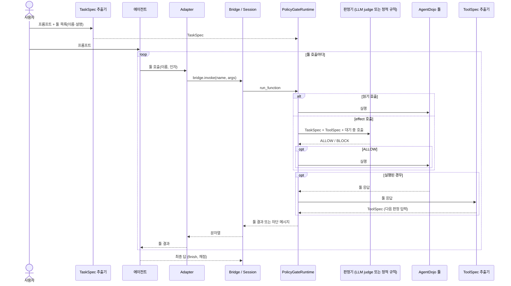

# AgentGate — LLM 에이전트 툴 호출 Policy Gate

LLM 에이전트의 툴 호출을 **실행 직전에** 룰북(R1–R10) 기준으로 판정해 허용(ALLOW)하거나 차단(BLOCK)하는 Policy Gate다. AgentDojo v1.2.2(`agentdojo==0.1.35`) 시나리오에서 여러 에이전트 프레임워크(AgentDojo native, smolagents, mini-swe-agent, browser-use, 외부 프로세스 Wrapper)로 검증한다.

## 1. 개요

### 무엇을 막는가

툴 응답(메일, 파일, 웹페이지, 메시지 등)에 심어진 지시를 에이전트가 따라 실행하는 간접 프롬프트 인젝션이다. 대상은 effect 호출, 즉 상태를 바꾸거나(송금, 삭제, 계정 변경, 예약) 데이터를 밖으로 보내거나(메일, 메시지, 게시, 공유) URL을 방문하는 호출이다. 읽기 호출은 막지 않는다.

### 위협 모델

| 구분 | 내용 |
|---|---|
| 신뢰 | 사용자 프롬프트, 사용자가 지목하거나 위임한 자료, 사용자 자신의 계정 정보 |
| 불신 | 그 밖의 툴 응답. 공격자는 툴 응답에 글을 심을 수 있다 |
| 공격자 목표 | 공격자에게 연락·송금, 데이터 반출, 삭제·은폐, 계정·권한 변경, 공격 URL 방문·전파 |
| 범위 밖 | 툴 호출 없이 답변 문장만 바꾸는 공격, 에이전트·모델 자체의 변조 |

Gate는 사용자 프롬프트에서 추출한 TaskSpec(사용자가 허용한 범위)과 툴 응답에서 추출한 ToolSpec(응답에 담긴 값과 요청)을 비교해, 호출이 사용자 요청에서 왔는지 툴 응답 속 요청에서 왔는지를 판정한다. 규칙은 [`docs/rulebook.md`](docs/rulebook.md)에 있다.

## 2. 구성

| 모듈 | 역할 |
|---|---|
| [`src/agentgate/core/`](src/agentgate/core/) | Gate 공통부: 자료형, 값 출처(`ValueIndex`), TaskSpec, 단일 집행 지점 `GatedRuntime`. LLM 호출 없음 |
| [`src/agentgate/policy_gate/`](src/agentgate/policy_gate/) | Policy Gate: `PolicyGateRuntime`, 판정 LLM(`llm_judge.py`), 정적 규칙(`rule_checker.py`), ToolSpec 추출기, 조건 조립 |
| [`src/agentgate/adapters/`](src/agentgate/adapters/) | 프레임워크 Adapter(native, smolagents, mini-swe-agent, browser-use, contract) |
| [`src/agentgate/harness/`](src/agentgate/harness/) | 프레임워크 연결: `GateToolBridge`, `Session`, registry, runner, contract v1 서비스·client, conformance 검사 |
| [`src/agentgate/scenarios/`](src/agentgate/scenarios/) | AgentDojo 시나리오: suite 로딩, pipeline, 재생, 공격 궤적, 지표, 시나리오 실행 CLI |
| [`src/agentgate/experiment/`](src/agentgate/experiment/) | 실험 조건 등록부(`no_gate`, `gate_llm_judge`, `gate_static_rules`) |
| [`src/agentgate/agents/`](src/agentgate/agents/) | 평가 대상 에이전트(Claude, Ollama, scripted) |
| [`src/agentgate/llm/`](src/agentgate/llm/) | LLM client, TaskSpec 추출기, 판정 LLM 입력 helper |
| [`dashboard/`](dashboard/) | 파일럿 실행 대시보드(FastAPI) |

## 3. Policy Gate 동작 흐름



- 모든 툴 호출은 `GatedRuntime.run_function` 한 곳을 지난다. Gate를 거치지 않은 실행이 하나라도 있으면 그 run은 무효이고 점수는 집계에서 빠진다.
- TaskSpec이 없거나, Gate에 닿지 못하거나, 판정에 실패하면 차단한다(fail-closed).
- 판정기는 툴 응답 원문을 보지 않고 ToolSpec만 본다.

구조와 집행 지점은 [`docs/architecture.md`](docs/architecture.md)에 있다.

## 4. 설치

```bash
python -m venv .venv && . .venv/bin/activate
pip install -e '.[dev,dashboard,smolagents,mini-swe-agent]'
python -m pytest -q
```

browser-use는 `anthropic`·`openai` 버전이 agentgate와 충돌하므로 별도 venv에 설치한다. 대시보드와 시나리오 CLI는 [`config/frameworks.yaml`](config/frameworks.yaml)의 `python:` 경로로 이 venv를 찾아 worker 프로세스에서 실행한다. Chrome이 필요하다.

```bash
python3.13 -m venv .venv-browser-use
.venv-browser-use/bin/pip install "browser-use @ git+https://github.com/NiceGuy1313/browser-use@f39fb5c3a6fc611688007819c71ef104bd6ca01a" \
  agentdojo==0.1.35 pyyaml requests
.venv-browser-use/bin/pip install --no-deps -e .
.venv-browser-use/bin/python -m agentgate.harness.conformance --framework browser-use
```

## 5. 환경 변수

[`.env.example`](.env.example)을 `.env`로 복사해 값을 넣는다. `.env`는 git에 올리지 않는다. 같은 이름의 환경 변수가 있으면 `.env`보다 우선한다.

| 변수 | 용도 |
|---|---|
| `ANTHROPIC_API_KEY` | Anthropic 모델(TaskSpec·ToolSpec 추출 등) |
| `OLLAMA_API_KEY` | Ollama Cloud 모델(예: `gpt-oss:120b`). local 서버는 불필요 |
| `OLLAMA_HOST` | 기본 `https://ollama.com`. local 서버는 `http://localhost:11434` |
| `OPENAI_API_KEY` | OpenAI 모델 |
| `AGENTGATE_LLM_PROVIDER` · `AGENTGATE_LLM_MODEL` | TaskSpec 추출 LLM(기본 anthropic `claude-haiku-5-5`). 캐시가 있으면 키 없이 재사용 |
| `AGENTGATE_LLM_EFFORT` · `AGENTGATE_LLM_FALLBACKS` | TaskSpec 추출 설정(anthropic 전용) |
| `AGENTGATE_TOOLSPEC_MODEL` | ToolSpec 추출 LLM(기본 `claude-haiku-5-5`) |
| `AGENTGATE_JUDGE_PROVIDER` · `AGENTGATE_JUDGE_MODEL` · `AGENTGATE_JUDGE_THINK` | 판정 LLM(`gate_llm_judge`). 비우면 에이전트 설정을 따른다 |
| `AGENTGATE_AGENT_PROVIDER` · `AGENTGATE_AGENT_MODEL` | 평가 대상 에이전트 모델(시나리오 CLI의 `--model` 기본값) |
| `AGENTGATE_AGENT_EFFORT` · `AGENTGATE_AGENT_THINK` | 에이전트 추론 설정(각각 anthropic, ollama 전용) |

## 6. 실행

### 대시보드

```bash
uvicorn dashboard.app:app --host 127.0.0.1 --port 8000
```

http://127.0.0.1:8000 에서 **프레임워크**, **모델**, **검증 방식**(실험 조건)을 고르고 실행한다. 비교 조건을 하나 더 고를 수 있다. 시나리오는 고정 파일럿 세트(banking, 사용자 작업 4 × injection task 3과 공격 없는 run 4개, 공격 `tool_knowledge`)다. 끝나면 utility, ASR, 공격 하 utility, 차단 호출 수와 시나리오별 호출 판정이 표시된다. 실행 기록은 `dashboard/runs/`(git 제외)에 남으며 보고서 수치에는 쓰지 않는다.

### 시나리오 CLI

```bash
python -m agentgate.scenarios.run --framework smolagents --condition gate_static_rules \
  --model ollama:gpt-oss:120b --suite banking --user-task user_task_0 \
  --injection-task injection_task_0 --attack tool_knowledge --out results/runs/demo
python -m agentgate.scenarios.run --framework native --conditions no_gate gate_llm_judge gate_static_rules \
  --pairs @data/agentdojo/pairs/strat3_seed0.txt --out results/runs/<name>
python scripts/analysis/check_enforcement.py --run results/runs/<name>
python scripts/analysis/summarize_live.py --run results/runs/<name>
```

run마다 `<out>/<condition>/<suite>/<user_task>/<injection_task|none>.json`, 전체 요약은 `<out>/scenario_summary.json`이다. TaskSpec 출처 기본값은 LLM 추출(`--spec llm`)이다. 옵션 전체는 `python -m agentgate.scenarios.run --help`로 본다.

### 재생 평가와 재생 대조

에이전트 없이 AgentDojo 정답 궤적을 Gate로 재생한다.

```bash
python scripts/evaluation/replay_evaluation.py --condition gate_static_rules --spec oracle --out results/replay/oracle
python scripts/evaluation/replay_contrast.py --attack tool_knowledge   # 판정 LLM과 정적 규칙의 호출 단위 대조
```

`replay_contrast.py`는 결과를 `results/RESULTS.md`의 "재생 대조" 절로 쓴다.

### conformance 검사

프레임워크가 모든 툴 호출을 Gate에 통과시키는지 LLM·네트워크 없이 확인한다. 새 프레임워크 연결 절차는 [`docs/integration_guide.md`](docs/integration_guide.md)에 있다.

```bash
python -m agentgate.harness.conformance --framework smolagents --condition gate_static_rules
python -m agentgate.harness.conformance --entry "python examples/contract_wrapper/minimal_agent.py"
```

## 7. 실험 조건

정의는 [`src/agentgate/experiment/conditions.py`](src/agentgate/experiment/conditions.py)다. 모든 프레임워크가 세 조건 모두에서 돈다.

| 조건 | 내용 |
|---|---|
| `no_gate` | 방어 없음(기준선). Gate는 호출을 기록만 한다 |
| `gate_llm_judge` | 방식 A. 판정 LLM이 룰북 R1–R10을 TaskSpec·ToolSpec·대기 중 호출에 적용한다. 판정 LLM은 에이전트와 같은 모델이다 |
| `gate_static_rules` | 방식 B. 같은 입력에 정적 규칙 코드를 적용한다. 판정에 LLM 호출이 없다 |

판정은 ALLOW / BLOCK 두 가지뿐이다. TaskSpec·ToolSpec 추출은 두 방식 모두 `claude-haiku-5-5`를 쓴다. 조건을 비교할 때는 같은 실행에 `no_gate`를 함께 넣는다.

## 8. 폴더 구조

```
src/agentgate/   core · policy_gate · adapters · harness · scenarios · experiment · agents · llm · config.py
config/          gate.yaml, rulebook.yaml, frameworks.yaml, agentdojo/(툴 역할·인자 역할·민감 읽기·지목 자료 규칙)
prompts/         extract_taskspec.md, extract_toolspec.md (LLM 입력, 캐시 키에 포함)
scripts/         agentdojo · taskspec · evaluation · analysis · cloud
dashboard/       대시보드 앱(app.py)과 정적 파일(static/)
examples/        contract_wrapper/minimal_agent.py (contract v1 참조 Wrapper)
tests/           core/ · policy_gate/ · frameworks/ · 공통 테스트
data/            agentdojo/(벤치마크 추출, oracle TaskSpec, 층화 표본 쌍) · atr/(룰북 근거) · cache/(LLM 캐시, git 제외)
results/         평가 결과(RESULTS.md, 원본 기록은 git 제외)
docs/            architecture.md · rulebook.md · integration_guide.md
archive/         이전 버전 코드와 결과 문서
```

## 9. 결과와 보관본

- 결과 문서는 `results/RESULTS.md`이며 [`scripts/analysis/summarize_results.py`](scripts/analysis/summarize_results.py)와 [`scripts/evaluation/replay_contrast.py`](scripts/evaluation/replay_contrast.py)가 생성한다. 손으로 고치지 않는다. 실행 원본 기록은 git에 올리지 않는다.
- 이전 버전은 `archive/`에 보관한다. 현재 코드는 보관본을 import하지 않는다.

| 위치 | 내용 |
|---|---|
| [`archive/v1.bak/`](archive/v1.bak/README.md) | AgentDojo 맞춤 결정론 정책 P1–P9 |
| [`archive/v2.bak/`](archive/v2.bak/README.md) | 인젝션 판별기 + Trusted LLM |
| [`archive/v3_sonnet_2026-10-18/`](archive/v3_sonnet_2026-10-18/RESULTS.md) | Sonnet 판정 LLM 결과 |
| [`archive/v2_v3_results_2026-10-17/`](archive/v2_v3_results_2026-10-17/README.md) | 그 이전 결과 문서와 문서 사본 |
