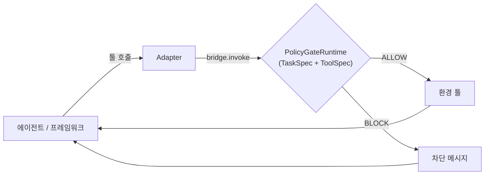

# AgentGate — LLM 에이전트 툴 호출 Policy Gate

LLM 에이전트의 effect 툴 호출(송금·전송·삭제·URL 방문 등)을 실행 직전에 룰북(R1–R10)으로 판정해 ALLOW / BLOCK하는 Policy Gate다. AgentDojo v1.2.2(`agentdojo==0.1.35`)에서 여러 에이전트 프레임워크로 검증한다.



## 실험 조건

| 조건 | 내용 |
|---|---|
| `no_gate` | 방어 없음(기준선). 호출을 기록만 한다 |
| `gate_llm_judge` | 판정 LLM이 룰북을 TaskSpec·ToolSpec·대기 중 호출에 적용한다 |
| `gate_static_rules` | 같은 입력에 정적 규칙 코드를 적용한다. 판정에 LLM 호출이 없다 |

## 설치

```bash
python -m venv .venv && . .venv/bin/activate
pip install -e '.[dev,dashboard,smolagents,mini-swe-agent]'
cp .env.example .env    # API 키 입력, git 제외
python -m pytest -q
```

browser-use는 의존성이 충돌하므로 별도 venv에 설치한다(`config/frameworks.yaml`의 `python:`가 이 venv를 가리킨다, Chrome 필요).

```bash
python3.13 -m venv .venv-browser-use
.venv-browser-use/bin/pip install "browser-use @ git+https://github.com/NiceGuy1313/browser-use@f39fb5c3a6fc611688007819c71ef104bd6ca01a" agentdojo==0.1.35 pyyaml requests
.venv-browser-use/bin/pip install --no-deps -e .
```

## 실행

```bash
uvicorn dashboard.app:app --host 127.0.0.1 --port 8000          # 대시보드: 프레임워크·모델·조건 선택
python -m agentgate.experiment.cli --framework smolagents --conditions no_gate gate_static_rules \
  --model ollama:gpt-oss:120b --pilot --out results/runs/demo      # 시나리오 CLI (--help)
python -m agentgate.harness.conformance --framework smolagents      # Gate 경유 검사(LLM·네트워크 없음)
```

## 문서

- [`docs/adapter_guide.md`](docs/adapter_guide.md): 다른 프레임워크에 Adapter를 붙이는 위치와 절차
- [`docs/integration_guide.md`](docs/integration_guide.md): 외부 프로세스 Wrapper 규약(contract v1)
- [`docs/architecture.md`](docs/architecture.md): 모듈 구조, 단일 집행 지점, fail-closed
- [`docs/rulebook.md`](docs/rulebook.md): 룰북 R1–R10, TaskSpec·ToolSpec, 정적 규칙 해석
- 결과: `results/RESULTS.md`(스크립트 생성물, 실험 전에는 없다)

## 폴더

```
src/agentgate/   core · policy_gate · environments · adapters · harness · experiment · scenarios · agents · llm
config/          gate.yaml · rulebook.yaml · frameworks.yaml · agentdojo/(툴 역할·인자 역할 바인딩)
prompts/         TaskSpec·ToolSpec 추출 프롬프트(캐시 키에 포함)
scripts/         agentdojo · taskspec · evaluation · analysis · cloud · dev
dashboard/       대시보드(FastAPI)
examples/        contract_wrapper/minimal_agent.py (contract v1 참조 Wrapper)
tests/ · data/ · results/ · docs/
```
