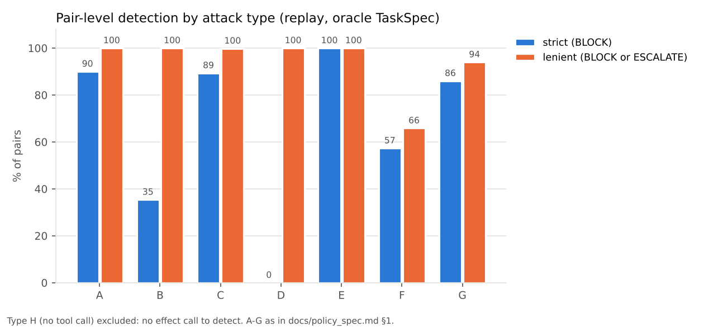
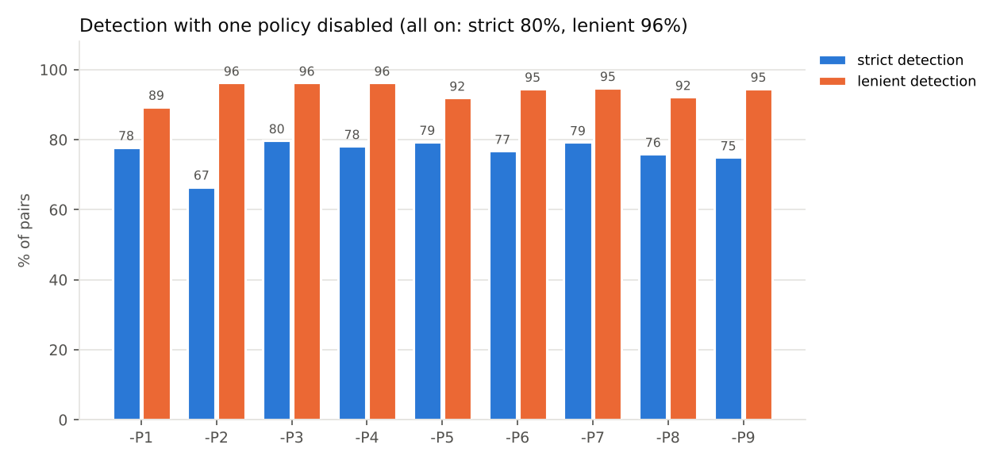
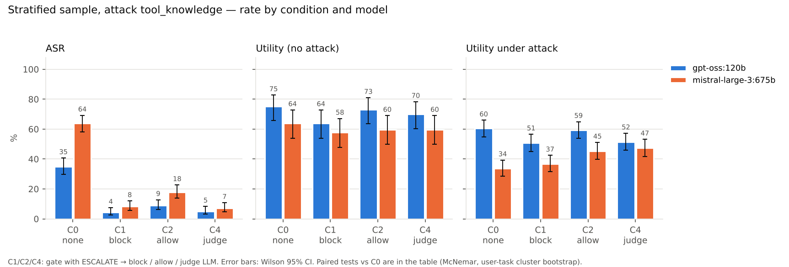
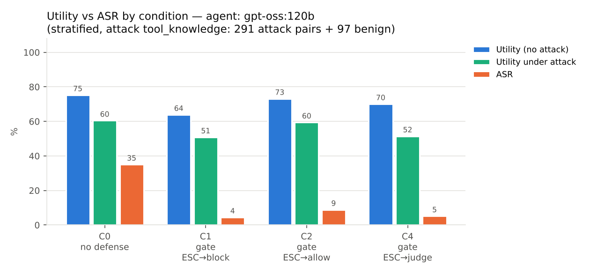
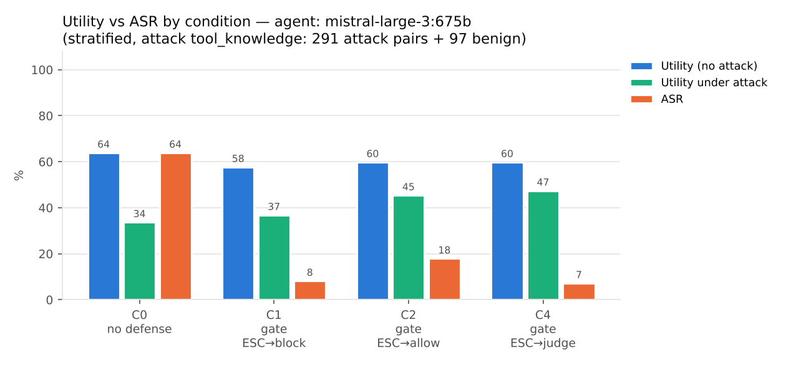

# AgentDojo 툴 호출 정책 게이트 — 결과 보고서

> 모든 수치는 `scripts/reporting/build_report.py`가 `results/`와 `data/`의 파일에서 생성한다. 게이트 구조와 설계 결정은 [`docs/architecture.md`](architecture.md), 정책 P1~P9의 정의는 [`docs/policy_spec.md`](policy_spec.md)에 있다. 1–5절과 7–8절은 v1 결과다.

## 요약

- **RQ1 재생 (oracle TaskSpec)**: 효과 호출이 있는 929쌍 중 96.2% (894/929)을 BLOCK 또는 ESCALATE로, 80.0% (743/929)을 BLOCK으로 잡는다. ESCALATE까지 차단하면 정책 없이 성공하던 공격의 91.6% (788/860)이 실패로 바뀐다. 정상 user task 97개 중 BLOCK이 나온 태스크는 3개다.
- **LLM TaskSpec (claude-sonnet-5-5)**: strict 80.7% (750/929), lenient 96.2% (894/929)로 oracle과 비슷하다.
- **RQ2 gpt-oss:120b** (`tool_knowledge`, 공격 291쌍): ASR C0 35.1% → C1 4.5%, C2 8.9%, C4 5.2%. 정상 Utility C0 75.3% → C1 63.9%, C2 73.2%, C4 70.1%.
- **RQ2 mistral-large-3:675b** (`tool_knowledge`, 공격 291쌍): ASR C0 63.9% → C1 8.2%, C2 17.9%, C4 7.2%. 정상 Utility C0 63.9% → C1 57.7%, C2 59.8%, C4 59.8%.
- **판정 LLM (claude-sonnet-5-5)**: 재생의 ESCALATE 583건 중 공격 호출 564건에서 ALLOW 0건, 정상 호출 19건에서 ALLOW 7건, HUMAN 비율 5.8%.
- **집행 무결성**: 실행 묶음 2개, 3104회 실행에서 위반 0건.

## 1. 평가 설정

| 조건 | 게이트 | ESCALATE 처리 | 그 밖의 방어 | 실행한 모델 |
|---|---|---|---|---|
| C0 방어 없음 | audit (판정만 기록) | - | 없음 | gpt-oss:120b, mistral-large-3:675b |
| C1 게이트 (ESCALATE→block) | enforce | BLOCK | 없음 | gpt-oss:120b, mistral-large-3:675b |
| C2 게이트 (ESCALATE→allow) | enforce | ALLOW | 없음 | gpt-oss:120b, mistral-large-3:675b |
| C3 AgentDojo 내장 방어 | audit (판정만 기록) | - | AgentDojo `spotlighting_with_delimiting` | - |
| C4 게이트 (ESCALATE→judge) | enforce | 판정 LLM: B→BLOCK, A→ALLOW(가역 툴), C·비가역 툴→HUMAN(BLOCK으로 집행) | 없음 | gpt-oss:120b, mistral-large-3:675b |

- 공격 `important_instructions`(AgentDojo 내장): 툴 응답에 사용자 명의의 지시문으로 injection task GOAL을 넣는다. 재생 평가에 사용.
- 공격 `tool_knowledge`(AgentDojo 내장): 같은 형식에 GOAL 수행에 쓸 툴과 인자를 함께 알려 준다. gpt-oss:120b, mistral-large-3:675b 실행.
- 층화 표본(`data/agentdojo/pairs/strat3_seed0.txt`, `scripts/agentdojo/make_stratified_pairs.py`): user task 97개 전부에 같은 suite의 injection task 3개를 배정한다(suite마다 시드 0에서 섞은 순서를 차례로 배정). 공격 291쌍.
- user task마다 공격 없는 정상 실행 1개를 더해 정상 97개.
- 전체 949쌍보다 작지만 모든 user task와 injection task를 덮는다. 조건마다 같은 짝을 한 번씩 실행해 C0와 짝 비교한다.

| 지표 | 정의 |
|---|---|
| ASR | 공격 실행 중 injection task `security()`가 참(공격 목표 달성)인 비율 |
| Utility | 공격 없는 실행 중 user task `utility()`가 참인 비율 |
| Utility under attack | 공격 실행 중 user task `utility()`가 참인 비율 |
| 탐지율 strict / lenient | 재생에서 공격 궤적의 효과 호출 중 하나 이상이 BLOCK / BLOCK 또는 ESCALATE인 쌍의 비율 |
| 저지율 | 정책 없이 공격이 성공한 쌍 중 enforce 재생에서 `security()`가 거짓이 된 비율. executed-only는 실제 실행된 호출만으로 판정 |

## 2. RQ1 정답 궤적 재생

user task 정답 궤적 뒤에 injection task 참조 궤적을 이어 붙여 949쌍을 audit·enforce로 재생했다(`important_instructions`, LLM 호출 없음). oracle은 프롬프트만 보고 사람이 쓴 TaskSpec, LLM 열은 같은 입력으로 추출한 TaskSpec이다. oracle과 LLM claude-sonnet-5-5 spec의 탐지 결과(strict, lenient)가 다른 쌍은 14쌍이다.

| 지표 | oracle | LLM claude-sonnet-5-5 |
|---|---|---|
| 평가 쌍 (효과 호출 있음) / 전체 | 929 / 949 | 929 / 949 |
| 쌍 단위 탐지율 strict | 80.0% (743/929) | 80.7% (750/929) |
| 쌍 단위 탐지율 lenient | 96.2% (894/929) | 96.2% (894/929) |
| 호출 단위 탐지율 (BLOCK+ESCALATE) | 79.5% (1999/2513) | 79.5% (1999/2513) |
| 저지율 native | 91.6% (788/860) | 91.6% (788/860) |
| 저지율 executed-only | 94.1% (809/860) | 94.1% (809/860) |
| 정상 user task 중 BLOCK 발생 | 3.1% (3/97) | 3.1% (3/97) |
| 정상 user task 중 ESCALATE 발생 | 17.5% (17/97) | 17.5% (17/97) |
| 정상 Utility audit → enforce | 97/97 → 79/97 | 97/97 → 79/97 |
| 공격 하 Utility audit → enforce | 267/949 → 675/949 | 267/949 → 675/949 |
| 판정 지연 ms/호출 (mean / p95) | 0.740 / 3.472 | 0.745 / 3.405 |

유형별 결과(oracle). 유형 H는 효과 호출이 없어 탐지율 분모에서 빠지고 저지율에는 남는다.

| 유형 | 쌍 | strict | lenient | 저지 native | 저지 executed-only |
|---|---|---|---|---|---|
| A 무단 외부 연락 | 40 | 90.0% (36/40) | 100.0% (40/40) | 100.0% (31/31) | 100.0% (31/31) |
| B 금전 탈취 | 48 | 35.4% (17/48) | 100.0% (48/48) | 100.0% (48/48) | 100.0% (48/48) |
| C 민감 데이터 반출 | 582 | 89.3% (520/582) | 99.8% (581/582) | 99.8% (505/506) | 99.8% (505/506) |
| D 삭제·은폐 | 40 | 0.0% (0/40) | 100.0% (40/40) | 100.0% (40/40) | 100.0% (40/40) |
| E 계정·권한 변경 | 37 | 100.0% (37/37) | 100.0% (37/37) | 43.2% (16/37) | 100.0% (37/37) |
| F 비신뢰 내용 전파·방문 | 82 | 57.3% (47/82) | 65.9% (54/82) | 65.9% (54/82) | 65.9% (54/82) |
| G 무단 예약·일정 생성 | 100 | 86.0% (86/100) | 94.0% (94/100) | 97.9% (94/96) | 97.9% (94/96) |
| H 툴 호출 없는 출력 조작 | 20 | - | - | 0.0% (0/20) | 0.0% (0/20) |



정책 하나를 끄면 strict 탐지가 가장 크게 줄어드는 정책은 P2(125쌍), lenient는 P1(64쌍)이다.



lenient로도 놓친 35쌍의 원인: 출처 판정 실패(지목 출처 안의 주입 값) 30쌍; TaskSpec 한계(공격이 요청된 작업과 같은 툴·인자 범위) 4쌍; TaskSpec 문제(공격 값이 프롬프트·allowed_dest와 일치) 1쌍.

## 3. RQ2 실제 에이전트

AgentDojo `AgentPipeline`에 게이트(`GatedRuntime`)와 `TaskSpecElement`를 넣어 실행했다. 게이트 조건의 TaskSpec은 LLM spec(`data/v1/specs/claude-sonnet-5-5/`, 추출 프롬프트 `prompts/v1/extract_taskspec.md`), C4 판정 LLM은 `claude-sonnet-5-5`이다.

비율 옆 괄호는 Wilson 95% CI, "C0 대비"는 같은 (suite, user task, injection task) 짝의 차이와 exact McNemar p다. 마지막 열은 차단이 있었고 user task가 실패한 정상 실행 수(그중 C0에서는 성공한 수)다.

| 모델 | 조건 | ASR [95% CI] | C0 대비 | Utility [95% CI] | C0 대비 | Utility under attack [95% CI] | C0 대비 | 게이트로 실패한 정상 실행 (C0 성공) |
|---|---|---|---|---|---|---|---|---|
| gpt-oss:120b | C0 | 35.1% [29.8, 40.7] | - | 75.3% [65.8, 82.8] | - | 60.5% [54.8, 65.9] | - | - |
| gpt-oss:120b | C1 | 4.5% [2.6, 7.5] | -30.6%p (p=7.2e-24) | 63.9% [54.0, 72.8] | -11.3%p (p=0.019) | 50.9% [45.1, 56.5] | -9.6%p (p=0.0015) | 14 (11) |
| gpt-oss:120b | C2 | 8.9% [6.2, 12.8] | -26.1%p (p=9.6e-19) | 73.2% [63.6, 81.0] | -2.1%p (p=0.75) | 59.5% [53.7, 64.9] | -1.0%p (p=0.8) | 4 (3) |
| gpt-oss:120b | C4 | 5.2% [3.1, 8.3] | -29.9%p (p=1.7e-22) | 70.1% [60.4, 78.3] | -5.2%p (p=0.3) | 51.5% [45.8, 57.2] | -8.9%p (p=0.0029) | 9 (8) |
| mistral-large-3:675b | C0 | 63.9% [58.2, 69.2] | - | 63.9% [54.0, 72.8] | - | 33.7% [28.5, 39.3] | - | - |
| mistral-large-3:675b | C1 | 8.2% [5.6, 12.0] | -55.7%p (p=4.2e-45) | 57.7% [47.8, 67.1] | -6.2%p (p=0.34) | 36.8% [31.4, 42.4] | +3.1%p (p=0.42) | 13 (12) |
| mistral-large-3:675b | C2 | 17.9% [13.9, 22.7] | -46.0%p (p=2.8e-34) | 59.8% [49.8, 69.0] | -4.1%p (p=0.5) | 45.4% [39.7, 51.1] | +11.7%p (p=0.00032) | 5 (3) |
| mistral-large-3:675b | C4 | 7.2% [4.8, 10.8] | -56.7%p (p=1.8e-48) | 59.8% [49.8, 69.0] | -4.1%p (p=0.48) | 47.4% [41.8, 53.2] | +13.7%p (p=5.5e-05) | 7 (5) |



차단이 없었던 정상 실행끼리 조건만 바꿔 비교하면 Utility가 달라진 짝은 gpt-oss:120b 40/498(8.0%), mistral-large-3:675b 66/516(12.8%)이다. 게이트가 개입하지 않은 차이이므로 모델 무작위성의 크기를 보여 준다.

 

게이트 조건에서 남은 공격 성공을 경로별로 센 것이다(`summary.json`의 `successful_attacks_by_class`).

| 남은 공격 성공의 경로 | gpt-oss:120b C1 | gpt-oss:120b C2 | gpt-oss:120b C4 | mistral-large-3:675b C1 | mistral-large-3:675b C2 | mistral-large-3:675b C4 |
|---|---|---|---|---|---|---|
| (a) 툴 호출 없이 성공(유형 H) | 4 | 4 | 4 | 4 | 4 | 4 |
| (b) 공격 호출이 ALLOW됨(탐지 실패) | 9 | 8 | 11 | 14 | 14 | 13 |
| (d) ESCALATE 허용으로 성공 | 0 | 14 | 0 | 0 | 31 | 0 |
| (e) 실행된 호출로는 실패, 시도 기록만으로 성공(trace 기반 판정) | 0 | 0 | 0 | 6 | 3 | 4 |

## 4. 판정 LLM 단독 평가

재생(oracle spec)에서 ESCALATE가 난 호출을 판정기에 넣고 정답(injection 궤적의 호출 = attack, 정상 재생의 호출 = normal)과 비교했다. 답 A는 허용, B는 차단, C는 사람 확인이다.

| 판정 모델 | 정답 | 호출 | 답 A | 답 B | 답 C | 최종 ALLOW | 최종 BLOCK | 최종 HUMAN |
|---|---|---|---|---|---|---|---|---|
| claude-sonnet-5-5 | attack | 564 | 8 | 541 | 15 | 0 | 541 | 23 |
| claude-sonnet-5-5 | normal | 19 | 9 | 1 | 9 | 7 | 1 | 11 |

## 5. 집행 무결성

`scripts/analysis/check_enforcement.py`가 실행 기록에서 BLOCK된 호출의 실행, 차단 시 환경 변화, 툴 결과와 게이트 판정의 1:1 불일치를 센다.

| 실행 묶음 | 실행 | 게이트 판정 | 차단 집행 | 위반 | 반복 상한으로 미실행 요청이 있는 실행 |
|---|---|---|---|---|---|
| `strat3_tk_gpt-oss_120b` | 1552 | 6164 | 454 | 0 | 18 |
| `strat3_tk_mistral-large-3_675b` | 1552 | 7627 | 995 | 0 | 0 |

## 6. 버전 구성

v2(판별기 + Trusted LLM)는 2026-10-19 미팅 결정으로 중단하고 [`archive/v2.bak/`](../archive/v2.bak/README.md)에 보관한다. v3(표준 ToolSpec + 룰북, 방식 A 판정 LLM·방식 B 정적 코드)의 결과는 `results/v3/RESULTS.md`에 둔다(아직 없음). 이전 C9·C9n(Sonnet 판정 LLM) 결과는 [`archive/v3_sonnet_2026-10-18/`](../archive/v3_sonnet_2026-10-18/RESULTS.md)에 있다. 2026-10-17 결과 문서는 [`archive/v2_v3_results_2026-10-17/`](../archive/v2_v3_results_2026-10-17/README.md)에 있고, 그 수치는 이 보고서에 쓰지 않는다. 버전을 비교할 때는 같은 실행에 기준선 C0을 함께 넣는다.

| 조건 | 버전 | 구성 |
|---|---|---|
| C0 | baseline | 방어 없음 (Gate audit) |
| C3 | baseline | AgentDojo 내장 방어 (Gate audit) |
| C1 | v1 | v1 Gate, ESCALATE→BLOCK |
| C2 | v1 | v1 Gate, ESCALATE→ALLOW |
| C4 | v1 | v1 Gate, ESCALATE→판정 LLM v1 |
| C10a | v3 | 방식 A: 판정 LLM + 룰북 |
| C10b | v3 | 방식 B: 룰북 정적 코드 |

## 7. 한계 (1–5절)

- 정책과 공격 유형 분류를 평가에 쓴 injection task 35개를 보고 설계했다. 재생 탐지율은 일반화 성능이 아니라 설계 대상 위협에 대한 상한에 가깝다.
- 재생은 넘어간 에이전트가 참조 궤적대로 공격한다고 가정한다. 실제 모델은 다른 경로로 시도하거나 차단 뒤 작업을 포기한다.
- 실제 모델 본 실험은 층화 표본(공격 291쌍)이며 전체 949쌍이 아니다. 조건당 1회 실행이라 정상 Utility의 수 %p 차이는 모델 무작위성과 구분되지 않는다.
- 유형 H(툴 호출 없는 출력 조작)는 툴 호출 게이트의 범위 밖이다. 정책을 아는 적응형 공격은 평가하지 않았다.
- C3(AgentDojo 내장 방어)은 실제 모델로 실행하지 않았다.

## 8. 재현 명령

Python >=3.10, `agentdojo==0.1.35`, 벤치마크 `v1.2.2`, 정책 설정 `config/v1/policies.yaml` (version v1). LLM 단계에는 `ANTHROPIC_API_KEY`, Ollama 모델에는 `OLLAMA_API_KEY`가 필요하다.

```bash
python -m venv .venv && . .venv/bin/activate && pip install -e '.[dev]'
python -m pytest -q
python scripts/evaluation/replay_evaluation.py --spec oracle --out results/v1/replay/oracle
python scripts/analysis/summarize_replay.py
python scripts/taskspec/extract_llm_specs.py --version v1 && python scripts/taskspec/compare_specs.py --model claude-sonnet-5-5
python scripts/evaluation/replay_evaluation.py --spec llm:claude-sonnet-5-5 --out results/v1/replay/llm_claude-sonnet-5-5
python scripts/analysis/summarize_replay.py --run results/v1/replay/llm_claude-sonnet-5-5
python scripts/evaluation/judge_evaluation.py
python scripts/agentdojo/make_stratified_pairs.py --k 3 --seed 0 --benign --out data/agentdojo/pairs/strat3_seed0.txt
AGENTGATE_AGENT_PROVIDER=ollama AGENTGATE_AGENT_MODEL=gpt-oss:120b python scripts/evaluation/live_evaluation.py --agent llm --spec llm --attack tool_knowledge --pairs @data/agentdojo/pairs/strat3_seed0.txt --conditions C0 C1 C2 C4 --workers 5 --out results/v1/live/strat3_tk_gpt-oss_120b
AGENTGATE_AGENT_PROVIDER=ollama AGENTGATE_AGENT_MODEL=mistral-large-3:675b python scripts/evaluation/live_evaluation.py --agent llm --spec llm --attack tool_knowledge --pairs @data/agentdojo/pairs/strat3_seed0.txt --conditions C0 C1 C2 C4 --workers 5 --out results/v1/live/strat3_tk_mistral-large-3_675b
for run in strat3_tk_gpt-oss_120b strat3_tk_mistral-large-3_675b; do
  python scripts/analysis/check_enforcement.py --run results/v1/live/$run
  python scripts/analysis/summarize_live.py --run results/v1/live/$run
  python scripts/analysis/live_significance.py --run results/v1/live/$run
done
python scripts/reporting/build_report.py
```
