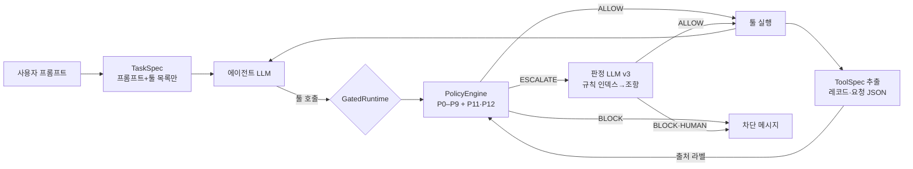

# v3·v3.1: Trusted LLM + 정책 문서 (live C6, C7, C7n)

판별기 없이 정책이 판단하는 구성이다. 툴 응답은 LLM이 구조화된 JSON(ToolSpec)으로 바꾸고, 정책은 그 JSON과 TaskSpec만 읽는다. ESCALATE는 판정 LLM v3(claude-sonnet-5-5)가 정책 문서(규칙 문서)에서 인덱스로 고른 조항만 보고 처리한다. 결과는 [RESULTS.md](RESULTS.md).

## 흐름



## 판정 입력

| 입력 | 만드는 곳 | 내용 |
|---|---|---|
| TaskSpec | TaskSpec 추출기 (프롬프트와 툴 목록만 입력) | `requested_ops`, `allowed_dest`, `named_sources`, `delegated_sources`(v3), `amount_cap`, `egress_requested` |
| 사용자 고정 설정 | `config/user_policy.yaml` | `always_block: []`, `always_human: [delete_file, update_password]` |
| ToolSpec | ToolSpec 추출기 (claude-haiku-5-5, 툴 응답마다) | `records[]`(id, kind, author), `requests[]`(record, addressed_to, action, targets). 자유 텍스트 없음. 원문에 없는 작성자·값은 코드가 버림 |

정책과 판정 LLM은 툴 응답 원문을 보지 않는다.

## 정책 (v1의 P1–P9에 추가·변경)

| 정책 | 클래스 | 규칙 → 판정 |
|---|---|---|
| P0 사용자 고정 설정 | `UserFixedPolicy` | `always_block` → BLOCK, `always_human` → 판정 없이 HUMAN |
| P11 툴 콘텐츠가 시킨 행동 | `InstructedActionPolicy` | 호출이 ToolSpec 속 요청과 일치하고, 사용자가 요청하지도 위임하지도 않은 행동 → BLOCK, 그 밖 → ESCALATE. 사용자가 준 값은 일치 근거에서 뺀다 |
| P12 요청된 행동만 | `RequestedActionPolicy` | `requested_ops`에 없는 상태 변경·외부 전송 → ESCALATE |
| P7 | (변경) | 공격 문구 목록 삭제. 벤치마크의 공격 템플릿을 미리 알고 막는 규칙이기 때문 |
| P10 판별기 | (제외) | v2 참고 |

v3.1 변경 (`config["v31"]`, v3 live의 정상 작업 손실을 범주별 일반 규칙으로 수정):

| 표시 | 대상 | 변경 |
|---|---|---|
| A1 | P6·P8·P9 | 요청되지 않은 행동이라도 위임 자료의 요청과 일치하면 BLOCK 대신 ESCALATE |
| A2 | 규칙 J1 | 위임 자료에서 와야 하는 것은 요청 자체이고, 수행에 필요한 내용은 다른 자료에서 와도 됨 |
| A3 | 판정 입력 | 위임 자료의 ToolSpec을 항상 넣음 |
| B1 | P11 | 지목 자료 안의 링크를 여는 호출은 BLOCK 대신 ESCALATE |
| B2 | 지목 자료 일치 | 이름 비교 최소 길이 4 → 3 |
| C1 | P3 | 전송을 요청했고 수신자가 신뢰 출처나 지목 자료에서 왔으면 BLOCK 대신 ESCALATE |
| D2 | P0 | `always_human` 툴이라도 `requested_ops`에 있으면 사람 확인 생략 |

## 정책 문서와 판정 LLM v3

- 정책 문서 `config/policy_rules_v31.yaml`(v3는 `policy_rules_v3.yaml`): 코드 집행 조항 R1–R8, 판정 LLM 조항 J1–J7, 조항별 트리거(`policy:<id>`, `tool_class:<분류>`, `signal:<신호>`).
- 근거: ATR test-corpora 공격 사례 분류(`results/rules/v1`). AgentDojo 공격 문구는 쓰지 않았다. 다만 코드 조항은 AgentDojo 툴 환경에서 설계한 P1–P9를 일반화한 것이다.
- 판정 LLM v3는 system에 규칙 인덱스 전체(프롬프트 캐시), user에 사실과 트리거로 고른 조항만 받는다. 답은 ALLOW / BLOCK / HUMAN, 해석 실패는 HUMAN이다. HUMAN은 BLOCK으로 집행하고 따로 센다.
- `use_rules=False`(C7n)는 정책 문서 없이 같은 사실만 주는 ablation이다.

## 코드

이 폴더는 읽기용 사본이다. 실행·테스트는 저장소 루트의 같은 경로 원본으로 한다. 사본은 `python scripts/reporting/sync_version_folders.py`가 원본에서 만들고, `tests/test_version_folders.py`가 원본과 같은지 확인한다.

| 구성 | 파일 |
|---|---|
| 정책 문서 | `config/policy_rules_v3.yaml`, `config/policy_rules_v31.yaml` |
| 판정 LLM v3 | `src/agentgate/llm/trusted_judge_v3.py` |
| ToolSpec 추출기 | `src/agentgate/llm/toolspec_extractor.py`, `prompts/extract_toolspec.md` |
| TaskSpec 추출기 | `src/agentgate/llm/taskspec_extractor.py`, `prompts/extract_taskspec.md` |
| P0·P11·P12, v3.1 helper (발췌) | `src/agentgate/policy/rules_v3_excerpt.py` ← 원본 `src/agentgate/policy/rules.py` |
| ToolSpec 요청 대조 (발췌) | `src/agentgate/provenance_v3_excerpt.py` ← 원본 `src/agentgate/provenance.py` |
| 사용자 고정 설정 | `config/user_policy.yaml` |
| 정책 문서 근거, ToolSpec 품질 평가 | `scripts/analysis/analyze_atr_corpora.py`, `scripts/evaluation/toolspec_evaluation.py` |
| 테스트 | `tests/policy/test_p11_p12.py`, `tests/policy/test_v31.py` |

ToolSpec 연결은 루트 `src/agentgate/runtime.py`의 `GatedRuntime(toolspec=...)`, 설정은 `src/agentgate/config.py`의 `load_policy_config_v3`·`load_policy_config_v31`(v1 설정 위에 만들어 v1 결과는 그대로 재현)이다.

## 재현 (루트에서)

```bash
python scripts/evaluation/toolspec_evaluation.py --out results/toolspec/v1
python scripts/analysis/analyze_atr_corpora.py --atr <agent-threat-rules checkout> --out results/rules/v1
python scripts/evaluation/replay_evaluation.py --spec llm:claude-sonnet-5-5-v3 --gate v31 --escalate judge_v3 \
  --attack tool_knowledge --out results/replay/v31/judge_v3_llmspec_tool_knowledge   # 정책 문서 없이: judge_v3_norules
python scripts/evaluation/live_evaluation.py --agent llm --spec llm --attack tool_knowledge \
  --pairs @data/pairs/strat3_seed1.txt --conditions C0 C1 C6 C7 C7n --spec-cache-dir data/specs/llm_cache_v3 \
  --out results/live/v31/strat3s1_tk_gpt-oss_120b
```
