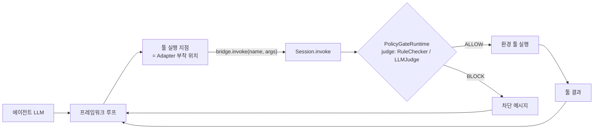

# Adapter를 어디에 붙여야 하는가

다른 에이전트 프레임워크를 자체 LLM Wrapper로 감싼 팀원이 Policy Gate를 붙일 때 보는 문서다. 외부 프로세스 Wrapper의 HTTP 규약 세부는 [`integration_guide.md`](integration_guide.md), 구조 전체는 [`architecture.md`](architecture.md)에 있다.

## 원칙

Wrapper(추적·로깅)만으로는 막을 수 없다. 로그가 남을 때 툴은 이미 실행되었다. 에이전트가 툴을 **실행하는 바로 그 지점**을 Adapter로 바꿔 `bridge.invoke(name, args)`를 부르게 해야 호출이 Gate(`PolicyGateRuntime.run_function`)를 지난다. 툴을 직접 실행하면 `GatedRuntime`이 거부하고(`UngatedExecutionError`) 그 run은 무효(`valid: false`)가 된다.



## 부착 위치

| framework | 툴 실행 지점 | Adapter가 하는 일 | 파일:함수 |
|---|---|---|---|
| smolagents | 생성한 `Tool` 클래스의 `forward` | `forward`가 `gated_callable(bridge, name)`을 부른다 | [`adapters/smolagents_adapter.py`](../src/agentgate/adapters/smolagents_adapter.py):`make_tools` |
| mini-swe-agent | 에이전트 환경(`Environment.execute`) | 셸 환경을 `GatedShell`로 바꾼다. 명령 한 줄이 툴 호출 하나이며 `bridge.invoke`로 간다(실제 셸 실행 없음) | [`adapters/mini_swe_agent_adapter.py`](../src/agentgate/adapters/mini_swe_agent_adapter.py):`GatedShell.execute` |
| browser-use | `tools.registry.action`으로 등록한 액션 | AgentDojo 툴마다 gated 액션을 등록한다. 브라우저 액션은 뺀다 | [`adapters/browser_use_adapter.py`](../src/agentgate/adapters/browser_use_adapter.py):`make_tools`, `_gated_action` |
| AgentDojo native | pipeline의 `runtime.run_function` | pipeline에 `BridgeRuntime`을 넘긴다. `run_function`이 `bridge.invoke_detail`을 부른다 | [`adapters/native.py`](../src/agentgate/adapters/native.py):`BridgeRuntime.run_function` |
| 외부 프로세스 Wrapper | Wrapper 자신의 툴 실행 지점 | contract v1: 그 지점에서 `GateSession.invoke`를 부른다 → HTTP `/invoke` → `bridge.invoke` | [`harness/agentgate_client.py`](../src/agentgate/harness/agentgate_client.py):`GateSession.invoke`, [`harness/service.py`](../src/agentgate/harness/service.py):`invoke` |

공통 helper는 [`harness/tool_schema.py`](../src/agentgate/harness/tool_schema.py)의 `gated_callable(bridge, name)`(args dict → 에이전트가 받을 문자열)과 `arguments(schema)`(JSON schema → 인자 목록)다.

## 새 프레임워크 연결 (Python Adapter)

1. `FrameworkAdapter`([`adapters/base.py`](../src/agentgate/adapters/base.py)) 서브클래스를 만들고 `routes_tools_through_bridge = True`를 선언한다.
2. `run(...)`에서 `bridge.tool_schemas()`로 툴을 등록하고, 툴 본문을 `gated_callable(bridge, name)`으로 둔다. 프레임워크 자체 툴(`final_answer` 등)은 `internal_tools`에 적는다.
3. `config/frameworks.yaml`에 등록한다.
4. conformance를 통과시킨다.

```python
from agentgate.adapters.base import FrameworkAdapter, FrameworkResult
from agentgate.harness.tool_schema import gated_callable


class MyAdapter(FrameworkAdapter):
    name = "my-framework"
    requires = ("my_framework",)
    internal_tools = frozenset({"final_answer"})   # 프레임워크 자체 툴
    routes_tools_through_bridge = True             # 의무 Gate 경로 선언

    def run(self, task, bridge, model, options, max_steps, sink):
        import my_framework
        tools = [my_framework.Tool(name=s["name"], description=s["description"],
                                   fn=gated_callable(bridge, s["name"]))   # 툴 본문 = Gate 호출
                 for s in bridge.tool_schemas()]
        agent = my_framework.Agent(tools=tools, max_steps=max_steps, **model.litellm_kwargs())
        output = agent.run(task)
        return FrameworkResult(final_output=None if output is None else str(output), steps=agent.steps)
```

`my_framework`의 API는 예시다. 프레임워크가 kwargs로 툴을 부르면 `lambda **kw: call(kw)`처럼 dict로 바꿔 넘긴다.

```yaml
# config/frameworks.yaml
frameworks:
  my-framework:
    adapter: my_package.my_adapter:MyAdapter
    python: .venv-my-framework/bin/python   # 선택: 의존성이 충돌할 때 별도 venv worker
```

```bash
python -m agentgate.harness.conformance --framework my-framework --conditions no_gate gate_static_rules
```

conformance는 LLM·네트워크 없이 가짜 LLM으로 정답·공격 궤적을 돌려 native 기준과 trace·채점이 같은지, Gate 밖 실행이 없는지, 이벤트 순서(`tool_start → gate_decision → tool_end`)가 맞는지 본다. 출력 끝의 `N/N passed`를 확인한다. 경계 로그 연결(`loggers` 또는 `sink.emit("tool_start", ...)`)은 [`integration_guide.md`](integration_guide.md)의 "우회 감지"에 있다.

## 외부 프로세스 Wrapper (contract v1)

```python
from agentgate_client import GateSession          # harness/agentgate_client.py를 복사해 쓴다

gate = GateSession.from_env()
messages, tools = [{"role": "user", "content": gate.prompt()}], gate.openai_tools()
final = None
for step in range(GateSession.max_steps_from_env()):
    reply = call_llm(GateSession.model_from_env(), messages, tools)   # Wrapper 자신의 LLM
    if not reply.tool_calls:
        final = reply.content
        break
    for call in reply.tool_calls:                                     # 툴 실행 지점
        messages.append({"role": "tool", "tool_call_id": call.id,
                         "content": gate.invoke(call.name, call.args)})
gate.finish(final)
```

`call_llm`은 Wrapper가 채운다. 동작하는 전체 예시는 [`examples/contract_wrapper/minimal_agent.py`](../examples/contract_wrapper/minimal_agent.py)다.

## 하면 안 되는 것

- **툴 직접 실행**: AgentDojo 툴 함수, `suite.tools`, 환경 객체를 Adapter·Wrapper에서 부르지 않는다. run이 무효가 된다.
- **차단 메시지 가공·재시도 우회**: Gate가 돌려준 문자열(차단 메시지 포함)을 그대로 툴 결과로 돌려준다. 예외로 바꾸거나, 고쳐 쓰거나, 같은 호출을 자동 재시도하지 않는다.
- **`/decide`로 판정받고 직접 실행**: `/decide`(`GateSession.decide`)는 Wrapper 자체 툴의 판정만 한다. AgentDojo 툴을 넣으면 400이다. 실행은 `/invoke`로만 한다.
- **자체 side-effect 툴을 Gate가 지킨다고 가정**: Gate는 현재 바인딩(`ToolBinding`, `config/agentdojo/tool_roles.yaml`의 `effect`)에 있는 툴만 판정한다. Wrapper 자체 툴은 판정 대상이 아니다. 판정하게 하려면 `environments/`와 `ToolBinding`에 그 툴의 역할을 추가한다.

## 확장 지점

새 판정기는 [`policy_gate/judge.py`](../src/agentgate/policy_gate/judge.py)의 `register_judge(name, factory)`로 등록한다(판정기는 `(call, context) -> {"verdict": "ALLOW" | "BLOCK", ...}`). 새 환경은 [`environments/__init__.py`](../src/agentgate/environments/__init__.py)의 `ENVIRONMENTS`에 `Environment` 구현을 추가하고, 툴 역할은 `ToolBinding.from_dir`이 읽는 설정 디렉터리(`config/agentdojo/`와 같은 형식)로 둔다. 새 실험 조건은 [`experiment/conditions.py`](../src/agentgate/experiment/conditions.py)의 `register_condition(Condition(name, mode, judge, description))`로 등록한다.
