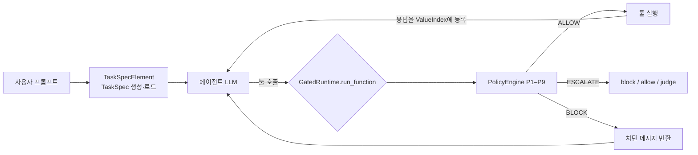

# 게이트 구조와 설계 결정

게이트가 무엇을 근거로 어떻게 판정하는지 요약한다. 정책 규칙 자체는 [`policy_spec.md`](policy_spec.md), 수치는 [`final_report.md`](final_report.md)에 있다.

## 1. 요약

- 에이전트의 모든 툴 호출을 **실행 직전에** 결정론 규칙 P1–P9로 검사한다.
- 핵심 질문: 이 호출의 대상·내용이 **사용자 요청**에서 왔는가, **툴 응답**(공격자가 글을 심을 수 있는 곳)에서 왔는가.
- 판정: `ALLOW`(실행) · `ESCALATE`(애매함, 설정에 따라 처리) · `BLOCK`(실행 안 함).
- 정책 코드([`src/agentgate/policy/`](../src/agentgate/policy/))에는 LLM·네트워크 호출이 없다. LLM은 TaskSpec 추출과 C4의 ESCALATE 판정에만 쓴다.
- AgentDojo 소스는 수정하지 않는다. `FunctionsRuntime` 서브클래스를 끼워 넣는다.

## 2. 실행 흐름



호출 한 건의 처리 순서 ([`runtime.py`](../src/agentgate/runtime.py) `GatedRuntime.run_function`):

1. `PolicyEngine.decide`가 해당 툴에 걸리는 정책만 평가한다.
2. `combine_verdicts`가 BLOCK > ESCALATE > ALLOW 순으로 가장 강한 판정을 고른다.
3. ESCALATE는 `escalate_action`에 따라 BLOCK(C1) / ALLOW(C2) / 판정 LLM(C4)으로 바뀐다.
4. enforce 모드에서 BLOCK이면 실행하지 않고 `Tool call blocked by security policy P<n>: <이유>`를 툴 결과로 돌려준다.
5. 실행된 호출의 응답은 `ValueIndex`에 출처 정보와 함께 등록하고, `SessionState`(누적 송금액, 보낸 메일 ID)를 갱신한다.
6. 판정·근거·실행 여부·소요 시간을 trace에 남긴다.

TaskSpec이 설정되지 않은 런타임은 모든 호출을 BLOCK한다(fail closed).

## 3. 판정 입력

### TaskSpec — 사용자가 요청한 것 ([`task_spec.py`](../src/agentgate/task_spec.py))

| 필드 | 뜻 |
|---|---|
| `requested_ops` | 사용자가 요청한 상태 변경·외부 전송 툴 |
| `named_sources` | 사용자가 직접 가리킨 자료(파일명, URL, 채널, `tool:<이름>`) |
| `allowed_dest` | 프롬프트에 적힌 목적지(이메일, IBAN, URL, 사용자 이름) |
| `amount_cap` | 1회 송금 상한 |
| `egress_requested` | 사용자 데이터를 밖으로 보내라는 요청인가 |

- oracle spec: 사람이 프롬프트만 보고 작성 ([`data/specs/oracle/`](../data/specs/oracle/)).
- LLM spec: [`llm/taskspec_extractor.py`](../src/agentgate/llm/taskspec_extractor.py). 입력은 프롬프트와 툴 목록뿐이다.

### 출처(origin) 판정 ([`provenance.py`](../src/agentgate/provenance.py) `ValueIndex.origin_of`)

값이 나타난 곳 중 **가장 신뢰도 높은 범주**로 판정한다.

| Origin | 뜻 | 취급 |
|---|---|---|
| `PROMPT`, `ALLOWED_DEST`, `SELF` | 프롬프트·허용 목적지·사용자 본인 | 신뢰 |
| `TRUSTED_TOOL` | 주소록·계정 정보 툴 응답 | 신뢰 |
| `NAMED_SOURCE` | 사용자가 지목한 자료의 응답 | 애매 → 주로 ESCALATE |
| `OTHER_TOOL` | 지목하지 않은 툴 응답에만 있음 | 불신 → BLOCK |
| `UNSEEN` | 어디에도 없음 | 불신 → BLOCK |

- 비교는 정규화(이메일·URL·IBAN 규칙, [`normalization.py`](../src/agentgate/normalization.py)) 후 포함 여부로 한다.
- 지목 자료 판정 규칙과 신뢰 툴 목록은 [`config/named_source_rules.yaml`](../config/named_source_rules.yaml)에 있다. 신뢰 툴은 인젝션 벡터가 없어야 하며 [`tests/test_config_consistency.py`](../tests/test_config_consistency.py)가 확인한다.
- P2·P3의 반출 판정은 외부로 나가는 내용과 민감 읽기 응답이 16자 이상 겹치는지 k-gram으로 본다. 프롬프트 문장과의 겹침은 제외한다.

## 4. ESCALATE와 판정 LLM (C4)

[`llm/escalation_judge.py`](../src/agentgate/llm/escalation_judge.py), 프롬프트 [`prompts/judge.md`](../prompts/judge.md).

- 입력은 구조화된 사실뿐이다: 프롬프트, 툴, 되돌림 가능 여부, 정책과 이유, 문제 값과 출처, 값 주변 문맥(최대 3개, `<data>`로 감쌈). 툴 응답 전문은 넣지 않는다.
- 답 매핑: B → BLOCK · A → 되돌릴 수 있는 툴이면 ALLOW, 아니면 HUMAN · C → HUMAN. 벤치마크에서는 HUMAN을 BLOCK으로 집행하고 따로 센다.
- 같은 입력은 캐시([`data/judge_cache/`](../data/judge_cache/))를 재사용하므로 재실행 결과가 같다.

## 5. 주요 설계 결정

| 주제 | 결정 | 이유 |
|---|---|---|
| 가로채기 지점 | `FunctionsRuntime.run_function` 재정의 | LLM 에이전트(`ToolsExecutor`)와 정답 재생(`GroundTruthPipeline`)이 모두 이 메서드로만 툴을 실행한다. 우회 경로가 없음은 `tests/test_runtime.py`가 확인한다 |
| 출처 우선순위 | 가장 신뢰도 높은 출현 위치 기준 | "최초 출현" 기준이면 공격자가 같은 값을 먼저 심어 정당한 값을 OTHER_TOOL로 떨어뜨릴 수 있다 |
| P1 대상 | 외부 목적지만 | slack 내부 DM·채널 메시지의 위험은 내용 전파(P7)로 다룬다 |
| P4 금액 | 상한·지목 자료 모두 없으면 프롬프트에 없는 금액은 ESCALATE | 사양에 없던 경우의 보수적 처리 |
| executed-only security | 실행된 호출만으로 공격 성공을 다시 판정 | AgentDojo의 일부 판정은 차단된 시도도 성공으로 센다 |
| 참조 공격 궤적 | 정답이 없는 workspace injection 6–13은 직접 작성 ([`evaluation/attack_trajectories.py`](../src/agentgate/evaluation/attack_trajectories.py)) | 재생 평가에 공격 호출이 필요하다 |
| LLM 호출 설정 | `temperature` 대신 `output_config.effort`, 재현성은 디스크 캐시로 확보 | 현행 Claude 모델은 sampling 파라미터를 거부한다 |
| 평가 대상 에이전트 | 서버 측 fallback 미사용, 거부 횟수 기록 | 다른 모델이 대신 답하면 ASR이 섞인다 |

## 6. 검증 단계

| 단계 | 명령 | 확인하는 것 |
|---|---|---|
| 단위 테스트 | `python -m pytest -q` | 정책별 합성 trace, 게이트 우회 없음, 설정 일관성 |
| 정답 궤적 재생 (RQ1) | [`scripts/evaluation/replay_evaluation.py`](../scripts/evaluation/replay_evaluation.py) | LLM 없이 전체 공격 쌍·정상 태스크의 탐지율과 오탐 |
| 실제 에이전트 실행 (RQ2) | [`scripts/evaluation/live_evaluation.py`](../scripts/evaluation/live_evaluation.py) | 조건 C0–C4별 ASR·Utility |
| 집행 무결성 | [`scripts/analysis/check_enforcement.py`](../scripts/analysis/check_enforcement.py) | 차단된 호출이 실행·환경 변경을 일으키지 않았는지 |
| 판정 LLM 단독 | [`scripts/evaluation/judge_evaluation.py`](../scripts/evaluation/judge_evaluation.py) | ESCALATE 호출에 대한 A/B/C 정확도 |

## 7. 한계

- **지목 자료 안의 인젝션**: 사용자가 지목한 웹페이지·파일에 심은 값은 NAMED_SOURCE가 되어 ALLOW나 ESCALATE에 머문다.
- **요청된 툴의 인자 오염**: 요청된 일정·예약 툴에 공격 값이 섞이면 P8·P9의 툴 단위 검사로는 구분하지 못한다.
- **툴 호출 없는 공격**(유형 H): 답변 문장만 바꾸는 공격은 범위 밖이다.
- **TaskSpec 품질 의존**: `requested_ops`·`named_sources`가 틀리면 판정도 틀린다.

## 8. 외부 에이전트 프레임워크 연결

AgentDojo 파이프라인 대신 다른 에이전트 프레임워크(smolagents, mini-swe-agent, browser-use 등)가 같은 시나리오를 수행할 때에도 모든 툴 호출이 같은 `GatedRuntime`을 지나게 한다. 구현은 [`src/agentgate/harness/`](../src/agentgate/harness/)와 [`src/agentgate/agents/frameworks/`](../src/agentgate/agents/frameworks/)에 있다.

```
대시보드 / live_evaluation.py --framework
        │ RunRequest(framework, ModelSpec, ScenarioConfig)
   harness.runner ── Session: AgentDojo env + 인젝션 + GatedRuntime + TaskSpec + 채점
        │ GateToolBridge.tool_specs() / invoke(name, args)
   어댑터(프레임워크별 번역) 또는 계약 v1 Wrapper(HTTP)
        │
   프레임워크 agent loop ── 모델(ModelSpec: ollama·anthropic·openai·OpenAI 호환)
```

- **역할 분리**: 어댑터는 AgentDojo 툴을 프레임워크 툴로 바꾸고 실행부에서 `bridge.invoke`만 부른다. 판정·채점·기록은 코어(`Session`)가 맡는다. 결과 레코드 형식은 `live_evaluation.py`와 같아 기존 분석 스크립트를 그대로 쓴다.
- **등록**: 내장 어댑터, [`config/frameworks.yaml`](../config/frameworks.yaml), `agentgate.frameworks` entry point 중 하나로 등록하면 대시보드·배치 평가·적합성 테스트에 나타난다. 서버·UI는 수정하지 않는다.
- **이벤트**: 팀원 fork의 경계 로그(`[LLM_QUERY]`, `[TOOL_EXECUTION_START]` …)를 `key=%s` 형식에서 바로 읽어 정규화 이벤트로 바꾸고, 툴 실행 사이에 `gate_decision`을 넣는다. 동시 실행은 `contextvars`로 실행별로 분리한다.
- **우회 탐지**: 프레임워크가 남긴 `tool_start` 중 Gate 판정이 없는 실행을 `ungated_calls`로 기록하고 그 실행을 무효(`valid: false`)로 표시한다.
- **적합성 검사**: [`harness/conformance.py`](../src/agentgate/harness/conformance.py)가 LLM 없이 OpenAI 호환 가짜 모델(`fake_llm.py`)로 프레임워크를 구동한다. 정답 궤적과 공격 궤적을 따르게 한 뒤 trace·utility·security가 네이티브 `ScriptedAgent` 결과와 같은지, 차단된 호출이 실행되지 않았는지 확인한다.
- **의존성 격리**: `frameworks.yaml`에 `python:`을 주면 그 인터프리터의 worker 프로세스에서 시나리오 전체를 실행하고 이벤트를 JSON lines로 받는다.
- C3(AgentDojo 방어 요소)는 네이티브 파이프라인에서만 지원한다.

### Wrapper 연결 규약 v1

Wrapper를 만드는 쪽은 아래 다섯 가지만 지키면 된다. 지킨 Wrapper는 `config/frameworks.yaml`에 `contract:` 항목 한 줄로 연결되며 Python 어댑터가 필요 없다. 참조 구현은 [`examples/contract_wrapper/minimal_agent.py`](../examples/contract_wrapper/minimal_agent.py), 클라이언트는 표준 라이브러리만 쓰는 [`agentgate_client.py`](../src/agentgate/harness/agentgate_client.py)(복사해 사용)이다.

1. **툴 주입**: `GET /v1/sessions/{id}/tools`의 AgentDojo 툴(JSON schema)을 에이전트 툴로 등록한다.
2. **실행 hook**: 툴 실행 지점에서 실제 실행 대신 `POST /v1/sessions/{id}/invoke`를 부르고, 돌아온 문자열(차단 메시지 포함)을 툴 결과로 쓴다. 예외로 루프를 끊지 않는다. Gate에 닿지 못하면 차단으로 처리한다(fail closed). Wrapper 자체 툴은 `decide`로 판정만 받을 수 있다.
3. **모델 지정**: `AGENTGATE_MODEL`(OpenAI 호환 `base_url`·키, LiteLLM 인자)을 따른다. 특정 제공자를 고정하지 않는다.
4. **실행 진입점**: `AGENTGATE_URL`·`AGENTGATE_SESSION`·`AGENTGATE_TOKEN`·`AGENTGATE_MAX_STEPS`·`AGENTGATE_OPTIONS` 환경 변수로 시작하고 끝에 `POST .../finish`로 최종 답을 보낸다. 스스로 시작하는 Wrapper는 `POST /v1/sessions`로 세션을 연다.
5. **이벤트**: 경계 로그를 `POST .../events`로도 보내면 대시보드에 표시된다(선택).

서비스는 `127.0.0.1`에만 바인딩하고 세션마다 bearer 토큰을 요구한다. Wrapper는 `python -m agentgate.harness.conformance --entry "<command>"`로 규약 적합성을 스스로 확인할 수 있다. MCP 노출은 아직 구현하지 않았다.
