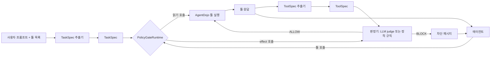

# 구조와 집행 지점

AgentGate가 툴 호출을 어디에서 가로채고 어떻게 집행하는지 정리한다. 판정 규칙은 [`rulebook.md`](rulebook.md), 프레임워크 연결 절차는 [`integration_guide.md`](integration_guide.md)에 있다.

## 1. 요약

- 에이전트의 모든 AgentDojo 툴 호출은 `GatedRuntime.run_function` 한 곳을 지난다. 이곳이 유일한 집행 지점이다.
- 판정은 `PolicyGateRuntime`이 한다. effect 호출만 판정기(판정 LLM 또는 정적 규칙)에 보내고, 답(ALLOW / BLOCK)을 집행한다.
- 프레임워크는 `Adapter → GateToolBridge → Session → PolicyGateRuntime` 경로로만 툴을 실행한다. Gate를 거치지 않은 실행이 있으면 그 run은 무효다.
- 정해지지 않은 상황(TaskSpec 없음, Gate 연결 실패, 규칙 오류)은 모두 차단한다(fail-closed).
- AgentDojo 소스는 수정하지 않는다. `FunctionsRuntime` 서브클래스를 끼워 넣는다.

## 2. 단일 집행 지점: `GatedRuntime.run_function`

[`core/runtime.py`](../src/agentgate/core/runtime.py). AgentDojo의 `ToolsExecutor`(LLM 에이전트)와 `GroundTruthPipeline`(재생)은 모두 `runtime.run_function`으로만 툴을 실행한다. 그래서 이 메서드를 재정의하면 모든 실행 경로가 덮인다.

호출 한 건의 처리 순서:

1. TaskSpec이 없으면 BLOCK한다.
2. `resolve`가 최종 판정을 정한다(`PolicyGateRuntime`이 재정의).
3. enforce 모드에서 BLOCK이면 실행하지 않고 차단 메시지를 툴 결과로 돌려준다.
4. ALLOW면 실행한다. 응답은 `ValueIndex`에 출처 정보와 함께 등록하고, `label_response`가 ToolSpec을 붙이며, `SessionState`(보낸 메시지 등)를 갱신한다.
5. 판정·근거·실행 여부·소요 시간을 trace에 남긴다.

`GatedRuntime`은 생성 시 툴 함수를 모두 감싼다. 감싼 함수는 `run_function` 안에서만 실행되고, 밖에서 부르면 실행하지 않고 `UngatedExecutionError`를 내며 `ungated_executions`에 기록한다.

### `PolicyGateRuntime`

[`policy_gate/runtime.py`](../src/agentgate/policy_gate/runtime.py). `GatedRuntime`의 hook만 바꾼다.

| hook | 동작 |
|---|---|
| `resolve` | 읽기 호출은 ALLOW. effect 호출은 판정기에 보내 그 답을 쓴다. enforce 모드인데 판정기가 없으면 예외를 낸다 |
| `label_response` | 실행된 응답마다 ToolSpec 추출기를 불러 `labels["toolspec"]`에 붙인다 |
| `block_message` | `Tool call blocked by policy gate (R2, R3): <이유>`(이유 240자 이내). 판정 기록 전체는 trace에만 남는다 |

판정기 조립은 [`policy_gate/assembly.py`](../src/agentgate/policy_gate/assembly.py), 조건 정의는 [`experiment/conditions.py`](../src/agentgate/experiment/conditions.py)다.

## 3. 프레임워크 연결 계층

```
대시보드 / 시나리오 CLI (agentgate.scenarios.run)
        │ RunRequest(framework, ModelSpec, ScenarioConfig)
   harness.runner ── Session: AgentDojo 환경 + 인젝션 + PolicyGateRuntime + TaskSpec + 채점
        │ GateToolBridge.tool_specs() / invoke(name, args)
   Adapter(프로세스 내) 또는 contract v1 Wrapper(HTTP, harness.service)
        │
   프레임워크 agent loop ── 모델(ModelSpec: ollama·anthropic·openai·OpenAI 호환)
```

| 구성 요소 | 파일 | 역할 |
|---|---|---|
| `FrameworkAdapter` | [`adapters/base.py`](../src/agentgate/adapters/base.py) | 프레임워크 번역만 한다. 툴 본문을 `bridge.invoke`로 바꾸고 `routes_tools_through_bridge = True`를 선언한다 |
| `GateToolBridge` | [`harness/bridge.py`](../src/agentgate/harness/bridge.py) | 프레임워크가 툴에 닿는 유일한 문. `invoke` → `Session.invoke`. `gate_decision` 이벤트를 남긴다 |
| `Session` | [`harness/session.py`](../src/agentgate/harness/session.py) | 시나리오 하나: 환경, 인젝션, `PolicyGateRuntime`, TaskSpec, 채점(`finish`) |
| contract 서비스 | [`harness/service.py`](../src/agentgate/harness/service.py) | 외부 프로세스 Wrapper용 HTTP 규약 v1(`/v1/sessions/...`). 대시보드가 mount한다 |
| registry | [`harness/registry.py`](../src/agentgate/harness/registry.py) | 내장 어댑터, `config/frameworks.yaml`, `agentgate.frameworks` entry point |
| runner·worker | [`harness/runner.py`](../src/agentgate/harness/runner.py), [`harness/worker.py`](../src/agentgate/harness/worker.py) | 실행 하나를 돌리고 레코드를 만든다. `python:`이 지정된 프레임워크는 별도 인터프리터 worker에서 돈다 |

native 어댑터도 AgentDojo pipeline에 bridge를 거치는 `BridgeRuntime`을 넘기므로 같은 경로를 지난다.

### contract 서비스

- `127.0.0.1`에만 바인딩하고 session마다 bearer token을 요구한다.
- AgentDojo 툴은 `/invoke`로만 실행한다. `/decide`는 Wrapper 자체 툴의 판정만 하며 AgentDojo 툴을 넣으면 400이다.
- Wrapper는 `gate_decision`·`gate_bypass`·`result` 이벤트를 보낼 수 없다(무시한다).

### 연결된 프레임워크

| 프레임워크 | 툴을 넘기는 방식 | 이벤트 순서 |
|---|---|---|
| native | AgentDojo pipeline에 `BridgeRuntime` | 기준 경로 |
| smolagents | 툴마다 `Tool`, `forward`에서 `bridge.invoke` | `Tool.__call__`: tool_start → gate_decision → tool_end |
| mini-swe-agent | 툴은 `bash` 하나. `GatedShell`이 명령 한 줄을 툴 호출 하나로 처리한다(실제 셸 실행 없음) | `execute_action`: tool_start(bash) → gate_decision(명령별) → tool_end(bash) |
| browser-use | 브라우저 액션을 빼고 툴마다 커스텀 액션. 이름이 겹치면 AgentDojo 툴 우선. 별도 venv | `Registry.execute_action`: tool_start → gate_decision → tool_end |
| contract Wrapper | HTTP `/invoke` | Wrapper가 보낸 tool_start → gate_decision → tool_end |

## 4. 우회 감지와 무효 처리

우회는 두 경로로 잡는다.

| 경로 | 감지 방법 | 기록 |
|---|---|---|
| 툴 함수 직접 호출 | 감싼 툴 함수가 `run_function` 밖 호출을 거부 | `GatedRuntime.ungated_executions` |
| 프레임워크 내부 실행 | 경계 로그 `tool_start`와 Gate 판정 횟수 대조, 등록되지 않은 툴 이름 | `GateToolBridge.ungated_calls` |

하나라도 있으면 레코드는 `valid: false`, `invalid_reason`을 갖고, 점수는 `excluded_scores`로 옮겨 집계에서 뺀다. 이벤트 `gate_bypass`(ERROR)를 낸다. `routes_tools_through_bridge = True`를 선언하지 않은 어댑터는 registry가 사용 불가로 표시하고 runner가 실행을 거부한다(`contract_problems`). 동작은 conformance 검사(`python -m agentgate.harness.conformance`)로 확인한다.

## 5. fail-closed

| 상황 | 처리 |
|---|---|
| TaskSpec이 없음 | 모든 호출 BLOCK(`no TaskSpec is configured`) |
| enforce 모드인데 판정기가 없음 | `PolicyGateRuntime.resolve`가 예외 |
| 정적 규칙 함수 예외 | 그 규칙의 BLOCK |
| 판정 LLM 답을 해석할 수 없음 | BLOCK |
| Wrapper가 Gate에 닿지 못함 | client가 차단 메시지를 돌려주고 실행하지 않음 |
| Gate 밖 툴 실행 | 실행 거부, run 무효 |

## 6. 데이터 흐름



- TaskSpec 추출기의 입력은 사용자 프롬프트와 툴 목록(이름·설명)뿐이다.
- ToolSpec 추출기는 툴 응답을 읽지만 고정 스키마 JSON만 낸다. 판정기는 툴 응답 원문을 보지 않는다.
- LLM 캐시: TaskSpec `data/cache/taskspec/`, ToolSpec `data/cache/toolspec/`, 판정 `data/cache/judge/`(모두 git 제외).

## 7. 설정 파일

| 파일 | 내용 |
|---|---|
| [`config/gate.yaml`](../config/gate.yaml) | `GatedRuntime` 공통 설정(사용자 식별자, ValueIndex 길이) |
| [`config/rulebook.yaml`](../config/rulebook.yaml) | 룰북 R1–R10 |
| [`config/frameworks.yaml`](../config/frameworks.yaml) | 추가 프레임워크·contract Wrapper 등록 |
| [`config/agentdojo/tool_roles.yaml`](../config/agentdojo/tool_roles.yaml) | effect 툴 목록과 범주 |
| [`config/agentdojo/tool_args.yaml`](../config/agentdojo/tool_args.yaml) | 툴 인자 역할, R4 임계값 |
| [`config/agentdojo/named_source_rules.yaml`](../config/agentdojo/named_source_rules.yaml) | 지목 자료 판정 규칙, 신뢰 툴 |
| [`config/agentdojo/sensitive_reads.yaml`](../config/agentdojo/sensitive_reads.yaml) | 민감 읽기 툴 범주(R4) |

AgentDojo 고유 값(툴 이름 등)은 `config/agentdojo/`와 `src/agentgate/scenarios/`에만 둔다. 신뢰 툴은 인젝션 벡터가 없어야 하며 [`tests/test_config_consistency.py`](../tests/test_config_consistency.py)가 확인한다.

## 8. 주요 설계 결정

| 주제 | 결정 | 이유 |
|---|---|---|
| 가로채기 지점 | `FunctionsRuntime.run_function` 재정의 | AgentDojo의 모든 실행 경로가 이 메서드를 지난다 |
| 출처 우선순위 | 값이 나타난 곳 중 가장 신뢰도 높은 범주 | "최초 출현" 기준이면 공격자가 같은 값을 먼저 심어 정당한 값을 불신 범주로 떨어뜨릴 수 있다 |
| 판정 입력 | 툴 응답 원문 대신 ToolSpec | 판정기가 주입 문구를 직접 읽지 않게 한다 |
| 판정 결과 | ALLOW / BLOCK 두 가지 | 사람 확인 단계 없이 실행 직전에 결정한다 |
| executed-only security | 실행된 호출만으로 공격 성공을 다시 판정(`security_executed`) | AgentDojo의 일부 판정은 차단된 시도도 성공으로 센다 |
| 의존성 격리 | 충돌하는 프레임워크는 별도 venv worker | agentgate·AgentDojo 의존성을 바꾸지 않는다 |
