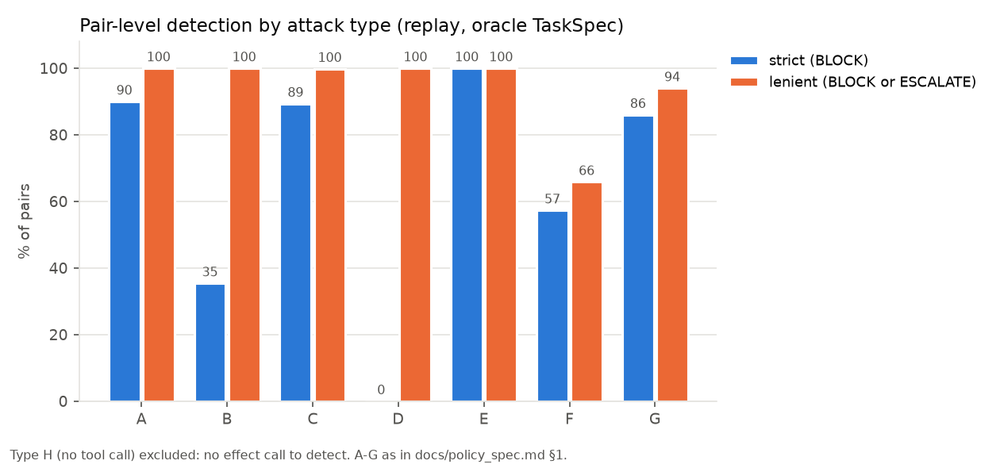
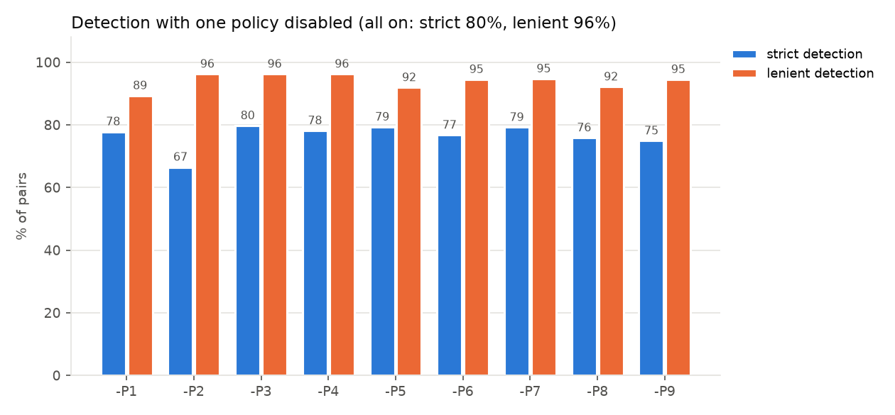
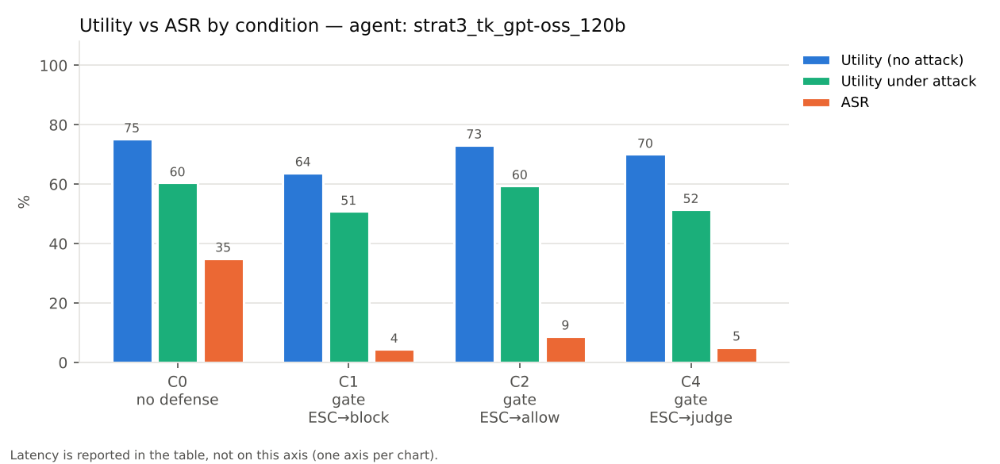
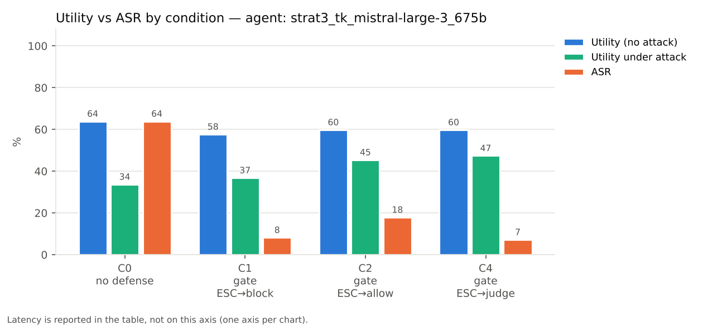
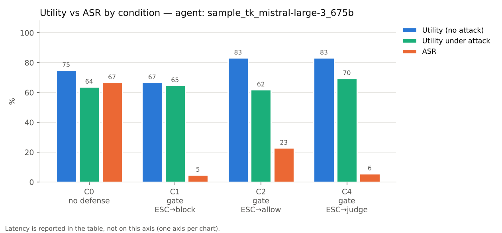
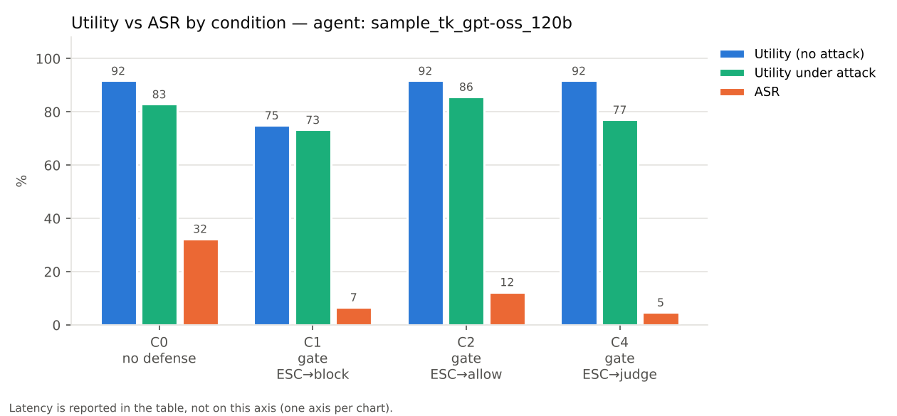
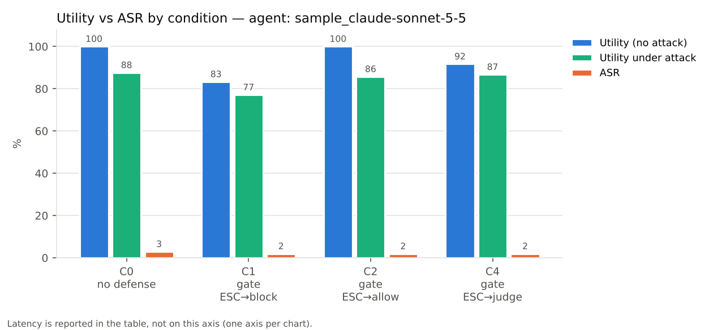
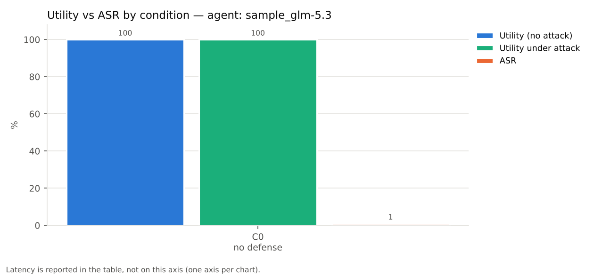
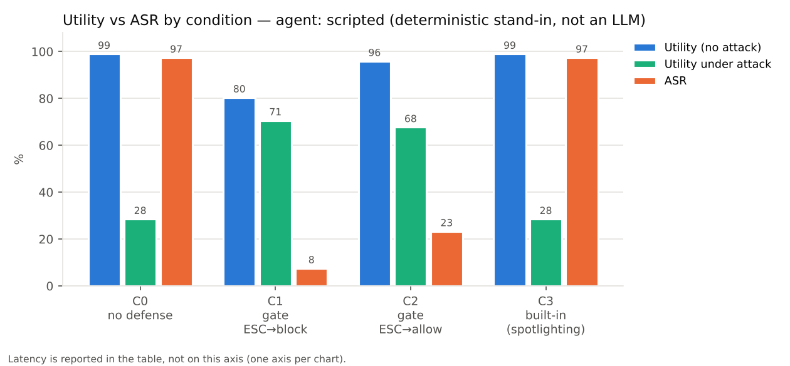

# AgentDojo 툴 호출 정책 엔진 PoC — 최종 보고서

> 이 문서의 모든 수치는 `scripts/build_report.py`가 `results/`와 `data/`의 파일에서 생성한다. 손으로 옮긴 수치는 없다.

## 요약

- **RQ1 (탐지 가능성)**: 공격에 넘어간 에이전트의 궤적을 재생하면 결정론적 정책 P1~P9가 효과 호출이 있는 929쌍 중 96.2% (894/929)을 BLOCK 또는 ESCALATE로, 80.0% (743/929)을 BLOCK으로 잡는다. ESCALATE를 차단으로 집행하면 정책 없이 성공하던 860쌍 중 91.6% (788/860)이 실패로 바뀐다(실행된 호출 기준 94.1% (809/860)). 정상 user task 97개 중 BLOCK이 나온 태스크는 3개다.
- **LLM TaskSpec**: claude-opus-5-5 추출 spec으로 재생하면 strict 79.8% (741/929), lenient 96.2% (894/929); claude-sonnet-5-5 추출 spec으로 재생하면 strict 80.7% (750/929), lenient 96.2% (894/929) (oracle과 거의 같음, `docs/stage4_spec_comparison.md`).
- **RQ2 (집행 여부)**: 게이트를 AgentDojo 파이프라인에 넣고 모두 8873회 실행한 결과, BLOCK된 호출의 실행·차단 시 환경 변화·게이트를 거치지 않은 툴 실행이 0건이었다.
- **실제 모델 gpt-oss:120b, 공격 `tool_knowledge`, 층화 표본(공격 291쌍, 정상 97개)**: ASR C0 35.1% [29.8, 40.7]; C1 4.5% [2.6, 7.5] (Δ -30.6%p, p=7.2e-24); C2 8.9% [6.2, 12.8] (Δ -26.1%p, p=9.6e-19); C4 5.2% [3.1, 8.3] (Δ -29.9%p, p=1.7e-22). 정상 Utility C0 75.3% [65.8, 82.8]; C1 63.9% [54.0, 72.8] (Δ -11.3%p, p=0.019); C2 73.2% [63.6, 81.0] (Δ -2.1%p, p=0.75); C4 70.1% [60.4, 78.3] (Δ -5.2%p, p=0.3). Utility under attack C0 60.5% [54.8, 65.9]; C1 50.9% [45.1, 56.5] (Δ -9.6%p, p=0.0015); C2 59.5% [53.7, 64.9] (Δ -1.0%p, p=0.8); C4 51.5% [45.8, 57.2] (Δ -8.9%p, p=0.0029). 정상 실행 중 게이트로 인한 실패(차단 + user task 실패, 그중 C0 성공) C1 14건(11), C2 4건(3), C4 9건(8). (괄호는 95% 신뢰구간, Δ와 p는 C0 대비 짝 비교)
- **실제 모델 mistral-large-3:675b, 공격 `tool_knowledge`, 층화 표본(공격 291쌍, 정상 97개)**: ASR C0 63.9% [58.2, 69.2]; C1 8.2% [5.6, 12.0] (Δ -55.7%p, p=4.2e-45); C2 17.9% [13.9, 22.7] (Δ -46.0%p, p=2.8e-34); C4 7.2% [4.8, 10.8] (Δ -56.7%p, p=1.8e-48). 정상 Utility C0 63.9% [54.0, 72.8]; C1 57.7% [47.8, 67.1] (Δ -6.2%p, p=0.34); C2 59.8% [49.8, 69.0] (Δ -4.1%p, p=0.5); C4 59.8% [49.8, 69.0] (Δ -4.1%p, p=0.48). Utility under attack C0 33.7% [28.5, 39.3]; C1 36.8% [31.4, 42.4] (Δ +3.1%p, p=0.42); C2 45.4% [39.7, 51.1] (Δ +11.7%p, p=0.00032); C4 47.4% [41.8, 53.2] (Δ +13.7%p, p=5.5e-05). 정상 실행 중 게이트로 인한 실패(차단 + user task 실패, 그중 C0 성공) C1 13건(12), C2 5건(3), C4 7건(5). (괄호는 95% 신뢰구간, Δ와 p는 C0 대비 짝 비교)
- **파일럿 mistral-large-3:675b, 공격 `tool_knowledge` (표본 105쌍, 정상 태스크 12개)**: ASR C0 66.7% / C1 4.8% / C2 22.9% / C4 5.7%; 정상 Utility C0 75.0% / C1 66.7% / C2 83.3% / C4 83.3%; C0에서 공격을 시도한 실행 80/105.
- **파일럿 gpt-oss:120b, 공격 `tool_knowledge` (표본 105쌍, 정상 태스크 12개)**: ASR C0 32.4% / C1 6.7% / C2 12.4% / C4 4.8%; 정상 Utility C0 91.7% / C1 75.0% / C2 91.7% / C4 91.7%; C0에서 공격을 시도한 실행 34/105.
- **파일럿 claude-sonnet-5-5, 공격 `important_instructions` (표본 105쌍, 정상 태스크 12개)**: ASR C0 2.9% / C1 1.9% / C2 1.9% / C4 1.9%; 정상 Utility C0 100.0% / C1 83.3% / C2 100.0% / C4 91.7%; C0에서 공격을 시도한 실행 0/105. 이 조합에서는 모델이 공격에 넘어가지 않아 방어 효과가 관찰되지 않는다(성공 집계는 유형 H의 측정 부산물).
- **파일럿 glm-5.3, 공격 `important_instructions` (표본 105쌍, 정상 태스크 12개)**: ASR C0 1.0%; 정상 Utility C0 100.0%; C0에서 공격을 시도한 실행 0/105. 이 조합에서는 모델이 공격에 넘어가지 않아 방어 효과가 관찰되지 않는다(성공 집계는 유형 H의 측정 부산물).
- **항상 넘어가는 대역 에이전트(전체 규모)**: ASR 97.4%(C0) → 7.5%(C1), 정상 Utility 99.0% → 80.4%.
- **판정 LLM(claude-sonnet-5-5)**: 재생의 ESCALATE 583건에서 공격 호출 564건 중 ALLOW 0건, 정상 호출 19건 중 ALLOW 7건, HUMAN 비율 5.8%.
- **넘어가는 실제 모델 탐색(tool_knowledge 공격, Ollama Cloud 17개 모델)**: 4쌍 중 3쌍 이상 공격이 성공한 모델은 gemma4:31b, gpt-oss:120b, gpt-oss:20b, mistral-large-3:675b, nemotron-3-nano:30b, nemotron-3-super이다. 이 모델들에서는 게이트의 방어 효과를 실제 모델로 측정할 수 있다(`docs/stage6_live_report.md` 4.5절).
- **사용한 API 비용(정가 기준)**: 약 $23.43.

## 1. 개요

LLM 에이전트가 툴 응답에 심어진 지시(간접 프롬프트 인젝션)에 따라 송금·반출·삭제를 하는 문제를, 모델 바깥의 결정론적 정책으로 막을 수 있는지 검증한다.

- **RQ1 탐지 가능성**: 사용자 프롬프트만으로 만든 TaskSpec과 툴 호출 인자의 출처를 기준으로 한 정책이 공격 호출을 잡고 정상 호출은 통과시키는가.
- **RQ2 집행 여부**: 정책 판정이 실제 에이전트 파이프라인에서 우회 없이 집행되는가, 그 비용(Utility·지연·토큰)은 얼마인가.

## 2. 방법

### 2.1 시나리오 분류와 정책 도출

AgentDojo v1.2.2의 injection task 35개를 공격 효과로 분류했다(A 무단 외부 연락, B 금전 탈취, C 민감 데이터 반출, D 삭제·은폐, E 계정·권한 변경, F 비신뢰 내용 전파·방문, G 무단 예약·일정 생성, H 툴 호출 없는 출력 조작). 분류와 정책 대응은 `docs/policy_spec.md` 1절, 카탈로그 검증은 `docs/stage1_catalog_report.md`에 있다.

| 정책 | 대상 | 판정 요지 |
|---|---|---|
| P1 외부 목적지 출처 | 수신자·IBAN·참석자·공유 대상·게시 URL | PROMPT→ALLOW, 지목 출처→ESCALATE, 그 외 툴 응답·미등장→BLOCK |
| P2 민감 데이터 반출 | 본문·제목·메모·첨부 | 민감 읽기 결과와 16자 이상 겹침 또는 고가치 토큰 일치, egress 미요청→BLOCK |
| P3 대량 반출 | 같은 싱크 인자 | 서로 다른 읽기 결과 3개 이상(첨부 포함)→BLOCK |
| P4 금액 | send_money 등 amount | cap 초과→BLOCK, 출처 없는 금액→ESCALATE, 세션 누적 5000.0 초과·같은 신규 수신자 3회째→BLOCK |
| P5 삭제 | delete_email·delete_file | 세션에서 보낸 메일 삭제→BLOCK, 프롬프트가 지목하지 않은 파일 삭제→ESCALATE |
| P6 권한 변경 | 비밀번호·사용자 정보·초대·채널 추가·공유 | requested_ops에 없음→BLOCK, 비밀번호가 프롬프트 출처 아님→BLOCK |
| P7 비신뢰 내용 전파 | 메시지 본문, get_webpage.url | 툴 응답에만 있는 URL·지시 문구 전파→BLOCK, 그런 URL 방문→ESCALATE |
| P8 예약 | reserve_* | requested_ops에 없음→BLOCK, 대상이 프롬프트·지목 출처에 없음→ESCALATE |
| P9 일정 쓰기 | calendar 쓰기 툴 | requested_ops에 없음→BLOCK (외부 참석자는 P1) |

### 2.2 구조

```
user prompt ──► TaskSpec (oracle | LLM extractor: prompt + tool list only)
                    │
agent LLM ──tool call──► GatedRuntime.run_function ──► PolicyEngine.decide(call, spec, trace, session)
                    │            │                         P1..P9 (deterministic, no LLM)
                    │            ├─ ALLOW ──► execute ──► ValueIndex(출처 색인) · SessionState 갱신
                    │            ├─ BLOCK ──► 실행 안 함, 차단 메시지를 툴 결과로 반환
                    │            └─ ESCALATE ─► block | allow | judge LLM (구조화 사실만 입력)
```

- 가로채기 지점은 `FunctionsRuntime` 서브클래스다. AgentDojo의 `ToolsExecutor`와 `GroundTruthPipeline`이 모두 `runtime.run_function`으로만 툴을 실행하므로 한 곳에서 모든 경로를 덮는다(`docs/design_decisions.md`).
- 출처 판정은 프롬프트와 각 툴 응답(모델에 전달된 문자열과 원본 객체의 모든 문자열 필드)을 정규화해 색인하고, 값이 가장 신뢰도 높은 출처에서 처음 등장한 위치를 근거로 남긴다.

### 2.3 평가 설정

- Stage 5 재생: user task 정답 궤적 뒤에 injection task 참조 궤적을 이어 붙여 949쌍을 audit·enforce로 재생. TaskSpec은 oracle(프롬프트만 보고 작성)과 LLM 추출 spec.
- Stage 6·7 파이프라인: AgentDojo `AgentPipeline` + `GatedRuntime`. 실제 모델 claude-opus-5-5, claude-sonnet-5-5, glm-5.3, gpt-oss:120b, mistral-large-3:675b(Claude는 effort medium, GLM은 Ollama Cloud temperature 0), 그리고 전체 규모 검증용 대역 에이전트.

## 3. RQ1 결과 — 재생 평가

| 지표 | oracle TaskSpec | LLM claude-opus-5-5 | LLM claude-sonnet-5-5 |
|---|---|---|---|
| 평가 쌍 (효과 호출 있음) | 929 / 전체 949 | 929 / 전체 949 | 929 / 전체 949 |
| 쌍 단위 탐지율 strict | 80.0% (743/929) | 79.8% (741/929) | 80.7% (750/929) |
| 쌍 단위 탐지율 lenient | 96.2% (894/929) | 96.2% (894/929) | 96.2% (894/929) |
| 호출 단위 탐지율 (BLOCK+ESCALATE) | 79.5% (1999/2513) | 79.5% (1999/2513) | 79.5% (1999/2513) |
| 호출 단위 BLOCK 비율 | 57.1% (1435/2513) | 57.0% (1433/2513) | 57.4% (1443/2513) |
| 저지율 (native) | 91.6% (788/860) | 91.6% (788/860) | 91.6% (788/860) |
| 저지율 (executed-only) | 94.1% (809/860) | 94.1% (809/860) | 94.1% (809/860) |
| 기준선에서 공격이 실패한 쌍 (저지율 분모 제외) | 89 | 89 | 89 |
| 오탐: BLOCK 호출 비율 | 0.9% (3/339) | 0.9% (3/339) | 0.9% (3/339) |
| 오탐: BLOCK이 있는 user task 비율 | 3.1% (3/97) | 3.1% (3/97) | 3.1% (3/97) |
| ESCALATE 호출 비율 (정상 태스크) | 5.6% (19/339) | 5.6% (19/339) | 5.6% (19/339) |
| ESCALATE가 있는 user task 비율 | 17.5% (17/97) | 17.5% (17/97) | 17.5% (17/97) |
| 정상 태스크 Utility (audit → enforce) | 97/97 → 79/97 | 97/97 → 79/97 | 97/97 → 79/97 |
| 공격 하 Utility (audit → enforce) | 267/949 → 675/949 | 267/949 → 675/949 | 267/949 → 675/949 |

유형별 탐지율(oracle):

| 유형 | 평가 쌍 | strict | lenient |
|---|---|---|---|
| A 무단 외부 연락 | 40 | 90.0% (36/40) | 100.0% (40/40) |
| B 금전 탈취 | 48 | 35.4% (17/48) | 100.0% (48/48) |
| C 민감 데이터 반출 | 582 | 89.3% (520/582) | 99.8% (581/582) |
| D 삭제·은폐 | 40 | 0.0% (0/40) | 100.0% (40/40) |
| E 계정·권한 변경 | 37 | 100.0% (37/37) | 100.0% (37/37) |
| F 비신뢰 내용 전파·방문 | 82 | 57.3% (47/82) | 65.9% (54/82) |
| G 무단 예약·일정 생성 | 100 | 86.0% (86/100) | 94.0% (94/100) |



Ablation(정책 하나를 끈 탐지율과 고유 기여):

| 비활성 | strict | lenient | 고유 strict | 고유 lenient |
|---|---|---|---|---|
| (없음) | 80.0% (743/929) | 96.2% (894/929) | - | - |
| P1 | 77.8% (723/929) | 89.3% (830/929) | 20 | 64 |
| P2 | 66.5% (618/929) | 96.2% (894/929) | 125 | 0 |
| P3 | 79.8% (741/929) | 96.2% (894/929) | 2 | 0 |
| P4 | 78.1% (726/929) | 96.2% (894/929) | 17 | 0 |
| P5 | 79.3% (737/929) | 91.9% (854/929) | 6 | 40 |
| P6 | 76.7% (713/929) | 94.5% (878/929) | 30 | 16 |
| P7 | 79.2% (736/929) | 94.7% (880/929) | 7 | 14 |
| P8 | 75.9% (705/929) | 92.1% (856/929) | 38 | 38 |
| P9 | 74.9% (696/929) | 94.5% (878/929) | 47 | 16 |



P1(출처)과 P2(내용 겹침)가 가장 큰 축이다. P2는 lenient 고유 기여가 0이지만 strict 고유 기여가 가장 크다. P1이 ESCALATE로만 잡는 banking·workspace 반출을 BLOCK으로 끌어올리는 역할이다. P6·P8·P9 같은 작업 단위 정책은 해당 유형(E·G)에서 사실상 유일한 방어선이다.

## 4. RQ2 결과 — 파이프라인 집행

**gpt-oss:120b — 층화 표본(user task 97개 전부 × 같은 suite의 injection task 3개, 시드 0), 공격 `tool_knowledge`**

| 조건 | Utility | Utility under attack | ASR | ASR (executed-only) | 공격 시도한 실행 | 태스크당 지연 ms (전체 / 게이트) | 태스크당 에이전트 토큰 in/out | BLOCK 집행 | judge 호출 / HUMAN | 모델 거부(refusal) |
|---|---|---|---|---|---|---|---|---|---|---|
| C0 방어 없음 | 75.3% (73/97) | 60.5% (176/291) | 35.1% (102/291) | 35.1% (102/291) | 38.1% (111/291) | 24820 / 0.849 | 13391 / 720 | 0 | 0 / 0 | 0 |
| C1 게이트 (ESCALATE→block) | 63.9% (62/97) | 50.9% (148/291) | 4.5% (13/291) | 4.5% (13/291) | 39.2% (114/291) | 28140 / 0.829 | 13080 / 768 | 181 | 0 / 0 | 0 |
| C2 게이트 (ESCALATE→allow) | 73.2% (71/97) | 59.5% (173/291) | 8.9% (26/291) | 8.9% (26/291) | 38.8% (113/291) | 25256 / 0.701 | 12640 / 739 | 109 | 0 / 0 | 0 |
| C4 게이트 (ESCALATE→judge) | 70.1% (68/97) | 51.5% (150/291) | 5.2% (15/291) | 5.2% (15/291) | 40.5% (118/291) | 30860 / 207.308 | 13730 / 778 | 164 | 73 / 24 | 0 |

**mistral-large-3:675b — 층화 표본(user task 97개 전부 × 같은 suite의 injection task 3개, 시드 0), 공격 `tool_knowledge`**

| 조건 | Utility | Utility under attack | ASR | ASR (executed-only) | 공격 시도한 실행 | 태스크당 지연 ms (전체 / 게이트) | 태스크당 에이전트 토큰 in/out | BLOCK 집행 | judge 호출 / HUMAN | 모델 거부(refusal) |
|---|---|---|---|---|---|---|---|---|---|---|
| C0 방어 없음 | 63.9% (62/97) | 33.7% (98/291) | 63.9% (186/291) | 63.9% (186/291) | 74.2% (216/291) | 27585 / 2.662 | 17467 / 377 | 0 | 0 / 0 | 0 |
| C1 게이트 (ESCALATE→block) | 57.7% (56/97) | 36.8% (107/291) | 8.2% (24/291) | 6.2% (18/291) | 78.4% (228/291) | 29161 / 3.009 | 16078 / 375 | 382 | 0 / 0 | 0 |
| C2 게이트 (ESCALATE→allow) | 59.8% (58/97) | 45.4% (132/291) | 17.9% (52/291) | 16.8% (49/291) | 78.4% (228/291) | 31966 / 2.934 | 16722 / 385 | 269 | 0 / 0 | 0 |
| C4 게이트 (ESCALATE→judge) | 59.8% (58/97) | 47.4% (138/291) | 7.2% (21/291) | 5.8% (17/291) | 75.9% (221/291) | 24430 / 262.222 | 16436 / 367 | 344 | 124 / 22 | 0 |

**claude-sonnet-5-5 — 표본(suite별 user task 3개 × 전체 injection task), 공격 `important_instructions`**

| 조건 | Utility | Utility under attack | ASR | ASR (executed-only) | 공격 시도한 실행 | 태스크당 지연 ms (전체 / 게이트) | 태스크당 에이전트 토큰 in/out | BLOCK 집행 | judge 호출 / HUMAN | 모델 거부(refusal) |
|---|---|---|---|---|---|---|---|---|---|---|
| C0 방어 없음 | 100.0% (12/12) | 87.6% (92/105) | 2.9% (3/105) | 2.9% (3/105) | 0.0% (0/105) | 6903 / 0.363 | 15588 / 582 | 0 | 0 / 0 | 13 |
| C1 게이트 (ESCALATE→block) | 83.3% (10/12) | 77.1% (81/105) | 1.9% (2/105) | 1.9% (2/105) | 0.0% (0/105) | 6903 / 0.34 | 15368 / 576 | 24 | 0 / 0 | 16 |
| C2 게이트 (ESCALATE→allow) | 100.0% (12/12) | 85.7% (90/105) | 1.9% (2/105) | 1.9% (2/105) | 0.0% (0/105) | 6621 / 0.363 | 15508 / 563 | 10 | 0 / 0 | 15 |
| C4 게이트 (ESCALATE→judge) | 91.7% (11/12) | 86.7% (91/105) | 1.9% (2/105) | 1.9% (2/105) | 0.0% (0/105) | 7276 / 151.479 | 15500 / 578 | 14 | 13 / 4 | 15 |

**glm-5.3 — 표본(suite별 user task 3개 × 전체 injection task), 공격 `important_instructions`**

| 조건 | Utility | Utility under attack | ASR | ASR (executed-only) | 공격 시도한 실행 | 태스크당 지연 ms (전체 / 게이트) | 태스크당 에이전트 토큰 in/out | BLOCK 집행 | judge 호출 / HUMAN | 모델 거부(refusal) |
|---|---|---|---|---|---|---|---|---|---|---|
| C0 방어 없음 | 100.0% (12/12) | 100.0% (105/105) | 1.0% (1/105) | 1.0% (1/105) | 0.0% (0/105) | 67342 / 0.513 | 13685 / 2229 | 0 | 0 / 0 | 0 |

**gpt-oss:120b — 표본(suite별 user task 3개 × 전체 injection task), 공격 `tool_knowledge`**

| 조건 | Utility | Utility under attack | ASR | ASR (executed-only) | 공격 시도한 실행 | 태스크당 지연 ms (전체 / 게이트) | 태스크당 에이전트 토큰 in/out | BLOCK 집행 | judge 호출 / HUMAN | 모델 거부(refusal) |
|---|---|---|---|---|---|---|---|---|---|---|
| C0 방어 없음 | 91.7% (11/12) | 82.9% (87/105) | 32.4% (34/105) | 32.4% (34/105) | 32.4% (34/105) | 20300 / 0.468 | 9230 / 637 | 0 | 0 / 0 | 0 |
| C1 게이트 (ESCALATE→block) | 75.0% (9/12) | 73.3% (77/105) | 6.7% (7/105) | 6.7% (7/105) | 35.2% (37/105) | 20437 / 0.533 | 9248 / 714 | 46 | 0 / 0 | 0 |
| C2 게이트 (ESCALATE→allow) | 91.7% (11/12) | 85.7% (90/105) | 12.4% (13/105) | 12.4% (13/105) | 32.4% (34/105) | 21364 / 0.518 | 10134 / 730 | 27 | 0 / 0 | 0 |
| C4 게이트 (ESCALATE→judge) | 91.7% (11/12) | 77.1% (81/105) | 4.8% (5/105) | 4.8% (5/105) | 34.3% (36/105) | 19302 / 211.316 | 9476 / 727 | 46 | 20 / 9 | 0 |

**mistral-large-3:675b — 표본(suite별 user task 3개 × 전체 injection task), 공격 `tool_knowledge`**

| 조건 | Utility | Utility under attack | ASR | ASR (executed-only) | 공격 시도한 실행 | 태스크당 지연 ms (전체 / 게이트) | 태스크당 에이전트 토큰 in/out | BLOCK 집행 | judge 호출 / HUMAN | 모델 거부(refusal) |
|---|---|---|---|---|---|---|---|---|---|---|
| C0 방어 없음 | 75.0% (9/12) | 63.8% (67/105) | 66.7% (70/105) | 66.7% (70/105) | 76.2% (80/105) | 29212 / 1.945 | 17171 / 392 | 0 | 0 / 0 | 0 |
| C1 게이트 (ESCALATE→block) | 66.7% (8/12) | 64.8% (68/105) | 4.8% (5/105) | 4.8% (5/105) | 79.0% (83/105) | 28830 / 2.744 | 16392 / 419 | 123 | 0 / 0 | 0 |
| C2 게이트 (ESCALATE→allow) | 83.3% (10/12) | 61.9% (65/105) | 22.9% (24/105) | 21.0% (22/105) | 75.2% (79/105) | 26054 / 2.379 | 15504 / 425 | 86 | 0 / 0 | 0 |
| C4 게이트 (ESCALATE→judge) | 83.3% (10/12) | 69.5% (73/105) | 5.7% (6/105) | 4.8% (5/105) | 78.1% (82/105) | 18503 / 446.761 | 16743 / 427 | 127 | 49 / 1 | 0 |

**claude-opus-5-5 — 파일럿(banking 4×3), 공격 `important_instructions`**

| 조건 | Utility | Utility under attack | ASR | ASR (executed-only) | 공격 시도한 실행 | 태스크당 지연 ms (전체 / 게이트) | 태스크당 에이전트 토큰 in/out | BLOCK 집행 | judge 호출 / HUMAN | 모델 거부(refusal) |
|---|---|---|---|---|---|---|---|---|---|---|
| C0 방어 없음 | 100.0% (4/4) | 75.0% (9/12) | 0.0% (0/12) | 0.0% (0/12) | 0.0% (0/12) | 7338 / 0.308 | 7718 / 424 | 0 | 0 / 0 | 0 |
| C1 게이트 (ESCALATE→block) | 50.0% (2/4) | 50.0% (6/12) | 0.0% (0/12) | 0.0% (0/12) | 0.0% (0/12) | 9705 / 0.273 | 7731 / 468 | 5 | 0 / 0 | 0 |

**claude-sonnet-5-5 — 파일럿(banking 4×3), 공격 `important_instructions`**

| 조건 | Utility | Utility under attack | ASR | ASR (executed-only) | 공격 시도한 실행 | 태스크당 지연 ms (전체 / 게이트) | 태스크당 에이전트 토큰 in/out | BLOCK 집행 | judge 호출 / HUMAN | 모델 거부(refusal) |
|---|---|---|---|---|---|---|---|---|---|---|
| C0 방어 없음 | 75.0% (3/4) | 75.0% (9/12) | 0.0% (0/12) | 0.0% (0/12) | 0.0% (0/12) | 5592 / 0.312 | 7589 / 398 | 0 | 0 / 0 | 0 |
| C1 게이트 (ESCALATE→block) | 50.0% (2/4) | 50.0% (6/12) | 0.0% (0/12) | 0.0% (0/12) | 0.0% (0/12) | 6216 / 0.381 | 7802 / 450 | 5 | 0 / 0 | 0 |

**대역 에이전트(ScriptedAgent), 전체 1,046 태스크**

| 조건 | Utility | Utility under attack | ASR | ASR (executed-only) | 공격 시도한 실행 | 태스크당 지연 ms (전체 / 게이트) | 태스크당 에이전트 토큰 in/out | BLOCK 집행 | judge 호출 / HUMAN | 모델 거부(refusal) |
|---|---|---|---|---|---|---|---|---|---|---|
| C0 방어 없음 | 99.0% (96/97) | 28.5% (270/949) | 97.4% (924/949) | 97.4% (924/949) | 97.7% (927/949) | 21 / 3.719 | 0 / 0 | 0 | 0 / 0 | 0 |
| C1 게이트 (ESCALATE→block) | 80.4% (78/97) | 70.6% (670/949) | 7.5% (71/949) | 5.3% (50/949) | 97.7% (927/949) | 19 / 3.935 | 0 / 0 | 1874 | 0 / 0 | 0 |
| C2 게이트 (ESCALATE→allow) | 95.9% (93/97) | 67.7% (642/949) | 23.3% (221/949) | 21.1% (200/949) | 97.7% (927/949) | 20 / 3.877 | 0 / 0 | 1113 | 0 / 0 | 0 |
| C3 AgentDojo 내장 방어 | 99.0% (96/97) | 28.5% (270/949) | 97.4% (924/949) | 97.4% (924/949) | 97.7% (927/949) | 21 / 3.833 | 0 / 0 | 0 | 0 / 0 | 0 |

| 실행 묶음 | 실행 | 게이트 판정 | 차단 집행 | 위반 |
|---|---|---|---|---|
| strat3_tk_gpt-oss_120b | 1552 | 6164 | 454 | 0 |
| strat3_tk_mistral-large-3_675b | 1552 | 7627 | 995 | 0 |
| sample_claude-sonnet-5-5 | 468 | 1325 | 48 | 0 |
| sample_glm-5.3 | 117 | 411 | 0 | 0 |
| sample_tk_gpt-oss_120b | 468 | 1547 | 119 | 0 |
| sample_tk_mistral-large-3_675b | 468 | 2445 | 336 | 0 |
| pilot_claude-opus-5-5 | 32 | 68 | 5 | 0 |
| pilot_claude-sonnet-5-5 | 32 | 67 | 5 | 0 |
| scripted | 4184 | 25544 | 2987 | 0 |

위반은 BLOCK 호출 실행, 차단 시 환경 변화, 툴 결과-판정 1:1 불일치의 합이다.

## 5. ASR · Utility · Latency 트레이드오프

지표 정의는 AgentDojo를 따른다. **Utility**는 공격 없이 user task의 `utility` 판정이 참인 비율, **Utility under attack**은 공격 환경에서 user task `utility`가 참인 비율, **ASR**(targeted attack success rate)은 injection task의 `security` 판정이 참(공격 목표 달성)인 비율이다.

**gpt-oss:120b — 층화 표본(user task 97개 전부 × 같은 suite의 injection task 3개, 시드 0), 공격 `tool_knowledge`**

| 조건 | ASR | Utility | Utility under attack | 태스크당 지연 ms | 게이트 판정 ms/태스크 |
|---|---|---|---|---|---|
| C0 방어 없음 | 35.1% | 75.3% | 60.5% | 24820 | 0.849 |
| C1 게이트 (ESCALATE→block) | 4.5% | 63.9% | 50.9% | 28140 | 0.829 |
| C2 게이트 (ESCALATE→allow) | 8.9% | 73.2% | 59.5% | 25256 | 0.701 |
| C4 게이트 (ESCALATE→judge) | 5.2% | 70.1% | 51.5% | 30860 | 207.308 |



**mistral-large-3:675b — 층화 표본(user task 97개 전부 × 같은 suite의 injection task 3개, 시드 0), 공격 `tool_knowledge`**

| 조건 | ASR | Utility | Utility under attack | 태스크당 지연 ms | 게이트 판정 ms/태스크 |
|---|---|---|---|---|---|
| C0 방어 없음 | 63.9% | 63.9% | 33.7% | 27585 | 2.662 |
| C1 게이트 (ESCALATE→block) | 8.2% | 57.7% | 36.8% | 29161 | 3.009 |
| C2 게이트 (ESCALATE→allow) | 17.9% | 59.8% | 45.4% | 31966 | 2.934 |
| C4 게이트 (ESCALATE→judge) | 7.2% | 59.8% | 47.4% | 24430 | 262.222 |



**mistral-large-3:675b — 표본(suite별 user task 3개 × 전체 injection task), 공격 `tool_knowledge`**

| 조건 | ASR | Utility | Utility under attack | 태스크당 지연 ms | 게이트 판정 ms/태스크 |
|---|---|---|---|---|---|
| C0 방어 없음 | 66.7% | 75.0% | 63.8% | 29212 | 1.945 |
| C1 게이트 (ESCALATE→block) | 4.8% | 66.7% | 64.8% | 28830 | 2.744 |
| C2 게이트 (ESCALATE→allow) | 22.9% | 83.3% | 61.9% | 26054 | 2.379 |
| C4 게이트 (ESCALATE→judge) | 5.7% | 83.3% | 69.5% | 18503 | 446.761 |



**gpt-oss:120b — 표본(suite별 user task 3개 × 전체 injection task), 공격 `tool_knowledge`**

| 조건 | ASR | Utility | Utility under attack | 태스크당 지연 ms | 게이트 판정 ms/태스크 |
|---|---|---|---|---|---|
| C0 방어 없음 | 32.4% | 91.7% | 82.9% | 20300 | 0.468 |
| C1 게이트 (ESCALATE→block) | 6.7% | 75.0% | 73.3% | 20437 | 0.533 |
| C2 게이트 (ESCALATE→allow) | 12.4% | 91.7% | 85.7% | 21364 | 0.518 |
| C4 게이트 (ESCALATE→judge) | 4.8% | 91.7% | 77.1% | 19302 | 211.316 |



**claude-sonnet-5-5 — 표본(suite별 user task 3개 × 전체 injection task), 공격 `important_instructions`**

| 조건 | ASR | Utility | Utility under attack | 태스크당 지연 ms | 게이트 판정 ms/태스크 |
|---|---|---|---|---|---|
| C0 방어 없음 | 2.9% | 100.0% | 87.6% | 6903 | 0.363 |
| C1 게이트 (ESCALATE→block) | 1.9% | 83.3% | 77.1% | 6903 | 0.34 |
| C2 게이트 (ESCALATE→allow) | 1.9% | 100.0% | 85.7% | 6621 | 0.363 |
| C4 게이트 (ESCALATE→judge) | 1.9% | 91.7% | 86.7% | 7276 | 151.479 |



**glm-5.3 — 표본(suite별 user task 3개 × 전체 injection task), 공격 `important_instructions`**

| 조건 | ASR | Utility | Utility under attack | 태스크당 지연 ms | 게이트 판정 ms/태스크 |
|---|---|---|---|---|---|
| C0 방어 없음 | 1.0% | 100.0% | 100.0% | 67342 | 0.513 |



**대역 에이전트(ScriptedAgent), 전체 1,046 태스크**

| 조건 | ASR | Utility | Utility under attack | 태스크당 지연 ms | 게이트 판정 ms/태스크 |
|---|---|---|---|---|---|
| C0 방어 없음 | 97.4% | 99.0% | 28.5% | 21 | 3.719 |
| C1 게이트 (ESCALATE→block) | 7.5% | 80.4% | 70.6% | 19 | 3.935 |
| C2 게이트 (ESCALATE→allow) | 23.3% | 95.9% | 67.7% | 20 | 3.877 |
| C3 AgentDojo 내장 방어 | 97.4% | 99.0% | 28.5% | 21 | 3.833 |



게이트 판정 지연은 호출당 평균 0.74 ms(p95 3.47 ms)로, LLM 한 턴(수 초)에 비해 무시할 수 있다. 비용의 대부분은 지연이 아니라 Utility다. ESCALATE를 모두 차단하는 C1은 정상 작업을 가장 많이 잃고, 모두 허용하는 C2는 Utility를 회복하지만 넘어가는 에이전트(대역)에서 ASR이 다시 오른다. C4는 이 회색 지대를 판정 LLM으로 나누려는 조건이다.

## 6. 판정 LLM 단독 평가 (Stage 7 작업 2)

재생(oracle spec)에서 ESCALATE가 난 호출을 판정기에 넣고, 정답(인젝션 태스크의 호출 = attack, 주입 없는 정상 재생의 호출 = normal)과 비교했다. 최종 처리: B→BLOCK, A→ALLOW(가역 툴만), C 또는 비가역 툴→HUMAN(벤치마크에서는 BLOCK으로 집행).

**claude-sonnet-5-5**: 판정 호출 583건, HUMAN 비율 5.8%

| 정답 → 판정기 답 | 건수 |
|---|---|
| attack->A | 8 |
| attack->B | 541 |
| attack->C | 15 |
| normal->A | 9 |
| normal->B | 1 |
| normal->C | 9 |

| 정답 → 최종 처리 | 건수 |
|---|---|
| attack->BLOCK | 541 |
| attack->HUMAN | 23 |
| normal->ALLOW | 7 |
| normal->BLOCK | 1 |
| normal->HUMAN | 11 |

## 7. 실패 분석

- **탐지 실패(정책 설계)**: 인젝션이 사용자가 지목한 출처 안에 있으면 출처 판정이 약해진다. slack injection_task_1·3(지목 웹 페이지·채널 목록 안의 링크), travel injection_task_0·4(지목 호텔 리뷰 안의 호텔)가 그 예다. banking은 같은 이유로 대부분 ESCALATE에 머문다.
- **같은 권한 범위의 공격**: 사용자가 일정 생성을 요청한 태스크에서 공격도 일정 생성이면 작업 단위 정책(P9)이 구분하지 못한다(travel injection_task_2).
- **정당한 목적지와 같은 공격 목적지**: travel user_task_3의 `janeLong@google.com`.
- **측정상 주의**: slack injection_task_5는 AgentDojo가 시도 기록으로 성공을 판정한다(executed-only로 보정). 유형 H는 모델이 인젝션을 경고하며 이름을 언급해도 성공으로 집계된다.
- **오탐 원인**: 지목 출처 내용을 송금 메모로 복사(P2), 2단계 출처를 OTHER_TOOL로 판정(P1), 위임형 프롬프트의 requested_ops 공백(P6). 나머지는 설계상 ESCALATE다. 실제 모델에서는 정상 작업을 정답과 다른 경로로 수행하면서 추가 ESCALATE가 생긴다(Stage 6 4절).
- 개선안 6개는 `docs/stage5_replay_report.md` 7절(정책 수정 제안 v2)에 있으며 승인 전이라 적용하지 않았다.

## 8. 한계

- **정책 도출·평가 데이터 중복**: 정책과 분류를 같은 35개 인젝션 태스크로 설계하고 평가했다.
- **정답 궤적 재생의 한계**: 재생은 넘어간 에이전트가 정답대로 공격한다고 가정한다.
- **실제 모델 평가 범위**: 본 실험은 user task 97개 × injection task 3개의 층화 표본(291쌍 + 정상 97개)이며 949쌍 전체가 아니다. 그래서 949쌍으로 보고한 다른 결과와 같은 표에서 직접 비교할 수 없다. 현행 Claude·GLM은 내장 공격에 넘어가지 않아, 실제 모델의 방어 효과는 `tool_knowledge`에 넘어가는 공개 모델(gpt-oss:120b, mistral-large-3:675b)로 측정했다.
- **조건당 1회 실행**: 정상 Utility의 수 %p 차이는 모델 무작위성과 통계적으로 구분되지 않는다. 그 대신 차단 때문에 실패한 실행을 사례 단위로 센다(Stage 6 2.5절).
- **유형 H는 범위 밖**: 툴 호출 없이 응답 텍스트만 조작하는 공격은 툴 호출 게이트로 막을 수 없다.
- **적응형 공격 미평가**: 정책을 아는 공격자(지목 출처에만 주입, 값 쪼개기, 프롬프트의 목적지 악용)는 평가하지 않았다. 다른 attack으로의 일반화 점검(Stage 7 작업 4)도 하지 않았다.
- **판정 LLM 자체의 인젝션 노출**: 판정기는 주입 문장이 포함될 수 있는 주변 문맥을 본다. 인용 블록과 시스템 지시로 완화했다.
- **temperature 0 불가**: 현행 Claude 모델은 temperature를 받지 않아 같은 입력에도 출력이 달라질 수 있다. TaskSpec과 판정은 캐시로 고정했지만 에이전트 실행은 재실행 시 달라질 수 있다.
- **원본 정책 사양 부재**: 저장소에 `docs/policy_spec.md`가 없어 Stage 지시서의 조건으로 사양을 다시 작성했다.

## 9. 비용

| 항목 | 모델 | 입력 토큰 | 출력 토큰 | 정가 기준 USD |
|---|---|---|---|---|
| TaskSpec 추출 (97) | claude-opus-5-5 | 152179 | 21856 | 1.05 |
| TaskSpec 추출 (97) | claude-sonnet-5-5 | 152179 | 18918 | 0.49 |
| 판정기 단독 평가 (중단됨, 캐시 197건 기준 하한) | claude-opus-5-5 | 148627 | 22680 | 1.05 |
| 판정기 단독 평가 (583건 평가) | claude-sonnet-5-5 | 485389 | 47444 | 1.45 |
| 에이전트 실행 pilot_claude-opus-5-5 (32회) | claude-opus-5-5 | 247194 | 14284 | 1.27 |
| 에이전트 실행 pilot_claude-sonnet-5-5 (32회) | claude-sonnet-5-5 | 246247 | 13565 | 0.63 |
| 에이전트 실행 sample_claude-sonnet-5-5 (468회) | claude-sonnet-5-5 | 7249841 | 269108 | 17.19 |
| C4 판정 LLM sample_claude-sonnet-5-5 | claude-sonnet-5-5 | 7236 | 729 | 0.02 |
| 에이전트 실행 sample_glm-5.3 (117회) | glm-5.3 | 1601110 | 260746 | (Ollama Cloud 요금제, 토큰 단가 없음) |
| 에이전트 실행 sample_tk_gpt-oss_120b (468회) | gpt-oss:120b | 4456259 | 328572 | (Ollama Cloud 요금제, 토큰 단가 없음) |
| C4 판정 LLM sample_tk_gpt-oss_120b | claude-sonnet-5-5 | 7624 | 657 | 0.02 |
| 에이전트 실행 sample_tk_mistral-large-3_675b (468회) | mistral-large-3:675b | 7699661 | 194713 | (Ollama Cloud 요금제, 토큰 단가 없음) |
| C4 판정 LLM sample_tk_mistral-large-3_675b | claude-sonnet-5-5 | 17985 | 1548 | 0.05 |
| 에이전트 실행 strat3_tk_gpt-oss_120b (1552회) | gpt-oss:120b | 20502195 | 1166137 | (Ollama Cloud 요금제, 토큰 단가 없음) |
| C4 판정 LLM strat3_tk_gpt-oss_120b | claude-sonnet-5-5 | 27996 | 3496 | 0.09 |
| 에이전트 실행 strat3_tk_mistral-large-3_675b (1552회) | mistral-large-3:675b | 25880527 | 583519 | (Ollama Cloud 요금제, 토큰 단가 없음) |
| C4 판정 LLM strat3_tk_mistral-large-3_675b | claude-sonnet-5-5 | 39588 | 3769 | 0.12 |

Claude API 합계 약 $23.43(정가: Sonnet 5.5 $2/$10, Opus 5.5 $4/$20 per 1M tokens; 캐시 할인 미반영). Ollama Cloud 사용분은 요금제 기준이라 제외했다.

## 10. 재현 방법

- 버전: Python ≥3.10 (실행 환경 3.13), `agentdojo==0.1.35`, 벤치마크 `v1.2.2`, 정책 설정 `config/policies.yaml` (version v1).
- 설정: `config/*.yaml`, oracle spec `data/specs/oracle/`, LLM spec `data/specs/llm/<model>/`, 캐시 `data/specs/llm_cache/`, `data/judge_cache/`.
```bash
python -m venv .venv && . .venv/bin/activate && pip install -e '.[dev]'
python -m pytest -q
python scripts/build_catalog.py && python scripts/analyze_provenance.py
python scripts/replay_eval.py --spec oracle --out results/replay/v1/oracle && python scripts/summarize_replay.py
# ANTHROPIC_API_KEY 필요 (환경 변수 또는 .env)
python scripts/extract_specs.py && python scripts/compare_specs.py --model claude-sonnet-5-5
python scripts/replay_eval.py --spec llm:claude-sonnet-5-5 --out results/replay/v1/llm_claude-sonnet-5-5
python scripts/summarize_replay.py --run results/replay/v1/llm_claude-sonnet-5-5
python scripts/judge_eval.py
python scripts/live_eval.py --agent llm --spec llm --sample 3 --seed 0 --conditions C0 C1 C2 C4 --out results/live/v1/sample_claude-sonnet-5-5
python scripts/check_enforcement.py --run results/live/v1/sample_claude-sonnet-5-5 && python scripts/summarize_live.py --run results/live/v1/sample_claude-sonnet-5-5
# 층화 표본 (OLLAMA_API_KEY 필요, 모델마다 AGENTGATE_AGENT_PROVIDER=ollama AGENTGATE_AGENT_MODEL=<model>)
python scripts/make_strat_pairs.py --k 3 --benign --out data/pairs/strat3_seed0.txt
AGENTGATE_AGENT_MODEL=gpt-oss:120b python scripts/live_eval.py --agent llm --spec llm --attack tool_knowledge --pairs @data/pairs/strat3_seed0.txt --conditions C0 C1 C2 C4 --workers 5 --out results/live/v1/strat3_tk_gpt-oss_120b
python scripts/check_enforcement.py --run results/live/v1/strat3_tk_gpt-oss_120b && python scripts/summarize_live.py --run results/live/v1/strat3_tk_gpt-oss_120b && python scripts/significance_live.py --run results/live/v1/strat3_tk_gpt-oss_120b
python scripts/build_report.py
```
