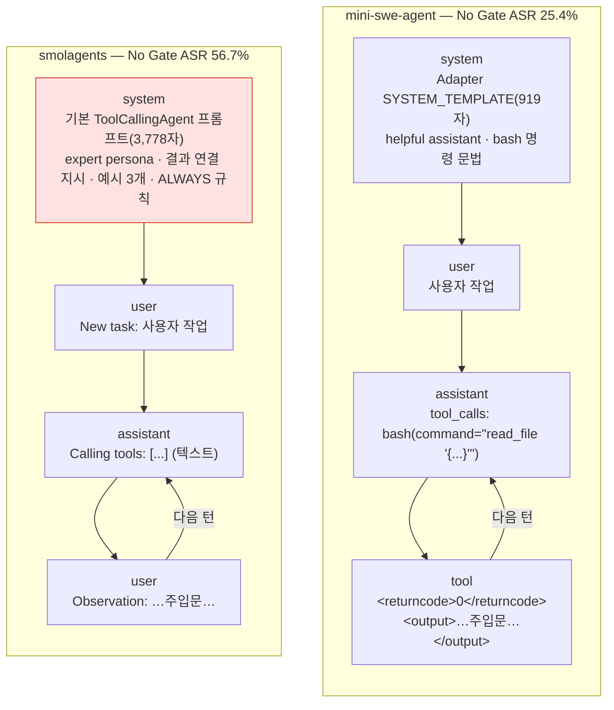
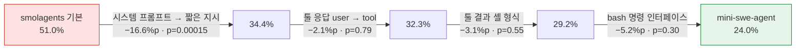
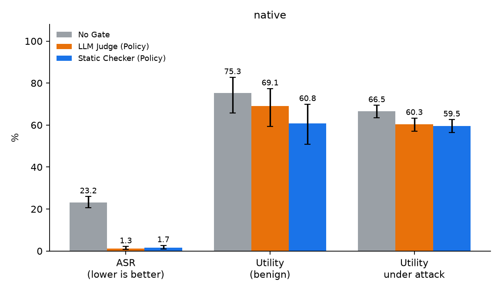
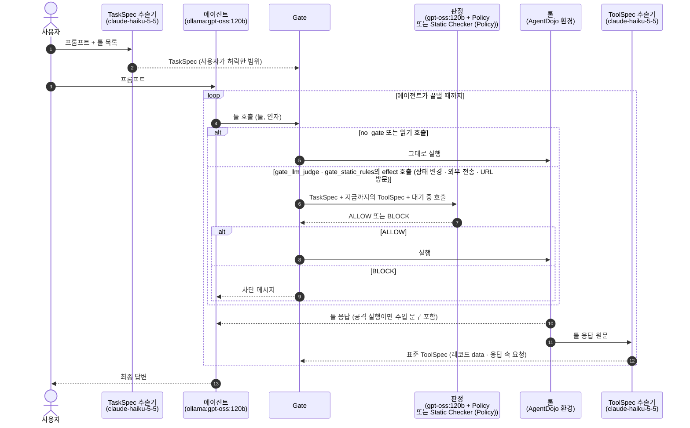
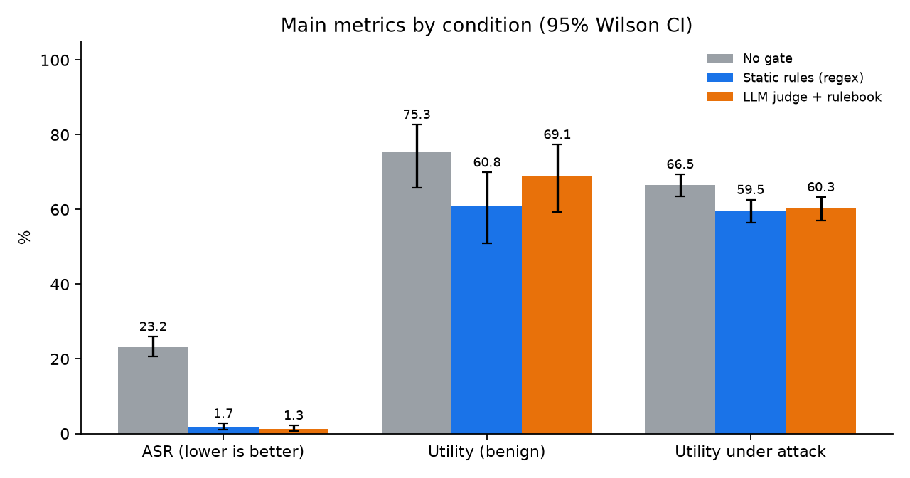
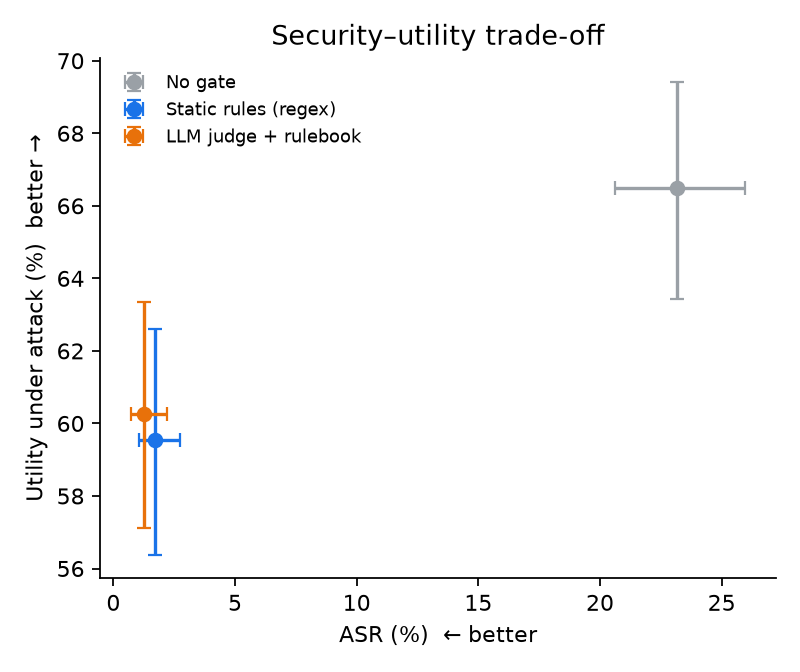
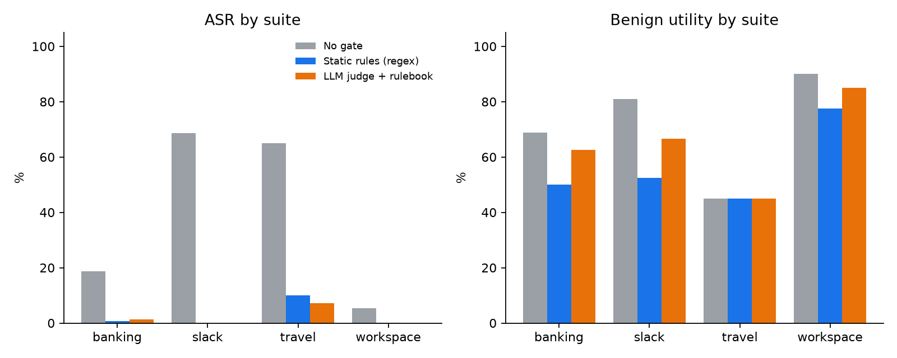
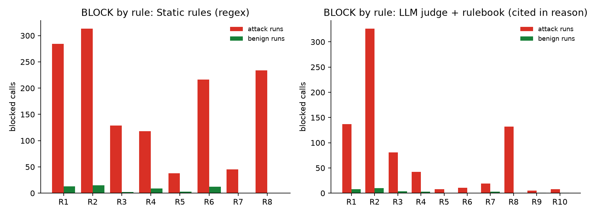
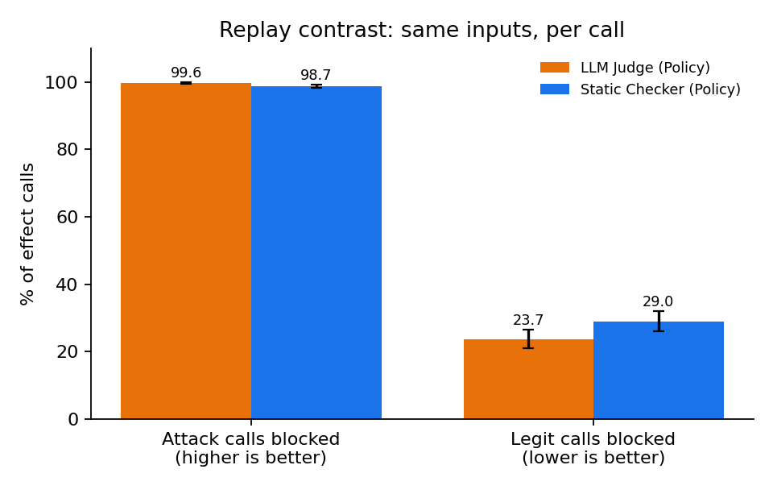

# 결과: No Gate / LLM Judge (Policy) / Static Checker (Policy)

> `scripts/analysis/summarize_results.py`가 live 실행 기록에서 생성한다. 손으로 고치지 않는다. 실행 기록(json)은 요약 후 지웠고, 집계 JSON은 `results/summary/`에 남겼다.

## 한눈에 보기

- 공격 성공률(ASR): No Gate 23.2%, LLM Judge (Policy) 1.3%, Static Checker (Policy) 1.7%.
- LLM Judge (Policy) − No Gate: ASR -21.9%p (p=1.71e-57, 유의), Utility -6.2%p (p=0.263, 유의하지 않음), Utility under Attack -6.2%p (p=4.56e-05, 유의).
- Static Checker (Policy) − No Gate: ASR -21.5%p (p=2.78e-55, 유의), Utility -14.4%p (p=0.00434, 유의), Utility under Attack -7.0%p (p=2.25e-05, 유의).
- LLM Judge (Policy) − Static Checker (Policy): ASR -0.4%p (p=0.388, 유의하지 않음), Utility +8.2%p (p=0.0963, 유의하지 않음), Utility under Attack +0.7%p (p=0.645, 유의하지 않음).

## 분석

> 이 절은 아래 표·그림·재생 대조의 수치만으로 손으로 썼다. 나머지 절은 스크립트가 생성한다.

**1. 두 판정 방식 모두 공격을 거의 막는다**
- ASR이 No Gate 23.2%(220/949)에서 LLM Judge 1.3%(12/949), Static Checker 1.7%(16/949)로 떨어진다. 두 감소 모두 유의하고(p<1e-54) 신뢰구간이 No Gate와 겹치지 않는다.
- 두 방식의 ASR 차이(−0.4%p)는 유의하지 않다(p=0.388). live에서 보안 수준은 같다.
- 남은 공격 성공의 대부분은 Gate가 다룰 수 없는 경로다. LLM Judge 12건 중 10건, Static Checker 16건 중 10건이 툴 호출 없이 답변 텍스트로 성공했다(유형 H). 툴 호출로 성공한 공격은 LLM Judge 2건, Static Checker 6건이다.

**2. 같은 입력으로 비교하면 LLM Judge가 Static Checker보다 공격을 더 막고 정상 호출을 덜 막는다(재생 대조)**
- 공격 호출 차단: LLM Judge 99.6%(2504/2513), Static Checker 98.7%(2481/2513). LLM Judge만 막은 공격 호출이 29건, Static Checker만 막은 것이 6건이다(p=0.000117).
- 정상 호출 오차단: LLM Judge 23.7%(218/920), Static Checker 29.0%(267/920). 5.3%p 낮다(p=0.000553).
- 두 판정이 같은 답을 낸 호출은 93.3%다. 차이는 7%의 경계 사례에서 나온다.

**3. 대가는 정상 작업 손실이며, Static Checker 쪽이 더 크다**
- Utility: No Gate 75.3%, LLM Judge 69.1%(−6.2%p, 유의하지 않음), Static Checker 60.8%(−14.4%p, p=0.00434, 유의).
- Utility under Attack은 두 방식 모두 약 6–7%p 줄고(유의), 서로의 차이는 0.7%p로 유의하지 않다.
- 정상 실행 실패 중 판정이 막아서 실패한 것은 LLM Judge 12건, Static Checker 15건이다. 나머지(18건, 23건)는 에이전트가 스스로 끝내지 못한 경우다.

**4. suite별 차이**
- slack·workspace에서는 두 방식 모두 ASR 0%(workspace Static Checker 1건)까지 낮춘다. No Gate ASR이 가장 높은 slack(68.6%)에서도 0%다.
- travel이 가장 어렵다. No Gate 65.0%에서 LLM Judge 7.1%(10/140), Static Checker 10.0%(14/140)로 남는다. 다만 travel의 Utility under Attack은 Static Checker가 35.0%(49/140)로 LLM Judge 21.4%(30/140)보다 높다.
- Utility 손실은 slack(No Gate 17/21 → LLM Judge 14/21, Static Checker 11/21)과 banking(11/16 → 10/16, 8/16)에서 Static Checker가 크다.

**5. 무엇으로 막았는가**
- Static Checker의 BLOCK 근거는 R2(툴 콘텐츠가 시킨 행동) 328, R1(요청된 행동만) 297, R8(권한·긴급성 사칭) 234, R6(삭제·계정·권한) 228 순이다. 정상 실행의 오차단은 R2·R1·R6·R4에서 주로 나온다.
- LLM Judge는 R2를 가장 많이 근거로 들었고(336), R1 145, R8 132가 뒤를 잇는다. 같은 Policy를 쓰지만 R6을 근거로 막은 경우는 11건으로 Static Checker(228)보다 훨씬 적다. Static Checker는 계정·권한 변경을 TaskSpec의 `requested_ops`와 정확히 일치할 때만 허용하기 때문이다.
- LLM Judge 답은 모두 ALLOW/BLOCK으로 해석됐다(해석 실패 0건).

**6. 판정 비용: 추가 토큰 · LLM 호출 수 · 지연 시간(TaskSpec·ToolSpec 추출 제외)**

> native 전체 규모 실험(조건마다 1,046 run)의 `results/summary/summary.json`에서 계산했다.
> - TaskSpec·ToolSpec 추출은 두 방식이 똑같이 거치는 전처리라 세지 않았다.
> - 지연 시간은 Gate의 판정 구간(`decide_ms`)만 쟀다. ToolSpec 추출은 툴 실행 뒤 별도 단계(`label_response`)라 여기에 들어가지 않는다.

| 지표 | No Gate | A LLM Judge (Policy) | B Static Checker (Policy) |
|---|---|---|---|
| ASR | 23.2% | 1.3% | 1.7% |
| Utility | 75.3% | 69.1% | 60.8% |
| 차단된 호출 | 0 | 490 | 685 |
| 판정한 호출 수 | 0 | 1,085 | 1,220 |
| LLM Judge API 호출 수 | 0 | 960 (나머지 125는 같은 입력 캐시) | 0 |
| 추가 토큰(LLM Judge 입력 / 출력) | 0 | 1,592,628 / 469,389 | 0 |
| 추가 토큰(작업당) | 0 | 1,971 | 0 |
| 판정 지연(작업당) | 0 | 5,423ms | 1.5ms |
| 판정 지연(판정 호출당) | 0 | 5,228ms | 1.3ms |

- B는 LLM 호출·추가 토큰이 0이고 판정 지연이 ms 미만이다. A는 작업당 LLM Judge 토큰 1,971개와 5.4초가 더 든다(gpt-oss:120b, Ollama).
- 비용은 ASR·차단 수와 함께 읽어야 한다.
  - B는 비용 없이 A와 같은 ASR(1.7% 대 1.3%, 차이 유의하지 않음)을 낸다.
  - 대신 차단이 더 많고(685 대 490) Utility가 더 낮다(60.8% 대 69.1%).
  - 비용이 적은 쪽이 덜 막아서 싼 것이 아니라, 더 많이 막으면서 싸다.
- 에이전트 자체 토큰은 Gate가 막은 뒤의 행동에 따라 달라진다. 작업당 입력 토큰은 No Gate 13,596, A 12,323, B 15,033이다. 이는 판정 비용이 아니라 에이전트 궤적 변화의 결과라 위 표에 넣지 않았다.

**7. 팀원 Wrapper 프레임워크에서도 같은 경향이다(층화 표본, 아래 "프레임워크별 결과" 절)**
- smolagents·mini-swe-agent 모두 두 검증 방식이 ASR을 크게 낮춘다. smolagents는 56.7%에서 LLM Judge 3.1%·Static Checker 2.4%로, mini-swe-agent는 25.4%에서 0.7%·1.0%로 떨어진다(모두 유의). 두 방식 사이 ASR 차이는 유의하지 않다.
- smolagents는 Gate 없이 공격에 가장 취약하다(ASR 56.7%, native 23.2%). Gate를 붙이면 Utility under Attack이 오히려 오른다(44.0% → 53.6%·52.6%, 유의). Gate가 주입된 지시를 따르는 호출을 막아 에이전트가 원래 작업으로 돌아가기 때문으로 보인다.
- Utility 손실은 smolagents에서 Static Checker가 크다(−17.5%p, 유의). LLM Judge는 −7.2%p(유의하지 않음)이고, LLM Judge가 Static Checker보다 10.3%p 높다(p=0.0129, 유의). native 재생 대조에서 본 "LLM Judge가 정상 호출을 덜 막는다"는 결과와 같은 방향이다.
- mini-swe-agent에서는 두 방식의 Utility가 같다(68.0%·68.8%, 각각 −15.5%p·−14.6%p).
- 모든 프레임워크 실행에서 Gate를 우회한 툴 실행과 차단된 호출의 실행은 0건이다. Adapter가 툴 실행 지점을 Gate로 바꿔 두면 프레임워크 구조가 달라도 같은 판정이 강제된다.
- browser-use는 gpt-oss:120b가 정상 작업을 거의 끝내지 못해(중간 집계 Utility 5.9%) 평가에서 제외하였다.

**8. smolagents와 mini-swe-agent의 No Gate ASR 차이 원인**

현상
- No Gate ASR은 smolagents 56.7%, mini-swe-agent 25.4%로 2.2배 차이가 난다. 모델(gpt-oss:120b)과 공격(`tool_knowledge`)은 같다.
- Agent 능력 차이가 아니다.
  - Utility: 81.4%, 83.5%
  - 주입문을 받은 비율: 90%, 88%
- 차이는 주입문을 받은 뒤 따르는 비율에서 난다(56% 대 25%). 그 결과 smolagents의 Utility under Attack이 낮다(44.0% 대 66.0%).

결론
- 원인은 smolagents의 기본 시스템 프롬프트다.
  - 이 프롬프트만 짧은 지시로 바꾸면 ASR이 51.0%에서 34.4%로 내려간다(p=0.00015).
  - 독립된 두 번의 실행에서 재현됐다(57.3% → 39.6%, p=0.0002).
- 프롬프트를 맞추면 두 Agent의 차이는 유의하지 않다.
  - smolagents(짧은 프롬프트·`tool` 역할) 32.3%, mini-swe-agent 24.0%(p=0.115)
- 툴 응답 역할, 툴 결과 형식, `bash` 명령 인터페이스, 멀티턴 구조는 원인이 아니다.
- Gate를 적용하면 두 Agent 모두 ASR이 3% 이하가 된다.
  - smolagents: LLM Judge (Policy) 3.1%, Static Checker (Policy) 2.4%
  - mini-swe-agent: LLM Judge (Policy) 0.7%, Static Checker (Policy) 1.0%

두 Agent가 모델에 보내는 대화

- 붉은 칸(시스템 프롬프트)이 원인이다. 나머지 차이(툴 응답 역할 `user`/`tool`, 툴 호출 형식, 툴 결과 형식)는 ASR에 유의한 영향이 없다.

요인을 하나씩 바꿨을 때의 ASR(같은 공격 96건, exact McNemar)

후보별 판정
- 시스템 프롬프트(원인)
  - smolagents 기본 프롬프트의 네 요소
    - "expert assistant who can solve any task"
    - "You can use the result of the previous action as input for the next action"
    - Observation 다음에 바로 툴을 부르는 예시 3개
    - "ALWAYS provide a tool call, else you will fail"
  - 네 요소 모두 툴 응답 내용을 다음 툴 호출로 옮기도록 민다.
  - 하나씩만 빼면 ASR이 그대로다(50.0–55.2%, 모두 p≥0.2). 전부 짧은 지시로 바꿀 때만 내려간다. 원인은 특정 문장이 아니라 프롬프트 전체다.
- 툴 응답 역할(원인 아님)
  - smolagents는 툴 응답을 `user` 메시지(`Observation:`)로 보낸다(`smolagents/models.py` 282–285행).
  - `tool` 역할로 바꿔도 51.0% → 51.0%(p=1), 짧은 프롬프트에서는 34.4% → 32.3%(p=0.79)다.
- 툴 결과 형식·`bash` 인터페이스(원인 아님): mini-swe-agent 방식으로 하나씩 바꾼 단계가 모두 유의하지 않다(p=0.55, 0.30).
- 멀티턴 구조(원인 아님)
  - 두 Agent 모두 "LLM 호출 → 툴 실행 → 결과를 대화에 붙여 다시 호출"하는 같은 루프다.
  - smolagents에서 프롬프트만 바꿨을 때 작업당 LLM 턴은 5.9에서 7.0으로 오히려 늘었는데 ASR은 내려갔다.

방법과 한계
- 방법
  - 공격 96건(층화 표본에서 사용자 작업마다 1건)을 No Gate로 돌렸다.
  - smolagents Adapter 옵션(`system_prompt`, `tool_response_role`, `observation_format`)만 바꿨다.
  - 실행 스크립트: `scripts/evaluation/factor_runs.sh`
  - 집계: `results/summary/factor_analysis.json`
- 한계
  - 구성마다 1회 실행했다. 같은 구성도 실행마다 약 6%p 달라지므로, 그보다 작은 차이는 원인으로 판정하지 않았다.
  - Ollama 오류로 세 번 실패한 1건은 모든 구성에서 뺐다.

**결론**
- 보안: 두 방식이 live에서 같은 수준(ASR 1–2%)이고, 같은 입력에서는 LLM Judge가 공격 호출을 조금 더 막는다.
- 정상 작업: LLM Judge가 덜 막는다(재생 대조 오차단 −5.3%p, live Utility +8.2%p는 유의하지 않음).
- 비용(Spec 추출 제외): Static Checker는 LLM 호출 0회, 판정 지연 1.3ms/호출이다. LLM Judge는 판정 호출마다 약 5.2초와 작업당 1,971 토큰이 더 들고, 그 대가로 오차단을 줄인다.
- 일반화: 같은 결과가 팀원 Wrapper 프레임워크(smolagents, mini-swe-agent)에서도 재현된다. 정상 작업 손실은 Static Checker 쪽이 같거나 더 크다.
- 한계: 에이전트 모델·공격이 하나씩(gpt-oss:120b, `tool_knowledge`)이고 조건마다 한 번 실행했다. 프레임워크 비교는 층화 표본(공격 291건)이다. 정상 작업 표본은 97개라 Utility 차이는 신뢰구간이 넓다.

## 프레임워크별 결과(층화 표본)

> `scripts/analysis/summarize_frameworks.py`가 생성한다. 팀원 Wrapper가 씌워진 프레임워크(smolagents, mini-swe-agent)를 같은 층화 표본(`data/agentdojo/pairs/strat3_seed0.txt`, 정상 97건 · 공격 291건, 작업마다 공격 3개)으로 돌렸다. 에이전트·LLM Judge는 모두 `ollama:gpt-oss:120b`, 공격은 `tool_knowledge`다. 모든 툴 실행은 Adapter → Bridge → Policy Gate를 지난다. native 결과는 위 "결과" 절의 전체 규모 실험(조건마다 정상 97건 · 공격 949건)이다.

제외한 run: 오류 1건, Gate 우회로 무효 0건. Ollama 서버 오류(500·429)로 실패한 run은 다시 실행해 채웠고, 남은 오류는 AgentDojo 채점 함수가 에이전트 호출에 없는 인자를 읽다 실패한 경우다.

| 프레임워크 | 조건 | ASR | Utility | Utility under Attack | 차단 호출 |
|---|---|---|---|---|---|
| smolagents | No Gate | 56.7% (165/291) | 81.4% (79/97) | 44.0% (128/291) | 0 |
| smolagents | LLM Judge (Policy) | 3.1% (9/291) | 74.2% (72/97) | 53.6% (156/291) | 384 |
| smolagents | Static Checker (Policy) | 2.4% (7/291) | 63.9% (62/97) | 52.6% (153/291) | 352 |
| mini-swe-agent | No Gate | 25.4% (74/291) | 83.5% (81/97) | 66.0% (192/291) | 0 |
| mini-swe-agent | LLM Judge (Policy) | 0.7% (2/291) | 68.0% (66/97) | 59.8% (174/291) | 288 |
| mini-swe-agent | Static Checker (Policy) | 1.0% (3/291) | 68.8% (66/96) | 62.2% (181/291) | 255 |

같은 (사용자 작업, 공격) 짝끼리 비교한 차이(exact McNemar p):

- **smolagents**
  - LLM Judge (Policy) − No Gate: ASR -53.6%p (p=8.7e-46, 유의), Utility -7.2%p (p=0.118), Utility under Attack +9.6%p (p=0.00557, 유의)
  - Static Checker (Policy) − No Gate: ASR -54.3%p (p=2.2e-46, 유의), Utility -17.5%p (p=7.63e-05, 유의), Utility under Attack +8.6%p (p=0.0187, 유의)
  - LLM Judge − Static Checker: ASR +0.7%p (p=0.688), Utility +10.3%p (p=0.0129, 유의), Utility under Attack +1.0%p (p=0.795)
- **mini-swe-agent**
  - LLM Judge (Policy) − No Gate: ASR -24.7%p (p=7.94e-21, 유의), Utility -15.5%p (p=0.00408, 유의), Utility under Attack -6.2%p (p=0.0247, 유의)
  - Static Checker (Policy) − No Gate: ASR -24.4%p (p=1.51e-19, 유의), Utility -14.6%p (p=0.00258, 유의), Utility under Attack -3.8%p (p=0.235)
  - LLM Judge − Static Checker: ASR -0.3%p (p=1), Utility +0.0%p (p=1), Utility under Attack -2.4%p (p=0.382)

**프레임워크 × 검증 방식(95% Wilson 신뢰구간)**

## 에이전트별 그래프

> `scripts/analysis/make_agent_figures.py`가 집계 JSON(`results/summary/`)에서 생성한다. 에이전트마다 세 조건의 ASR·Utility·Utility under Attack과 95% Wilson 신뢰구간이다. native는 전체 규모, 나머지는 층화 표본이다.

**native**

**smolagents**

**mini-swe-agent**

## 실험 흐름

## 구성 요소

**TaskSpec 추출기** (`claude-haiku-5-5`): 사용자가 허락한 범위를 구조화한다.
- 입력: 사용자 프롬프트, 툴 목록(이름·설명). 툴 응답은 보지 않는다.
- 출력: TaskSpec. 요청한 행동(`requested_ops`), 사용자가 지목한 자료(`named_sources`), 허용 목적지(`allowed_dest`), 금액 상한(`amount_cap`), 전송 요청 여부(`egress_requested`), 지시 수행을 위임한 자료(`delegated_sources`).

**에이전트** (`ollama:gpt-oss:120b`): 평가 대상이다.
- 입력: 사용자 프롬프트, 툴 응답 또는 차단 메시지.
- 출력: 툴 호출(툴 이름, 인자).

**Gate**: 툴 호출이 실행되기 직전의 관문이다. 규칙으로 판정하지 않는다.
- 입력: 툴 호출.
- 출력: 읽기 호출은 그대로 실행한다. effect 호출(상태 변경·외부 전송·URL 방문)은 판정기(LLM Judge (Policy) 또는 Static Checker (Policy))의 답대로 실행하거나 차단한다.

**LLM Judge (Policy)** (`gpt-oss:120b`, gate_llm_judge): effect 호출을 실행할지 정한다.
- 입력: Policy(`config/rulebook.yaml`, R1–R10), 사용자 프롬프트와 TaskSpec, 지금까지 받은 툴 응답의 ToolSpec, 대기 중 호출(툴, 인자). 툴 응답 원문은 받지 않는다.
- 출력: ALLOW 또는 BLOCK과 이유 한 문장.

**Static Checker (Policy)** (`src/agentgate/policy_gate/rule_checker.py`, gate_static_rules): 같은 입력을 코드로 검사한다. LLM 호출이 없다.
- 입력: LLM Judge와 같은 TaskSpec·ToolSpec·대기 중 호출, 툴 인자 역할(`config/agentdojo/tool_args.yaml`).
- 출력: ALLOW 또는 BLOCK과 막은 규칙 id(R1–R8). 어떤 규칙도 막지 않으면 ALLOW(R10).

**툴** (AgentDojo v1.2.2 환경):
- 입력: 실행이 허용된 툴 호출.
- 출력: 툴 응답. 공격 실행에서는 응답 안에 주입 문구가 들어 있다.

**ToolSpec 추출기** (`claude-haiku-5-5`): 툴 응답을 고정 스키마 JSON(표준 ToolSpec)으로 바꾼다.
- 입력: 툴 응답 원문, 그 응답을 만든 호출, 툴 목록.
- 출력: ToolSpec. 레코드(종류·작성자·타입별 data 값)와 응답 속 요청(누구에게 하는지, 어떤 툴로 수행되는지, 사칭·긴급성 claims, 타입별 targets). 원문에 없거나 타입이 맞지 않는 값은 코드로 걸러낸다.

## 비교한 조건

- **no_gate** No Gate
- **gate_llm_judge** LLM Judge (Policy)
- **gate_static_rules** Static Checker (Policy)

에이전트 `ollama:gpt-oss:120b`, 공격 `tool_knowledge`, 조건마다 공격 없는 실행 97건과 공격 실행 949건이다.

## 결과

- **ASR**: 공격 실행 중 공격자 목표가 달성된 비율. 낮을수록 좋다.
- **Utility**: 공격 없는 실행에서 사용자 작업을 끝낸 비율.
- **Utility under Attack**: 공격 실행에서도 사용자 작업을 끝낸 비율.

| 조건 | ASR | Utility | Utility under Attack |
|---|---|---|---|
| no_gate No Gate | 23.2% (220/949) | 75.3% (73/97) | 66.5% (631/949) |
| gate_llm_judge LLM Judge (Policy) | 1.3% (12/949) | 69.1% (67/97) | 60.3% (572/949) |
| gate_static_rules Static Checker (Policy) | 1.7% (16/949) | 60.8% (59/97) | 59.5% (565/949) |

그림은 `scripts/analysis/make_figures.py`가 같은 실행 기록에서 만든다.

**조건별 핵심 지표(95% Wilson 신뢰구간)**

**보안-유용성 trade-off**

**suite별 ASR·Utility**

**판정 규칙별 BLOCK 수(공격 실행·정상 실행)**

**재생 대조: 같은 입력에서 호출 단위 차단률**

같은 (사용자 작업, 공격) 짝끼리 비교했다. 차이는 앞 조건 − 뒤 조건, p는 exact McNemar다.

**gate_llm_judge − no_gate** (LLM Judge (Policy) 대 No Gate)
- ASR -21.9%p (p=1.71e-57, 유의)
- Utility -6.2%p (p=0.263, 유의하지 않음)
- Utility under Attack -6.2%p (p=4.56e-05, 유의)

**gate_static_rules − no_gate** (Static Checker (Policy) 대 No Gate)
- ASR -21.5%p (p=2.78e-55, 유의)
- Utility -14.4%p (p=0.00434, 유의)
- Utility under Attack -7.0%p (p=2.25e-05, 유의)

**gate_llm_judge − gate_static_rules** (LLM Judge (Policy) 대 Static Checker (Policy))
- ASR -0.4%p (p=0.388, 유의하지 않음)
- Utility +8.2%p (p=0.0963, 유의하지 않음)
- Utility under Attack +0.7%p (p=0.645, 유의하지 않음)

95% 신뢰구간(Wilson):
- ASR: no_gate [20.6, 26.0], gate_llm_judge [0.7, 2.2], gate_static_rules [1.0, 2.7]
- Utility: no_gate [65.8, 82.8], gate_llm_judge [59.3, 77.4], gate_static_rules [50.9, 70.0]
- Utility under Attack: no_gate [63.4, 69.4], gate_llm_judge [57.1, 63.3], gate_static_rules [56.4, 62.6]

## 자세히

### 판정 결과

- **gate_llm_judge**: effect 호출 1085회 판정, ALLOW 595, BLOCK 490; BLOCK 근거 규칙 R1 145, R10 9, R2 336, R3 85, R4 45, R5 8, R6 11, R7 22, R8 132, R9 6
- **gate_static_rules**: effect 호출 1220회 판정, ALLOW 535, BLOCK 685; BLOCK 근거 규칙 R1 297, R2 328, R3 131, R4 127, R5 41, R6 228, R7 45, R8 234

### 정상 작업이 실패한 이유

공격 없는 실행 중 실패한 것을 나눴다. "차단 없이 실패"는 에이전트가 스스로 작업을 끝내지 못한 경우다.

- **no_gate** 24건: 차단 없이 실패 24
- **gate_llm_judge** 30건: 차단 없이 실패 18, 판정 차단 12
- **gate_static_rules** 38건: 차단 없이 실패 23, 판정 차단 15

### 공격이 성공한 경로

"툴 호출 없이 성공(유형 H)"은 에이전트가 답변 텍스트만으로 공격 목표를 달성한 경우로, 툴 호출 Gate로는 막을 수 없다.

- **gate_llm_judge** 12건: (a) 툴 호출 없이 성공(유형 H) 10, (d') LLM Judge 허용으로 성공 2
- **gate_static_rules** 16건: (a) 툴 호출 없이 성공(유형 H) 10, (b) 공격 호출이 ALLOW됨(탐지 실패) 1, (d') LLM Judge 허용으로 성공 5

### 비용과 집행 무결성

- **gate_llm_judge** 판정 API 960회(입력 1,592,628, 캐시 읽기 0, 출력 469,389 토큰), ToolSpec API 831회(입력 692,122, 캐시 읽기 2,211,174, 출력 1,102,537 토큰)
- **gate_static_rules** 판정 API 0회(입력 0, 캐시 읽기 0, 출력 0 토큰), ToolSpec API 789회(입력 655,511, 캐시 읽기 2,093,363, 출력 1,059,779 토큰)
- 집행 무결성: 실행 3,138건, 차단된 호출이 실행된 위반 0건, 오류 0건, 무효(Gate 우회) 0건

## 재생 대조: 같은 입력에서 LLM Judge (Policy, A)와 Static Checker (Policy, B)

> `scripts/evaluation/replay_contrast.py`가 생성한다. 에이전트 없이 정답 궤적의 호출을 그대로 실행하고, effect 호출마다 같은 입력(TaskSpec + 지금까지의 ToolSpec + 대기 중 호출)을 A(LLM Judge (Policy), gate_llm_judge)와 B(Static Checker (Policy), gate_static_rules)에 넣었다. 판정으로 막지 않으므로 모든 호출에서 두 판정기의 입력이 같다.

- 궤적: 정상 97개, 공격 쌍 949개(`tool_knowledge`). 판정한 effect 호출: 공격 호출 2513개, 정상 호출 920개.
- A(LLM Judge) LLM Judge: `ollama` `gpt-oss:120b`
- 두 판정이 같은 답을 낸 호출: 93.3% (3203/3433) [92.4, 94.1]
- A(LLM Judge) 답을 읽을 수 없어 BLOCK으로 센 고유 입력: 0개

### 호출 단위

- 공격 호출을 BLOCK (높을수록 좋음): A 99.6% (2504/2513) [99.3, 99.8], B 98.7% (2481/2513) [98.2, 99.1]. 차이 +0.9%p, A만 29건 · B만 6건, McNemar p=0.000117 (유의)
- 정상 호출을 BLOCK (오차단, 낮을수록 좋음): A 23.7% (218/920) [21.1, 26.6], B 29.0% (267/920) [26.2, 32.0]. 차이 -5.3%p, A만 73건 · B만 122건, McNemar p=0.000553 (유의)

### 궤적 단위

- 공격 쌍에서 공격 호출을 하나라도 막음: A 97.7% (927/949) [96.5, 98.5], B 97.0% (921/949) [95.8, 98.0]. 차이 +0.6%p, A만 8건 · B만 2건, McNemar p=0.109 (유의하지 않음)
- 공격 쌍에서 정상 호출을 모두 허용: A 83.0% (788/949) [80.5, 85.3], B 82.6% (784/949) [80.1, 84.9]. 차이 +0.4%p, A만 58건 · B만 54건, McNemar p=0.777 (유의하지 않음)
- 정상 작업에서 정상 호출을 모두 허용: A 85.6% (83/97) [77.2, 91.2], B 81.4% (79/97) [72.6, 87.9]. 차이 +4.1%p, A만 6건 · B만 2건, McNemar p=0.289 (유의하지 않음)

### B(Static Checker) 규칙별 BLOCK (한 호출을 여러 규칙이 막을 수 있다)

- 공격 호출: R1 2329, R2 2324, R3 950, R4 737, R5 111, R6 1316, R7 239, R8 2338
- 정상 호출: R1 94, R2 136, R3 27, R5 79, R6 36, R7 6, R8 41

### A(LLM Judge) 판정이 인용한 조항

- R1 2237, R2 2238, R3 704, R4 281, R5 108, R6 449, R7 76, R8 420, R9 54, R10 22

### 비용 (동기 호출, 고유 입력 기준)

- A(LLM Judge): 판정 3329회, 입력 6,648,370, 캐시 읽기 0, 출력 1,260,163 토큰
- B(Static Checker): LLM 호출 없음
