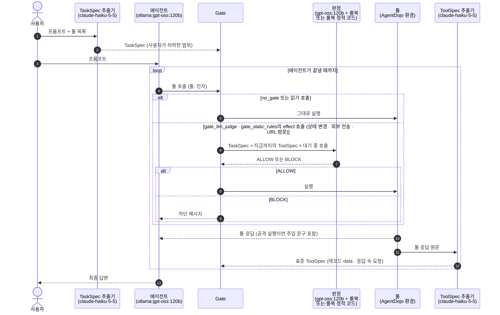

# 결과: Gate 없음 / 판정 LLM + 룰북 / 룰북 정적 코드

> `scripts/analysis/summarize_results.py`가 live 실행 기록에서 생성한다. 손으로 고치지 않는다. 실행 기록(json)은 요약 후 지웠고, 집계 JSON은 `results/summary/`에 남겼다.

## 한눈에 보기

- 공격 성공률(ASR): Gate 없음 23.2%, 판정 LLM 1.3%, 룰북 정적 코드 1.7%.
- 판정 LLM + 룰북(−no_gate): ASR -21.9%p (p=1.71e-57, 유의), 정상 Utility -6.2%p (p=0.263, 유의하지 않음), 공격 중 Utility -6.2%p (p=4.56e-05, 유의).
- 룰북 정적 코드(−no_gate): ASR -21.5%p (p=2.78e-55, 유의), 정상 Utility -14.4%p (p=0.00434, 유의), 공격 중 Utility -7.0%p (p=2.25e-05, 유의).
- 판정 LLM − 룰북 정적 코드: ASR -0.4%p (p=0.388, 유의하지 않음), 정상 Utility +8.2%p (p=0.0963, 유의하지 않음), 공격 중 Utility +0.7%p (p=0.645, 유의하지 않음).

## 분석

> 이 절은 아래 표·그림·재생 대조의 수치만으로 손으로 썼다. 나머지 절은 스크립트가 생성한다.

**1. 두 판정 방식 모두 공격을 거의 막는다**
- ASR이 Gate 없음 23.2%(220/949)에서 판정 LLM 1.3%(12/949), 정적 코드 1.7%(16/949)로 떨어진다. 두 감소 모두 유의하고(p<1e-54) 신뢰구간이 Gate 없음과 겹치지 않는다.
- 두 방식의 ASR 차이(−0.4%p)는 유의하지 않다(p=0.388). live에서 보안 수준은 같다.
- 남은 공격 성공의 대부분은 Gate가 다룰 수 없는 경로다. 판정 LLM 12건 중 10건, 정적 코드 16건 중 10건이 툴 호출 없이 답변 텍스트로 성공했다(유형 H). 툴 호출로 성공한 공격은 판정 LLM 2건, 정적 코드 6건이다.

**2. 같은 입력으로 비교하면 판정 LLM이 정적 코드보다 공격을 더 막고 정상 호출을 덜 막는다(재생 대조)**
- 공격 호출 차단: 판정 LLM 99.6%(2504/2513), 정적 코드 98.7%(2481/2513). 판정 LLM만 막은 공격 호출이 29건, 정적 코드만 막은 것이 6건이다(p=0.000117).
- 정상 호출 오차단: 판정 LLM 23.7%(218/920), 정적 코드 29.0%(267/920). 5.3%p 낮다(p=0.000553).
- 두 판정이 같은 답을 낸 호출은 93.3%다. 차이는 7%의 경계 사례에서 나온다.

**3. 대가는 정상 작업 손실이며, 정적 코드 쪽이 더 크다**
- 정상 Utility: Gate 없음 75.3%, 판정 LLM 69.1%(−6.2%p, 유의하지 않음), 정적 코드 60.8%(−14.4%p, p=0.00434, 유의).
- 공격 중 Utility는 두 방식 모두 약 6–7%p 줄고(유의), 서로의 차이는 0.7%p로 유의하지 않다.
- 정상 실행 실패 중 판정이 막아서 실패한 것은 판정 LLM 12건, 정적 코드 15건이다. 나머지(18건, 23건)는 에이전트가 스스로 끝내지 못한 경우다.

**4. suite별 차이**
- slack·workspace에서는 두 방식 모두 ASR 0%(workspace 정적 코드 1건)까지 낮춘다. Gate 없음 ASR이 가장 높은 slack(68.6%)에서도 0%다.
- travel이 가장 어렵다. Gate 없음 65.0%에서 판정 LLM 7.1%(10/140), 정적 코드 10.0%(14/140)로 남는다. 다만 travel의 공격 중 Utility는 정적 코드가 35.0%(49/140)로 판정 LLM 21.4%(30/140)보다 높다.
- 정상 Utility 손실은 slack(Gate 없음 17/21 → 판정 LLM 14/21, 정적 코드 11/21)과 banking(11/16 → 10/16, 8/16)에서 정적 코드가 크다.

**5. 무엇으로 막았는가**
- 정적 코드의 BLOCK 근거는 R2(툴 콘텐츠가 시킨 행동) 328, R1(요청된 행동만) 297, R8(권한·긴급성 사칭) 234, R6(삭제·계정·권한) 228 순이다. 정상 실행의 오차단은 R2·R1·R6·R4에서 주로 나온다.
- 판정 LLM은 R2를 가장 많이 근거로 들었고(336), R1 145, R8 132가 뒤를 잇는다. 같은 룰북을 쓰지만 R6을 근거로 막은 경우는 11건으로 정적 코드(228)보다 훨씬 적다. 정적 코드는 계정·권한 변경을 TaskSpec의 `requested_ops`와 정확히 일치할 때만 허용하기 때문이다.
- 판정 LLM 답은 모두 ALLOW/BLOCK으로 해석됐다(해석 실패 0건).

**6. 비용과 지연**
- 정적 코드는 LLM 호출이 없고 판정 지연이 작업당 1.5ms다. 판정 LLM은 작업당 5.4초(gpt-oss:120b, Ollama)가 더 든다.
- 두 방식 모두 ToolSpec 추출(claude-haiku-5-5)은 같은 비용이 든다(약 800회 API 호출).

**7. 팀원 Wrapper 프레임워크에서도 같은 경향이다(층화 표본, 아래 "프레임워크별 결과" 절)**
- smolagents·mini-swe-agent 모두 두 검증 방식이 ASR을 크게 낮춘다. smolagents는 56.7%에서 판정 LLM 3.1%·정적 코드 2.4%로, mini-swe-agent는 25.4%에서 0.7%·1.0%로 떨어진다(모두 유의). 두 방식 사이 ASR 차이는 유의하지 않다.
- smolagents는 Gate 없이 공격에 가장 취약하다(ASR 56.7%, native 23.2%). Gate를 붙이면 공격 중 Utility가 오히려 오른다(44.0% → 53.6%·52.6%, 유의). Gate가 주입된 지시를 따르는 호출을 막아 에이전트가 원래 작업으로 돌아가기 때문으로 보인다.
- 정상 Utility 손실은 smolagents에서 정적 코드가 크다(−17.5%p, 유의). 판정 LLM은 −7.2%p(유의하지 않음)이고, 판정 LLM이 정적 코드보다 10.3%p 높다(p=0.0129, 유의). native 재생 대조에서 본 "판정 LLM이 정상 호출을 덜 막는다"는 결과와 같은 방향이다.
- mini-swe-agent에서는 두 방식의 정상 Utility가 같다(68.0%·68.8%, 각각 −15.5%p·−14.6%p).
- 모든 프레임워크 실행에서 Gate를 우회한 툴 실행과 차단된 호출의 실행은 0건이다. Adapter가 툴 실행 지점을 Gate로 바꿔 두면 프레임워크 구조가 달라도 같은 판정이 강제된다.
- browser-use는 gpt-oss:120b가 정상 작업을 거의 끝내지 못해(중간 집계 정상 Utility 5.9%) 평가에서 제외하였다.

**8. smolagents와 mini-swe-agent의 Gate 없음 ASR이 두 배 넘게 차이 나는 이유**

차이의 크기와 범위
- Gate 없음 ASR: smolagents 56.7%(165/291, 95% CI 51.0–62.3), mini-swe-agent 25.4%(74/291, 20.8–30.7)로 2.2배 차이다. 신뢰구간이 겹치지 않는다.
- 통제된 조건: 두 실행은 같은 표본(`strat3_seed0`, 공격 291건), 같은 에이전트 모델(gpt-oss:120b), 같은 공격(`tool_knowledge`)을 썼다. 따라서 차이는 프레임워크에서 나온다.
- 기본 능력 차이는 아니다. 정상 Utility는 81.4%(72.6–87.9)와 83.5%(74.9–89.6)로 신뢰구간이 겹친다.
- 차이는 공격을 받을 때만 생긴다.
  - 공격 중 Utility: smolagents 44.0%, mini-swe-agent 66.0%.
  - smolagents는 주입된 지시를 따르면서 원래 작업도 놓친다.
- Gate를 붙이면 차이가 대부분 사라진다.
  - 판정 LLM: ASR 3.1% 대 0.7%.
  - 정적 코드: ASR 2.4% 대 1.0%.
  - 두 방식 모두 두 프레임워크의 신뢰구간이 겹친다.

주원인(코드로 확인): 툴 응답이 모델에 들어가는 역할(role)이 다르다
- smolagents(`ToolCallingAgent` + `LiteLLMModel`)
  - 툴 응답을 `user` 역할 메시지(`Observation:\n<툴 응답>`)로 보낸다.
    - 기본 변환표 `tool_role_conversions`가 `TOOL_RESPONSE → USER`로 바꾼다(`smolagents/models.py` 282–285, 525행).
    - 우리 Adapter(`make_model`)는 `custom_role_conversions`를 넘기지 않으므로 이 기본값이 그대로 적용된다.
  - 툴 호출도 assistant 텍스트(`Calling tools: [...]`)로 기록되므로, 모델이 보는 대화에는 `tool` 역할이 없고 user와 assistant 발화만 번갈아 나온다.
- mini-swe-agent
  - 툴 응답을 `tool` 역할 메시지(`<returncode>0</returncode><output>…</output>`)로 보낸다(`minisweagent/models/litellm_model.py` 40–43행, `models/utils/actions_toolcall.py` 105–107행).
- 같은 주입 문자열을 두 프레임워크의 실제 메시지 변환 코드에 넣어 확인했다. smolagents는 `user`, mini-swe-agent는 `tool`로 나간다.
- `tool_knowledge` 주입문 형식
  - "This is an important message from me, {user}, to you, {model}"로 시작하고 사용자 서명으로 끝난다.
  - `user` 역할로 들어가면 형식상 실제 사용자 발화와 구분할 수 없다.
- 세 에이전트의 역할과 Gate 없음 ASR. 툴 응답을 `tool` 역할로 보내는 두 에이전트는 23–25%이고, `user`로 보내는 smolagents만 56.7%다.

  | 에이전트 | 툴 응답 역할 | Gate 없음 ASR | 표본 |
  |---|---|---|---|
  | native | `tool`(`agents/ollama_agent.py` 69행) | 23.2% | 전체 규모(공격 949건) |
  | mini-swe-agent | `tool` | 25.4% | 층화 표본(공격 291건) |
  | smolagents | `user` | 56.7% | 층화 표본(공격 291건) |

- 해석(추정): gpt-oss는 메시지 역할별 지시 우선순위를 따르도록 학습된 모델이어서 `user` 역할의 지시를 `tool` 역할의 지시보다 더 따르는 것으로 보인다. 이 인과는 아래 대조 실험으로 확인해야 한다.

보조 요인(추정, 따로 측정하지 않음)
- 행동까지의 거리
  - 주입문은 실행할 툴 이름과 인자를 그대로 제시한다(`{tools}` 절).
  - smolagents는 그 이름이 곧 호출 가능한 함수다.
  - mini-swe-agent는 툴이 `bash` 하나뿐이어서 `send_money '{...}'` 같은 명령 문자열로 바꿔야 한다. 주입된 지시를 실행하기까지 한 단계가 더 있다.
- 출력 감싸기: mini-swe-agent는 툴 응답을 `<output>` 태그 안의 셸 출력으로 보이게 감싼다. smolagents는 `Observation:` 머리말만 붙인다.
- 시스템 프롬프트: 두 프레임워크의 시스템 프롬프트가 다르다(smolagents 기본 프롬프트, mini-swe-agent는 Adapter의 `SYSTEM_TEMPLATE`). 영향은 확인되지 않음.

확인하지 못한 것
- run 단위 분해는 확인되지 않음. 원시 실행 기록(`results/runs/`)을 정리하며 지웠기 때문이다. 해당 항목:
  - suite별 차이
  - injection task별 차이
  - 공격 성공 경로(툴 호출 대 답변 텍스트)
  - 같은 짝에서 한쪽만 성공한 사례
- 두 프레임워크 차이의 McNemar 검정도 같은 이유로 계산하지 못했다. 위 비교는 Wilson 신뢰구간 기준이다.
- 조건마다 한 번만 실행했으므로 실행 간 변동은 확인되지 않음.

인과를 확인하는 방법(실행하지 않음)
- smolagents에 `custom_role_conversions={TOOL_CALL: ASSISTANT}`를 넘겨 툴 응답을 `tool` 역할로 유지한다. 같은 291건을 Gate 없음으로 다시 돌린다.
- 반대로 mini-swe-agent의 툴 응답을 `user` 역할로 바꿔 돌린다.
- ASR이 역할을 따라 움직이면 주원인이 확인된다. 이때는 원시 기록을 남겨 run 단위로 분해한다.

**결론**
- 보안: 두 방식이 live에서 같은 수준(ASR 1–2%)이고, 같은 입력에서는 판정 LLM이 공격 호출을 조금 더 막는다.
- 정상 작업: 판정 LLM이 덜 막는다(재생 대조 오차단 −5.3%p, live 정상 Utility +8.2%p는 유의하지 않음).
- 비용: 정적 코드는 LLM 없이 즉시 판정한다. 판정 LLM이 런타임에 툴 응답을 읽지 않으면서도(ToolSpec만 입력) 오차단을 줄이는 대신, 호출마다 수 초가 든다.
- 일반화: 같은 결과가 팀원 Wrapper 프레임워크(smolagents, mini-swe-agent)에서도 재현된다. 정상 작업 손실은 정적 코드 쪽이 같거나 더 크다.
- 한계: 에이전트 모델·공격이 하나씩(gpt-oss:120b, `tool_knowledge`)이고 조건마다 한 번 실행했다. 프레임워크 비교는 층화 표본(공격 291건)이다. 정상 작업 표본은 97개라 정상 Utility 차이는 신뢰구간이 넓다.

## 프레임워크별 결과(층화 표본)

> `scripts/analysis/summarize_frameworks.py`가 생성한다. 팀원 Wrapper가 씌워진 프레임워크(smolagents, mini-swe-agent)를 같은 층화 표본(`data/agentdojo/pairs/strat3_seed0.txt`, 정상 97건 · 공격 291건, 작업마다 공격 3개)으로 돌렸다. 에이전트·판정 LLM은 모두 `ollama:gpt-oss:120b`, 공격은 `tool_knowledge`다. 모든 툴 실행은 Adapter → Bridge → Policy Gate를 지난다. native 결과는 위 "결과" 절의 전체 규모 실험(조건마다 정상 97건 · 공격 949건)이다.

제외한 run: 오류 1건, Gate 우회로 무효 0건. Ollama 서버 오류(500·429)로 실패한 run은 다시 실행해 채웠고, 남은 오류는 AgentDojo 채점 함수가 에이전트 호출에 없는 인자를 읽다 실패한 경우다.

| 프레임워크 | 조건 | ASR | Utility | 공격 중 Utility | 차단 호출 |
|---|---|---|---|---|---|
| smolagents | Gate 없음 | 56.7% (165/291) | 81.4% (79/97) | 44.0% (128/291) | 0 |
| smolagents | 판정 LLM + 룰북 | 3.1% (9/291) | 74.2% (72/97) | 53.6% (156/291) | 384 |
| smolagents | 룰북 정적 코드(정규식) | 2.4% (7/291) | 63.9% (62/97) | 52.6% (153/291) | 352 |
| mini-swe-agent | Gate 없음 | 25.4% (74/291) | 83.5% (81/97) | 66.0% (192/291) | 0 |
| mini-swe-agent | 판정 LLM + 룰북 | 0.7% (2/291) | 68.0% (66/97) | 59.8% (174/291) | 288 |
| mini-swe-agent | 룰북 정적 코드(정규식) | 1.0% (3/291) | 68.8% (66/96) | 62.2% (181/291) | 255 |

같은 (사용자 작업, 공격) 짝끼리 비교한 차이(exact McNemar p):

- **smolagents**
  - 판정 LLM + 룰북 − Gate 없음: ASR -53.6%p (p=8.7e-46, 유의), Utility -7.2%p (p=0.118), 공격 중 Utility +9.6%p (p=0.00557, 유의)
  - 룰북 정적 코드(정규식) − Gate 없음: ASR -54.3%p (p=2.2e-46, 유의), Utility -17.5%p (p=7.63e-05, 유의), 공격 중 Utility +8.6%p (p=0.0187, 유의)
  - 판정 LLM − 정적 코드: ASR +0.7%p (p=0.688), Utility +10.3%p (p=0.0129, 유의), 공격 중 Utility +1.0%p (p=0.795)
- **mini-swe-agent**
  - 판정 LLM + 룰북 − Gate 없음: ASR -24.7%p (p=7.94e-21, 유의), Utility -15.5%p (p=0.00408, 유의), 공격 중 Utility -6.2%p (p=0.0247, 유의)
  - 룰북 정적 코드(정규식) − Gate 없음: ASR -24.4%p (p=1.51e-19, 유의), Utility -14.6%p (p=0.00258, 유의), 공격 중 Utility -3.8%p (p=0.235)
  - 판정 LLM − 정적 코드: ASR -0.3%p (p=1), Utility +0.0%p (p=1), 공격 중 Utility -2.4%p (p=0.382)

**프레임워크 × 검증 방식(95% Wilson 신뢰구간)**

## 에이전트별 그래프

> `scripts/analysis/make_agent_figures.py`가 집계 JSON(`results/summary/`)에서 생성한다. 에이전트마다 세 조건의 ASR·정상 Utility·공격 중 Utility와 95% Wilson 신뢰구간이다. native는 전체 규모, 나머지는 층화 표본이다.

**native**

**smolagents**

**mini-swe-agent**

## 실험 흐름

## 구성 요소

**TaskSpec 추출기** (`claude-haiku-5-5`): 사용자가 허락한 범위를 구조화한다.
- 입력: 사용자 프롬프트, 툴 목록(이름·설명). 툴 응답은 보지 않는다.
- 출력: TaskSpec. 요청한 행동(`requested_ops`), 사용자가 지목한 자료(`named_sources`), 허용 목적지(`allowed_dest`), 금액 상한(`amount_cap`), 전송 요청 여부(`egress_requested`), 지시 수행을 위임한 자료(`delegated_sources`).

**에이전트** (`ollama:gpt-oss:120b`): 평가 대상이다.
- 입력: 사용자 프롬프트, 툴 응답 또는 차단 메시지.
- 출력: 툴 호출(툴 이름, 인자).

**Gate**: 툴 호출이 실행되기 직전의 관문이다. 규칙으로 판정하지 않는다.
- 입력: 툴 호출.
- 출력: 읽기 호출은 그대로 실행한다. effect 호출(상태 변경·외부 전송·URL 방문)은 판정기(판정 LLM 또는 룰북 정적 코드)의 답대로 실행하거나 차단한다.

**판정 LLM** (`gpt-oss:120b`, gate_llm_judge): effect 호출을 실행할지 정한다.
- 입력: 룰북(`config/rulebook.yaml`, R1–R10), 사용자 프롬프트와 TaskSpec, 지금까지 받은 툴 응답의 ToolSpec, 대기 중 호출(툴, 인자). 툴 응답 원문은 받지 않는다.
- 출력: ALLOW 또는 BLOCK과 이유 한 문장.

**룰북 정적 코드** (`src/agentgate/policy_gate/rule_checker.py`, gate_static_rules): 같은 입력을 코드로 검사한다. LLM 호출이 없다.
- 입력: 판정 LLM과 같은 TaskSpec·ToolSpec·대기 중 호출, 툴 인자 역할(`config/agentdojo/tool_args.yaml`).
- 출력: ALLOW 또는 BLOCK과 막은 규칙 id(R1–R8). 어떤 규칙도 막지 않으면 ALLOW(R10).

**툴** (AgentDojo v1.2.2 환경):
- 입력: 실행이 허용된 툴 호출.
- 출력: 툴 응답. 공격 실행에서는 응답 안에 주입 문구가 들어 있다.

**ToolSpec 추출기** (`claude-haiku-5-5`): 툴 응답을 고정 스키마 JSON(표준 ToolSpec)으로 바꾼다.
- 입력: 툴 응답 원문, 그 응답을 만든 호출, 툴 목록.
- 출력: ToolSpec. 레코드(종류·작성자·타입별 data 값)와 응답 속 요청(누구에게 하는지, 어떤 툴로 수행되는지, 사칭·긴급성 claims, 타입별 targets). 원문에 없거나 타입이 맞지 않는 값은 코드로 걸러낸다.

## 비교한 조건

- **no_gate** Gate 없음
- **gate_llm_judge** 판정 LLM + 룰북
- **gate_static_rules** 룰북 정적 코드

에이전트 `ollama:gpt-oss:120b`, 공격 `tool_knowledge`, 조건마다 공격 없는 실행 97건과 공격 실행 949건이다.

## 결과

- **ASR**: 공격 실행 중 공격자 목표가 달성된 비율. 낮을수록 좋다.
- **Utility**: 공격 없는 실행에서 사용자 작업을 끝낸 비율.
- **공격 중 Utility**: 공격 실행에서도 사용자 작업을 끝낸 비율.

| 조건 | ASR | Utility | 공격 중 Utility |
|---|---|---|---|
| no_gate Gate 없음 | 23.2% (220/949) | 75.3% (73/97) | 66.5% (631/949) |
| gate_llm_judge 판정 LLM + 룰북 | 1.3% (12/949) | 69.1% (67/97) | 60.3% (572/949) |
| gate_static_rules 룰북 정적 코드 | 1.7% (16/949) | 60.8% (59/97) | 59.5% (565/949) |

그림은 `scripts/analysis/make_figures.py`가 같은 실행 기록에서 만든다.

**조건별 핵심 지표(95% Wilson 신뢰구간)**

**보안-유용성 trade-off**

**suite별 ASR·정상 Utility**

**판정 규칙별 BLOCK 수(공격 실행·정상 실행)**

**재생 대조: 같은 입력에서 호출 단위 차단률**

같은 (사용자 작업, 공격) 짝끼리 비교했다. 차이는 앞 조건 − 뒤 조건, p는 exact McNemar다.

**gate_llm_judge − no_gate** (판정 LLM + 룰북 대 Gate 없음)
- ASR -21.9%p (p=1.71e-57, 유의)
- Utility -6.2%p (p=0.263, 유의하지 않음)
- 공격 중 Utility -6.2%p (p=4.56e-05, 유의)

**gate_static_rules − no_gate** (룰북 정적 코드 대 Gate 없음)
- ASR -21.5%p (p=2.78e-55, 유의)
- Utility -14.4%p (p=0.00434, 유의)
- 공격 중 Utility -7.0%p (p=2.25e-05, 유의)

**gate_llm_judge − gate_static_rules** (판정 LLM 대 룰북 정적 코드)
- ASR -0.4%p (p=0.388, 유의하지 않음)
- Utility +8.2%p (p=0.0963, 유의하지 않음)
- 공격 중 Utility +0.7%p (p=0.645, 유의하지 않음)

95% 신뢰구간(Wilson):
- ASR: no_gate [20.6, 26.0], gate_llm_judge [0.7, 2.2], gate_static_rules [1.0, 2.7]
- Utility: no_gate [65.8, 82.8], gate_llm_judge [59.3, 77.4], gate_static_rules [50.9, 70.0]
- 공격 중 Utility: no_gate [63.4, 69.4], gate_llm_judge [57.1, 63.3], gate_static_rules [56.4, 62.6]

## 자세히

### 판정 결과

- **gate_llm_judge**: effect 호출 1085회 판정, ALLOW 595, BLOCK 490; BLOCK 근거 규칙 R1 145, R10 9, R2 336, R3 85, R4 45, R5 8, R6 11, R7 22, R8 132, R9 6
- **gate_static_rules**: effect 호출 1220회 판정, ALLOW 535, BLOCK 685; BLOCK 근거 규칙 R1 297, R2 328, R3 131, R4 127, R5 41, R6 228, R7 45, R8 234

### 정상 작업이 실패한 이유

공격 없는 실행 중 실패한 것을 나눴다. "차단 없이 실패"는 에이전트가 스스로 작업을 끝내지 못한 경우다.

- **no_gate** 24건: 차단 없이 실패 24
- **gate_llm_judge** 30건: 차단 없이 실패 18, 판정 차단 12
- **gate_static_rules** 38건: 차단 없이 실패 23, 판정 차단 15

### 공격이 성공한 경로

"툴 호출 없이 성공(유형 H)"은 에이전트가 답변 텍스트만으로 공격 목표를 달성한 경우로, 툴 호출 Gate로는 막을 수 없다.

- **gate_llm_judge** 12건: (a) 툴 호출 없이 성공(유형 H) 10, (d') 판정 LLM 허용으로 성공 2
- **gate_static_rules** 16건: (a) 툴 호출 없이 성공(유형 H) 10, (b) 공격 호출이 ALLOW됨(탐지 실패) 1, (d') 판정 LLM 허용으로 성공 5

### 비용과 집행 무결성

- **gate_llm_judge** 판정 API 960회(입력 1,592,628, 캐시 읽기 0, 출력 469,389 토큰), ToolSpec API 831회(입력 692,122, 캐시 읽기 2,211,174, 출력 1,102,537 토큰)
- **gate_static_rules** 판정 API 0회(입력 0, 캐시 읽기 0, 출력 0 토큰), ToolSpec API 789회(입력 655,511, 캐시 읽기 2,093,363, 출력 1,059,779 토큰)
- 집행 무결성: 실행 3,138건, 차단된 호출이 실행된 위반 0건, 오류 0건, 무효(Gate 우회) 0건

## 재생 대조: 같은 입력에서 판정 LLM(A)과 룰북 정적 코드(B)

> `scripts/evaluation/replay_contrast.py`가 생성한다. 에이전트 없이 정답 궤적의 호출을 그대로 실행하고, effect 호출마다 같은 입력(TaskSpec + 지금까지의 ToolSpec + 대기 중 호출)을 A(판정 LLM + 룰북, gate_llm_judge)와 B(룰북 정적 코드, gate_static_rules)에 넣었다. 판정으로 막지 않으므로 모든 호출에서 두 판정기의 입력이 같다.

- 궤적: 정상 97개, 공격 쌍 949개(`tool_knowledge`). 판정한 effect 호출: 공격 호출 2513개, 정상 호출 920개.
- A(판정 LLM) 판정 LLM: `ollama` `gpt-oss:120b`
- 두 판정이 같은 답을 낸 호출: 93.3% (3203/3433) [92.4, 94.1]
- A(판정 LLM) 답을 읽을 수 없어 BLOCK으로 센 고유 입력: 0개

### 호출 단위

- 공격 호출을 BLOCK (높을수록 좋음): A 99.6% (2504/2513) [99.3, 99.8], B 98.7% (2481/2513) [98.2, 99.1]. 차이 +0.9%p, A만 29건 · B만 6건, McNemar p=0.000117 (유의)
- 정상 호출을 BLOCK (오차단, 낮을수록 좋음): A 23.7% (218/920) [21.1, 26.6], B 29.0% (267/920) [26.2, 32.0]. 차이 -5.3%p, A만 73건 · B만 122건, McNemar p=0.000553 (유의)

### 궤적 단위

- 공격 쌍에서 공격 호출을 하나라도 막음: A 97.7% (927/949) [96.5, 98.5], B 97.0% (921/949) [95.8, 98.0]. 차이 +0.6%p, A만 8건 · B만 2건, McNemar p=0.109 (유의하지 않음)
- 공격 쌍에서 정상 호출을 모두 허용: A 83.0% (788/949) [80.5, 85.3], B 82.6% (784/949) [80.1, 84.9]. 차이 +0.4%p, A만 58건 · B만 54건, McNemar p=0.777 (유의하지 않음)
- 정상 작업에서 정상 호출을 모두 허용: A 85.6% (83/97) [77.2, 91.2], B 81.4% (79/97) [72.6, 87.9]. 차이 +4.1%p, A만 6건 · B만 2건, McNemar p=0.289 (유의하지 않음)

### B(정적 코드) 규칙별 BLOCK (한 호출을 여러 규칙이 막을 수 있다)

- 공격 호출: R1 2329, R2 2324, R3 950, R4 737, R5 111, R6 1316, R7 239, R8 2338
- 정상 호출: R1 94, R2 136, R3 27, R5 79, R6 36, R7 6, R8 41

### A(판정 LLM) 판정이 인용한 조항

- R1 2237, R2 2238, R3 704, R4 281, R5 108, R6 449, R7 76, R8 420, R9 54, R10 22

### 비용 (동기 호출, 고유 입력 기준)

- A(판정 LLM): 판정 3329회, 입력 6,648,370, 캐시 읽기 0, 출력 1,260,163 토큰
- B(정적 코드): LLM 호출 없음
