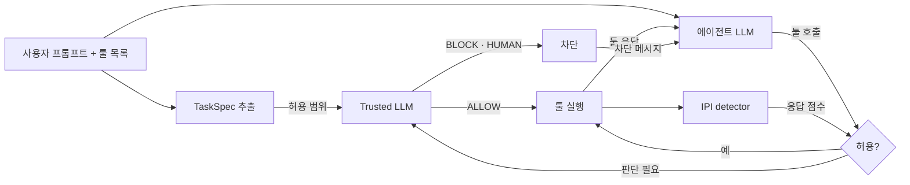

# v2 결과: IPI detector + Trusted LLM

> 수치는 `scripts/v2/summarize_v2.py`(전체 실행 3,138건)와 `scripts/v2/detector_tool_output_eval.py` 출력에서 가져왔다.

## 검사 흐름

**TaskSpec 추출** (claude-haiku-5-5, 실행 전 작업마다 1회, 배치)
- 입력: 사용자 프롬프트, 툴 이름·설명
- 출력: 요청된 동작(`requested_ops`), 사용자가 지목한 자료, 프롬프트에 적힌 목적지, 송금 상한, 데이터 전송 요청 여부

**에이전트 LLM** (gpt-oss:120b)
- 입력: 사용자 프롬프트, 이전 툴 응답
- 출력: 툴 호출 또는 최종 답

**IPI detector** (툴 응답마다)
- 입력: 실행된 툴 응답
  - horizon 모델: 응답 원문, 2048토큰 창
  - PIGuard 모델: 레코드별 평문, 512토큰 창
- 출력: 주입 확률, 0.5 이상이면 flag

**Trusted LLM** (claude-sonnet-5-5)
- 언제: 호출 인자가 flag된 응답에서 왔거나, 목적지·금액 같은 값의 출처를 규칙으로 확정하지 못할 때
- 입력
  - 허용 범위: TaskSpec, 사용자 고정 설정(`always_human`: delete_file, update_password)
  - 대기 중 호출: 툴, 인자 값, 값마다의 출처
  - 판별 결과: 출처 응답의 점수, 의심 구간 발췌
  - 넣지 않는 것: 프롬프트 원문, 툴 응답 전문
- 출력: ALLOW / BLOCK / HUMAN (HUMAN은 BLOCK으로 처리)

## 실험

- AgentDojo v1.2.2 전체: 공격 없는 작업 97건, 공격 949건(`tool_knowledge`)
- 같은 실행에서 세 조건을 비교: 방어 없음, horizon 모델(IPI detector), PIGuard 모델(IPI detector)
- 오류 0건, 차단 판정을 받은 호출이 실행된 경우 0건

## 결과

| | 방어 없음 | horizon 모델 | PIGuard 모델 |
|---|---|---|---|
| 공격 성공률 | 24.1% | **1.4%** | 2.1% |
| 공격 없을 때 작업 성공률 | 77.3% | **69.1%** (−8.2%p, 유의하지 않음) | 59.8% (−17.5%p, 유의) |
| 공격 중 작업 성공률 | 68.2% | 53.6% | 53.8% |
| 주입 응답 탐지율 | - | **95.0%** | 81.3% |
| 정상 응답 오탐률 | - | **0.3%** | 7.8% |

## 핵심

- **공격 차단은 둘 다 충분하다.** 공격 성공을 229건에서 13건(horizon), 20건(PIGuard)으로 줄였다.
- **차이는 정상 작업에서 난다.** horizon 모델은 정상 응답을 거의 잘못 잡지 않아 작업 손실이 작다. PIGuard 모델은 오탐이 많고, 오탐한 응답을 근거로 Trusted LLM이 정상 호출을 막았다(정상 작업 BLOCK 7건, horizon은 1건).
- **판별기가 놓쳐도 다른 정책이 막는다.** PIGuard는 주입 응답 194건을 놓쳤지만 공격 성공은 20건이다. 목적지·송금·반출 정책(P1–P9)이 나머지를 막았다.
- **Trusted LLM은 대부분 BLOCK한다.** 판단 요청의 약 12%만 ALLOW했다. HUMAN 70건 중 46건은 Trusted LLM이 아니라 고정 설정(delete_file, update_password)이 낸 사람 확인이다.
- **공격 중 손실은 "주입된 자료의 정상 값"을 막아서 생긴다.** 사용자가 지목한 자료에 주입이 섞이면 그 자료의 값 전체가 의심받는다. 차단으로 실패한 공격 실행의 47%(horizon), 54%(PIGuard)가 Trusted LLM의 BLOCK·HUMAN에서 시작했다.
- **Trusted LLM은 계산된 값을 확인하지 못한다.** 프롬프트 원문을 받지 않으므로, 에이전트가 계산한 금액은 출처 없는 값으로 보여 HUMAN이 된다.
- **비용**
  - Trusted LLM 입력의 약 57%가 프롬프트 캐시 읽기다.
  - 작업당 Gate 시간은 0.69초(horizon), 0.75초(PIGuard)다.
- **판별기 입력 형식이 중요하다.** PIGuard에 YAML 원문을 넣으면 정상 응답 오탐이 31.9%까지 오른다. 그래서 평문으로 넣었다.

## 결론과 다음 실험

- v2에서는 horizon 모델이 낫다. 공격 차단은 같은 수준이고 정상 작업 손실이 작다.
- 작업 성공률은 하한값이다. HUMAN을 모두 BLOCK으로 처리했다.
- 남은 개선 여지
  - Trusted LLM에 프롬프트 원문을 줄지
  - 응답 전체가 아니라 값이 속한 구간 점수로 허용할지
  - 판별기 임계값(지금 0.5)
- 실행 기록을 지워서 suite별·공격 유형별 분석은 없다. 필요하면 같은 설정으로 다시 실행한다.
