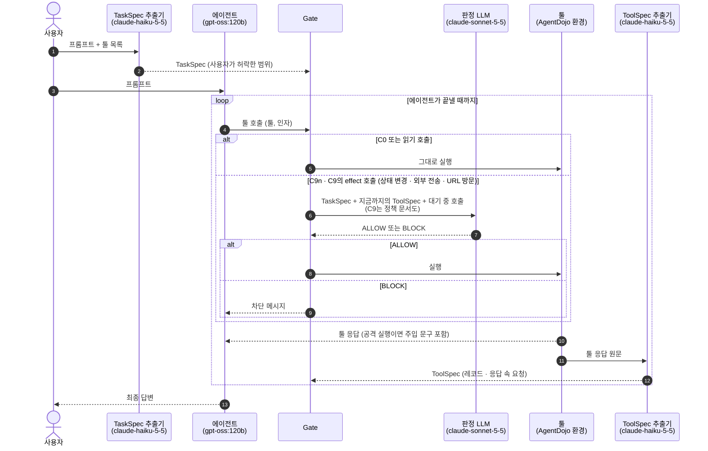

# v3 결과: Gate 없음 / Gate + 판정 LLM / Gate + 판정 LLM + 정책 문서

> `scripts/v3/summarize_v3.py`가 live 실행 기록에서 생성한다. 손으로 고치지 않는다. 실행 기록(json)은 요약 후 지웠다.

## 한눈에 보기

- 공격 성공률(ASR): Gate 없음 25.2% → Gate + 판정 LLM 2.3% → Gate + 판정 LLM + 정책 문서 1.9%.
- 판정 LLM을 넣으면(C9n − C0): ASR -22.9%p (p=3.8e-57, 유의), 정상 Utility -8.2%p (p=0.0963, 유의하지 않음), 공격 중 Utility -5.1%p (p=0.00126, 유의).
- 정책 문서를 읽히면(C9 − C9n): ASR -0.4%p (p=0.388, 유의하지 않음), 정상 Utility +7.2%p (p=0.118, 유의하지 않음), 공격 중 Utility +2.4%p (p=0.0826, 유의하지 않음).

## 실험 흐름

## 구성 요소

**TaskSpec 추출기** (`claude-haiku-5-5`): 사용자가 허락한 범위를 구조화한다.
- 입력: 사용자 프롬프트, 툴 목록(이름·설명). 툴 응답은 보지 않는다.
- 출력: TaskSpec. 요청한 행동(`requested_ops`), 사용자가 지목한 자료(`named_sources`), 허용 목적지(`allowed_dest`), 금액 상한(`amount_cap`), 전송 요청 여부(`egress_requested`), 지시 수행을 위임한 자료(`delegated_sources`).

**에이전트** (`gpt-oss:120b`): 평가 대상이다.
- 입력: 사용자 프롬프트, 툴 응답 또는 차단 메시지.
- 출력: 툴 호출(툴 이름, 인자).

**Gate**: 툴 호출이 실행되기 직전의 관문이다. 규칙으로 판정하지 않는다.
- 입력: 툴 호출.
- 출력: 읽기 호출은 그대로 실행한다. effect 호출(상태 변경·외부 전송·URL 방문)은 판정 LLM의 답대로 실행하거나 차단한다.

**판정 LLM** (`claude-sonnet-5-5`, C9n·C9): effect 호출을 실행할지 정한다.
- 입력: 사용자 프롬프트와 TaskSpec, 지금까지 받은 툴 응답의 ToolSpec, 대기 중 호출(툴, 인자). C9는 정책 문서(`config/v3/policy.yaml`, R1–R10)를 함께 받는다. 툴 응답 원문은 받지 않는다.
- 출력: ALLOW 또는 BLOCK과 이유 한 문장.

**툴** (AgentDojo v1.2.2 환경):
- 입력: 실행이 허용된 툴 호출.
- 출력: 툴 응답. 공격 실행에서는 응답 안에 주입 문구가 들어 있다.

**ToolSpec 추출기** (`claude-haiku-5-5`): 툴 응답을 판정 LLM이 읽을 JSON으로 바꾼다.
- 입력: 툴 응답 원문, 그 응답을 만든 호출, 툴 목록.
- 출력: ToolSpec. 레코드(종류·작성자)와 응답 속 요청(누구에게 하는 요청인지, 어떤 툴로 수행되는지, 어떤 값을 지목하는지). 원문에 없는 값은 코드로 걸러낸다.

## 비교한 조건

- **C0** Gate 없음
- **C9n** Gate + 판정 LLM
- **C9** Gate + 판정 LLM + 정책 문서

에이전트 `gpt-oss:120b`, 공격 `tool_knowledge`, 조건마다 공격 없는 실행 97건과 공격 실행 949건이다.

## 결과

- **ASR**: 공격 실행 중 공격자 목표가 달성된 비율. 낮을수록 좋다.
- **Utility**: 공격 없는 실행에서 사용자 작업을 끝낸 비율.
- **공격 중 Utility**: 공격 실행에서도 사용자 작업을 끝낸 비율.

| 조건 | ASR | Utility | 공격 중 Utility |
|---|---|---|---|
| C0 Gate 없음 | 25.2% (239/949) | 73.2% (71/97) | 68.1% (646/949) |
| C9n Gate + 판정 LLM | 2.3% (22/949) | 65.0% (63/97) | 63.0% (598/949) |
| C9 Gate + 판정 LLM + 정책 문서 | 1.9% (18/949) | 72.2% (70/97) | 65.4% (621/949) |

같은 (사용자 작업, 공격) 짝끼리 비교했다. 차이는 앞 조건 − 뒤 조건, p는 exact McNemar다.

**C9n − C0** (Gate + 판정 LLM 대 Gate 없음)
- ASR -22.9%p (p=3.8e-57, 유의)
- Utility -8.2%p (p=0.0963, 유의하지 않음)
- 공격 중 Utility -5.1%p (p=0.00126, 유의)

**C9 − C0** (Gate + 판정 LLM + 정책 문서 대 Gate 없음)
- ASR -23.3%p (p=2.63e-61, 유의)
- Utility -1.0%p (p=1, 유의하지 않음)
- 공격 중 Utility -2.6%p (p=0.0935, 유의하지 않음)

**C9 − C9n** (정책 문서를 읽었을 때 대 안 읽었을 때)
- ASR -0.4%p (p=0.388, 유의하지 않음)
- Utility +7.2%p (p=0.118, 유의하지 않음)
- 공격 중 Utility +2.4%p (p=0.0826, 유의하지 않음)

95% 신뢰구간(Wilson):
- ASR: C0 [22.5, 28.0], C9n [1.5, 3.5], C9 [1.2, 3.0]
- Utility: C0 [63.6, 81.0], C9n [55.0, 73.7], C9 [62.5, 80.1]
- 공격 중 Utility: C0 [65.0, 71.0], C9n [59.9, 66.0], C9 [62.4, 68.4]

## 자세히

### 판정 LLM의 판단

- **C9n**: effect 호출 1221회 판정, ALLOW 633, BLOCK 588
- **C9**: effect 호출 1217회 판정, ALLOW 669, BLOCK 548

### 정상 작업이 실패한 이유

공격 없는 실행 중 실패한 것을 나눴다. "차단 없이 실패"는 에이전트가 스스로 작업을 끝내지 못한 경우다.

- **C0** 26건: 차단 없이 실패 26
- **C9n** 34건: 차단 없이 실패 23, 판정 LLM 차단 11
- **C9** 27건: 차단 없이 실패 20, 판정 LLM 차단 7

### 공격이 성공한 경로

"툴 호출 없이 성공(유형 H)"은 에이전트가 답변 텍스트만으로 공격 목표를 달성한 경우로, 툴 호출 Gate로는 막을 수 없다.

- **C9n** 22건: (a) 툴 호출 없이 성공(유형 H) 12, (d') 판정 LLM 허용으로 성공 10
- **C9** 18건: (a) 툴 호출 없이 성공(유형 H) 8, (d') 판정 LLM 허용으로 성공 10

### ToolSpec 추출 품질

정답 궤적의 툴 응답(`tool_knowledge`, 중복 제거)을 추출한 결과다(`scripts/v3/toolspec_evaluation.py`).
- 주입 응답 499개: AI 대상 요청 추출 100.0% (499/499), 그 요청의 툴이 공격 목표 툴과 일치 62.5% (312/499)
- 정상 응답 172개: AI 대상 요청 오탐 0.0% (0/172), 요청이 하나라도 있다고 본 비율 6.4% (11/172)

### 비용과 집행 무결성

- **C9n** 판정 LLM API 1111회(입력 973,571, 캐시 읽기 286,166, 출력 95,572 토큰), ToolSpec API 333회(입력 230,238, 캐시 읽기 491,777, 출력 109,678 토큰)
- **C9** 판정 LLM API 1113회(입력 690,566, 캐시 읽기 1,581,599, 출력 108,808 토큰), ToolSpec API 334회(입력 218,907, 캐시 읽기 495,737, 출력 98,125 토큰)
- 집행 무결성: 실행 3,138건, 차단된 호출이 실행된 위반 0건, 오류 0건
