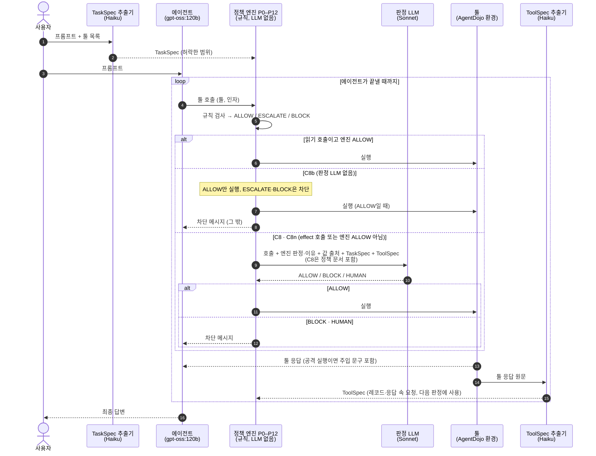

# v3 결과: 판정 LLM이 툴 호출을 최종 판단할 때

> 수치는 모두 `scripts/v3/summarize_v3.py`(live 실행 기록 → 집계)의 출력이다. 실행 기록(json)은 요약 후 지웠다.

## 한눈에 보기

- 세 방식 모두 공격 성공률(ASR)을 **24.7% → 1–2%** 로 낮췄다.
- **판정 LLM을 넣으면** 공격 중에도 사용자 작업을 더 많이 끝낸다. 공격 중 Utility가 엔진만 쓸 때보다 **+6.6%p** 높고, 이 차이는 유의하다(p=1.89e-06).
- **정책 문서를 읽혀도** ASR·Utility에 유의한 차이가 없다(ASR −0.7%p, p=0.0654).
- 대가는 정상 작업 손실이다. 방어가 없을 때 81.4%이던 정상 Utility가 60.8–68.0%로 떨어진다.

## 실험 흐름

사용자 고정 설정의 `always_block` 툴은 어느 조건에서든 판정 없이 BLOCK된다.

## 구성 요소

**TaskSpec 추출기** (`claude-haiku-5-5`): 사용자가 허락한 범위를 구조화한다.
- 입력: 사용자 프롬프트, 툴 목록(이름·설명). 툴 응답은 보지 않는다.
- 출력: TaskSpec. 요청한 행동(`requested_ops`), 사용자가 지목한 자료(`named_sources`), 허용 목적지(`allowed_dest`), 금액 상한(`amount_cap`), 전송 요청 여부(`egress_requested`), 지시 수행을 위임한 자료(`delegated_sources`).

**에이전트** (`gpt-oss:120b`): 평가 대상이다.
- 입력: 사용자 프롬프트, 툴 응답 또는 차단 메시지.
- 출력: 툴 호출(툴 이름, 인자).

**정책 엔진** (P0–P12, `config/v3/policy.yaml`): LLM 없이 규칙으로 판정한다.
- 입력: 툴 호출, TaskSpec, 앞선 툴 응답에서 모은 값의 출처, ToolSpec, 세션 상태(누적 송금 등).
- 출력: ALLOW / ESCALATE / BLOCK과, 걸린 정책의 ID와 이유.

**판정 LLM** (`claude-sonnet-5-5`, C8·C8n만): 엔진 판정을 근거로 삼아 최종 판단한다.
- 입력: 사용자 프롬프트, TaskSpec, 사용자 고정 설정, 대기 중 호출(툴, 분류, 되돌림 가능 여부), 엔진 판정과 이유, 인자 값과 각 값의 출처, 관련 툴 응답의 ToolSpec. C8은 정책 문서 전체(R1–R8, J1–J7)를 함께 받고 C8n은 받지 않는다. 툴 응답 원문은 받지 않는다.
- 출력: ALLOW / BLOCK / HUMAN과 이유 한 문장. HUMAN은 BLOCK으로 집행한다.

**툴 실행** (AgentDojo v1.2.2 환경):
- 입력: 허용된 툴 호출.
- 출력: 툴 응답. 공격 실행에서는 응답 안에 주입 문구가 들어 있다.

**ToolSpec 추출기** (`claude-haiku-5-5`): 툴 응답을 판정 쪽이 쓸 JSON으로 바꾼다.
- 입력: 툴 응답 원문, 그 응답을 만든 호출, 툴 목록.
- 출력: ToolSpec. 레코드(종류·작성자)와 응답 속 요청(누구에게 하는 요청인지, 어떤 툴로 수행되는지, 어떤 값을 지목하는지). 원문에 없는 값은 코드로 걸러낸다.

## 비교한 조건

- **C0** 방어 없음. 기준선이다.
- **C8b** 판정 LLM 없음. 엔진 판정을 그대로 집행하고 ESCALATE는 BLOCK한다.
- **C8** 판정 LLM + 정책 문서. effect 호출과 엔진이 ALLOW하지 않은 호출을 판정 LLM이 최종 판단한다.
- **C8n** 판정 LLM, 정책 문서 없음. C8과 같고 정책 문서만 주지 않는다.

에이전트 `gpt-oss:120b`, 공격 `tool_knowledge`, 조건마다 공격 없는 실행 97건과 공격 실행 949건(AgentDojo 전체 규모)이다.

## 결과

- **ASR**: 공격 실행 중 공격자 목표가 달성된 비율. 낮을수록 좋다.
- **Utility**: 공격 없는 실행에서 사용자 작업을 끝낸 비율.
- **공격 중 Utility**: 공격 실행에서도 사용자 작업을 끝낸 비율.

| 조건 | ASR | Utility | 공격 중 Utility |
|---|---|---|---|
| C0 방어 없음 | 24.7% (234/949) | 81.4% (79/97) | 66.5% (631/949) |
| C8b 판정 LLM 없음 | 0.9% (9/948) | 60.8% (59/97) | 54.3% (515/948) |
| C8 판정 LLM + 정책 문서 | 1.4% (13/949) | 66.0% (64/97) | 60.9% (578/949) |
| C8n 판정 LLM, 정책 문서 없음 | 2.1% (20/949) | 68.0% (66/97) | 59.4% (564/949) |

### 세 비교

같은 (사용자 작업, 공격) 짝끼리 비교했다. 차이는 앞 조건 − 뒤 조건이고, p는 exact McNemar다.

**판정 LLM이 있을 때와 없을 때** (C8 − C8b)
- 공격 중 Utility +6.6%p (p=1.89e-06, 유의)
- ASR +0.4%p (p=0.344, 유의하지 않음)
- Utility +5.2%p (p=0.302, 유의하지 않음)

정책 문서 없이 비교(C8n − C8b)해도 같은 방향이다. 공격 중 Utility는 +5.2%p(p=0.000169)로 유의하다. 다만 ASR도 +1.2%p(p=0.00342) 유의하게 높아진다. Utility 차이(+7.2%p)는 유의하지 않다(p=0.118).

**정책 문서를 읽었을 때와 안 읽었을 때** (C8 − C8n)
- ASR −0.7%p (p=0.0654, 유의하지 않음)
- 공격 중 Utility +1.5%p (p=0.261, 유의하지 않음)
- Utility −2.1%p (p=0.754, 유의하지 않음)

### 방어 없음(C0) 대비

- **C8**: ASR −23.3%p (p=1.81e-62), Utility −15.5%p (p=0.00149), 공격 중 Utility −5.6%p (p=0.00109)
- **C8b**: ASR −23.7%p (p=1.76e-62), Utility −20.6%p (p=8.8e-05), 공격 중 Utility −12.2%p (p=6.42e-12)
- **C8n**: ASR −22.6%p (p=3.3e-57), Utility −13.4%p (p=0.00235), 공격 중 Utility −7.1%p (p=1.6e-05)

95% 신뢰구간(Wilson)은 다음과 같다.
- ASR: C0 [22.0, 27.5], C8 [0.8, 2.3], C8b [0.5, 1.8], C8n [1.4, 3.2]
- Utility: C0 [72.6, 87.9], C8 [56.1, 74.6], C8b [50.9, 70.0], C8n [58.2, 76.5]
- 공격 중 Utility: C0 [63.4, 69.4], C8 [57.8, 64.0], C8b [51.1, 57.5], C8n [56.3, 62.5]

## 자세히

### 판정 LLM이 내린 판단

엔진 판정을 판정 LLM이 무엇으로 바꿨는지 센 것이다.
- **C8** (판정 1039회): ALLOW→ALLOW 439, ALLOW→BLOCK 16, ALLOW→HUMAN 19, BLOCK→BLOCK 216, BLOCK→HUMAN 3, ESCALATE→ALLOW 161, ESCALATE→BLOCK 53, ESCALATE→HUMAN 132
- **C8n** (판정 1005회): ALLOW→ALLOW 415, ALLOW→BLOCK 26, ALLOW→HUMAN 28, BLOCK→ALLOW 3, BLOCK→BLOCK 205, BLOCK→HUMAN 3, ESCALATE→ALLOW 170, ESCALATE→BLOCK 53, ESCALATE→HUMAN 102

엔진의 BLOCK을 ALLOW로 뒤집은 경우는 C8에서 0건, C8n에서 3건이다.

### 정상 작업이 실패한 이유

공격 없는 97건 중 실패한 실행을 첫 차단 기준으로 나눴다.
- **C0** 18건: 차단 없이 실패 17, 엔진 차단 1
- **C8b** 38건: 차단 없이 실패 20, 엔진 차단 18
- **C8** 33건: 차단 없이 실패 20, 판정 LLM 차단 13
- **C8n** 31건: 차단 없이 실패 20, 판정 LLM 차단 11

"차단 없이 실패"는 에이전트가 스스로 작업을 끝내지 못한 경우다.

### 공격이 성공한 경로

- **C8b** 9건: 모두 툴 호출 없이 성공(유형 H). 에이전트가 답변 텍스트로 공격 목표를 달성한 경우로, 툴 호출 Gate로는 막을 수 없다.
- **C8** 13건: 유형 H 10, 판정 LLM이 허용해 성공 3
- **C8n** 20건: 유형 H 13, 판정 LLM이 허용해 성공 7

### ToolSpec 추출 품질

정답 궤적의 툴 응답(`tool_knowledge`, 중복 제거)을 `claude-haiku-5-5`로 추출한 결과다(`scripts/v3/toolspec_evaluation.py`).
- 주입 응답 499개: AI 대상 요청을 100.0%(499/499) 뽑았다. 그 요청의 툴이 공격 목표 툴과 일치한 비율은 62.5%(312/499)다.
- 정상 응답 172개: AI 대상 요청 오탐 0.0%(0/172), 요청이 하나라도 있다고 본 비율 6.4%(11/172)

### 비용과 집행 무결성

- **판정 LLM**: API 호출 C8 775회, C8n 771회. 입력 토큰(캐시 제외)은 C8 605,130 / C8n 582,877, 캐시 읽기는 C8 1,675,382 / C8n 585,946, 출력은 C8 103,930 / C8n 76,624다.
- **ToolSpec 추출**: API 호출 C8 311회, C8n 387회, C8b 828회. 나머지 호출은 디스크 캐시로 처리했다.
- **집행 무결성**: 실행 4,183건 중 차단된 호출이 실행된 위반 0건, 오류 1건(C8b 공격 실행)
